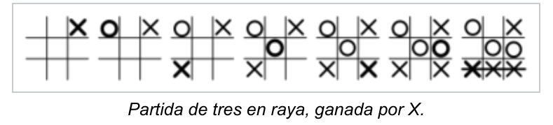
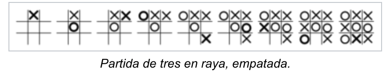
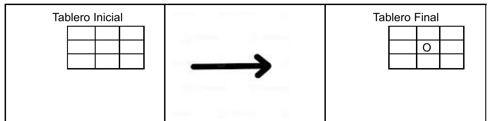
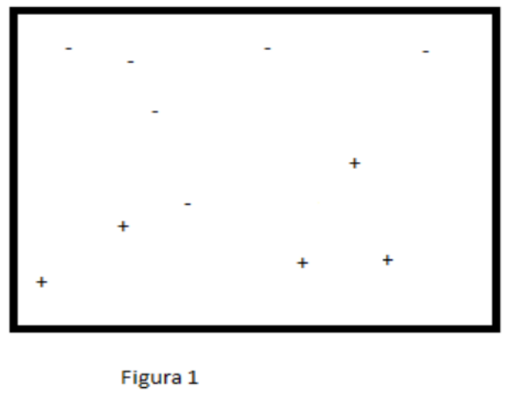
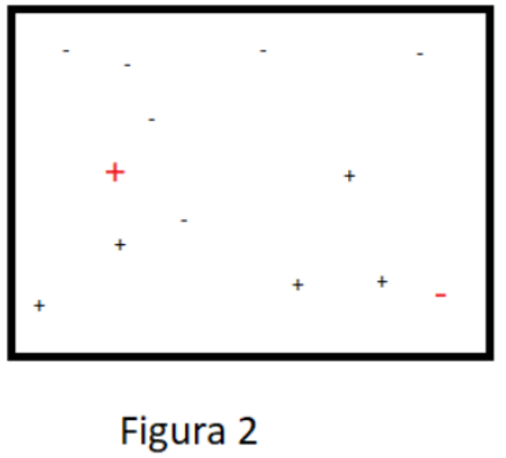
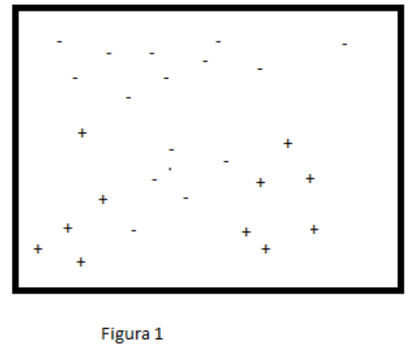
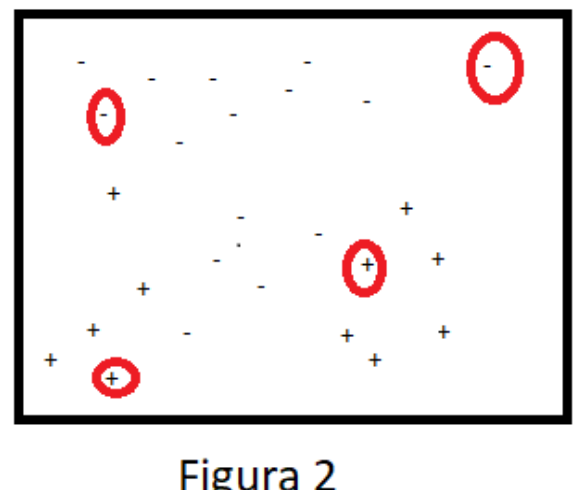
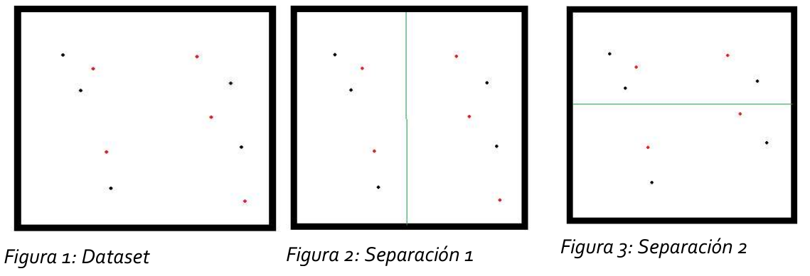

# Enunciados — Todos los exámenes (Aprendizaje Computacional)

Base recopilada con **únicamente los enunciados** (sin soluciones) de los **17 exámenes únicos** encontrados en el repositorio del curso (eliminando duplicados exactos por SHA-256 y versiones redundantes). Ordenados de **más reciente a más antiguo**.

## Índice de exámenes

| Fecha (cabecera / archivo) | Parte / Convocatoria | Temas principales | Enlace |
| :--- | :--- | :--- | :--- |
| `2026-11-04` *(nombre archivo)* | Sin cabecera impresa | SVM no lineal (RBF, `ksvm`, `ipop`, `tune`), ID3 | [[#2026-11-04 — Examen Aprendizaje Computacional (sin cabecera impresa)]] |
| `2026-02-04` *(nombre archivo)* | 2ª Convocatoria Ordinaria *(carpeta)* | Wine Quality (`randomForest`, `Adaboost.M1`), SVM lineal y no lineal | [[#2026-02-04 — Examen 2ª Convocatoria Ordinaria (sin cabecera impresa)]] |
| `2025-12-01` | Parte 2 | `Kyphosis` (ensemble `nnet` vs `randomForest`), `iris` (`AdaBoost.M1` + SVM) | [[#2025-12-01 — Examen Parte 2]] |
| `2024-12-11` | Examen completo | Tres en raya (`rpart`, `nnet`, SVM), Setas (ID3 + `kernlab`), DDoS (`randomForest`) | [[#2024-12-11 — Examen de Aprendizaje Computacional]] |
| `2023-01-04` *(archivo `04-12-2023`)* | Examen completo | Tres en raya (`rpart`, `nnet`, SVM), Setas (ID3 + `kernlab`) | [[#2023-01-04 — Examen de Aprendizaje Computacional]] |
| `2022-12-05` | Examen completo | `ejercicio2SVM.csv` (SVM), Titanic imputación de `Age` con `rpart` | [[#2022-12-05 — Examen de Aprendizaje Computacional]] |
| `2022-11-03` *(archivo `03-11-2025`)* | Parte 1 *(nombre archivo)* | SVM lineal (puntos A–E + `kernlab`), `GermanCredit` (ID3 + `rpart` 1-SE) | [[#2022-11-03 — Examen Parte 1]] |
| `2022-02-03` *(archivo `03-01-2022`)* | Examen Final (Parte 1 y Parte 2) | Titanic (ID3/`rpart`/`nnet`/SVM), `ejercicio2SVM.csv`, Boosting 2D, `Kyphosis` (SVM vs RF) | [[#2022-02-03 — Examen Final (Parte 1 y Parte 2)]] |
| `2022-01-19` *(archivo `17-02-2022`)* | Parte 2 | Boosting 2D (4 puntos), RF `importance`, `Kyphosis` (ensemble `rpart` vs `AdaBoost`) | [[#2022-01-19 — Examen Parte 2]] |
| `2021-12-13` | Examen completo | Tabla `x,y,z -> Salida` (ID3 + `rpart`), `ejercicio2SVM.csv`, Malicious URL (SVM vs MLP) | [[#2021-12-13 — Examen de Aprendizaje Computacional]] |
| `2020-09-21` | Parte Clasificadores + Parte Ensambles | Titanic (ID3/`rpart`/SVM), `Signal ~ In`, Malicious URL (RF + Stacking), Boosting 100×100 | [[#2020-09-21 — Examen de Aprendizaje Computacional (Clasificadores y Ensambles)]] |
| `2019-01-18` | Parte 2 | Tratamiento médico (ID3), `Kyphosis` (`rpart` vs MLP), SVM lineal y polinómica | [[#2019-01-18 — Examen Parte 2]] |
| `2018-01-24` | Parte 3 | Ensemble `nnet`/`rpart` (`recidiva`), RF `importance`, código `randomForest` | [[#2018-01-24 — Examen Parte 3]] |
| `2018-01-23` *(archivo `23-01-2019`)* | Parte Ensambles | Malicious URL (RF + Stacking), Boosting 100×100, código `randomForest` | [[#2018-01-23 — Examen Parte Ensambles]] |
| `2018-01-17` *(archivo `17-12-2018`)* | Parte 2 | Play Golf (ID3), Congressional voting (`rpart`), SVM conjuntos A y B | [[#2018-01-17 — Examen Parte 2]] |
| `2016-11-15` *(archivo `16-11-2016`)* | Parte 2 | Titanic (ID3/`rpart`/SVM), `Signal ~ In`, `Kyphosis` (`rpart` vs MLP) | [[#2016-11-15 — Examen Parte 2]] |
| `2015-01-22` | Parte 2 y Parte 3 | Simpson (ID3), `rpart` tabla 7 filas, TCP/IP Java–R, tabla CP, Boosting R, RF `importance` | [[#2015-01-22 — Examen Parte 2 y Parte 3]] |

---

## 2026-11-04 — Examen Aprendizaje Computacional (sin cabecera impresa)

> **Fuente:** `Examenes/Parcial 1/Examen Aprendizaje Computacional 04_11_2026 .pdf`
> **Metadatos:** Sin cabecera ni fecha impresa dentro del PDF *(el nombre del archivo indica `04_11_2026`)*.

### Problema 1 — SVM no lineal (RBF, kernlab, ipop, tune) e ID3

Se dispone del siguiente conjunto de datos, formado por 12 observaciones y dos atributos numéricos $X_1$ y $X_2$. El atributo objetivo $Y$ representa una clasificación binaria con valores $-1$ y $+1$.

El conjunto de datos presenta una distribución no lineal, por lo que no es posible separar ambas clases mediante una única recta.

| Obs. | $X_1$ | $X_2$ | $Y$ |
| :---: | :---: | :---: | :---: |
| 1 | $-2$ | $-2$ | $-1$ |
| 2 | $-2$ | $2$ | $-1$ |
| 3 | $2$ | $-2$ | $-1$ |
| 4 | $2$ | $2$ | $-1$ |
| 5 | $-1$ | $0$ | $+1$ |
| 6 | $1$ | $0$ | $+1$ |
| 7 | $0$ | $-1$ | $+1$ |
| 8 | $0$ | $1$ | $+1$ |
| 9 | $-0.5$ | $-0.5$ | $+1$ |
| 10 | $-0.5$ | $0.5$ | $+1$ |
| 11 | $0.5$ | $-0.5$ | $+1$ |
| 12 | $0.5$ | $0.5$ | $+1$ |

Se pretende construir un clasificador SVM que permita separar ambas clases utilizando una función kernel no lineal.

**Se pide:**
1. Representa gráficamente las observaciones utilizando $X_1$ y $X_2$, diferenciando las clases mediante colores. **(0.5 puntos)**
2. Justifica por qué no es posible encontrar una frontera de decisión lineal que clasifique correctamente todas las observaciones. **(0.25 puntos)**
3. Escribir el problema de optimización dual de una SVM (Kernel RBF, $C=10$, $\gamma = 0.5$) usando el conjunto de datos anterior. Considera que los vectores soportes son $(-2, -2)$, clase $-1$ y $(-1, 0)$, clase $+1$ **(0.75 puntos)**.

**Utiliza el paquete `kernlab` de R para construir una SVM con kernel RBF. Se pide:**
1. Entrena una SVM utilizando `ksvm()` con los siguientes parámetros iniciales: **(1 punto)**
   - Kernel: RBF.
   - $C = 10$.
   - $\gamma = 0.5$.
   - Clasificación binaria.
2. Obtén los siguientes elementos del modelo: **(1 punto)**
   - Número de vectores soporte.
   - Índices de las observaciones que son vectores soporte.
   - Multiplicadores de Lagrange $\alpha_i$.
   - Parámetro $b$.
   - Vector de pesos $w$, si se considera la representación en el espacio transformado.
   - Ancho del canal.
3. Calcula la predicción para las observaciones del conjunto de entrenamiento y determina el porcentaje de aciertos. **(0.5 puntos)**

**Utilizando IPOP, se pide:**

Se pretende comparar el modelo anterior con una implementación que permita acceder explícitamente a los parámetros de optimización. Utiliza una implementación de SVM basada en el algoritmo IPOP (*Improved Platt's Optimization Procedure*).
1. Resuelve el problema de optimización cuadrática usando IPOP a partir del conjunto de datos anterior. **(1 punto)**
2. Obtén los valores de: **(1 punto)**
   - Multiplicadores de Lagrange $\alpha_i$.
   - Vector de pesos $w$ en la representación transformada.
   - Término independiente $b$.
   - Número de vectores soporte.
3. Calcula la función de decisión. **(0.5 puntos)**

**Usa `Kerlab` para entrenar una SVM usando `tune`:**

Parte el conjunto de entrenamiento en 2 partes (entrenamiento y test) y usa la función kernel RBF. Las combinaciones de parámetros que debes comprobar se muestran a continuación:

| `C` | `Gamma` |
| :---: | :---: |
| $0.1$ | $0.1$ |
| $0.1$ | $0.5$ |
| $1$ | $0.1$ |
| $1$ | $0.5$ |
| $10$ | $0.1$ |
| $10$ | $0.5$ |
| $100$ | $0.1$ |
| $100$ | $0.5$ |

1. Utilizar la función `tune()` para seleccionar la mejor combinación de parámetros. **(1.5 puntos)**
2. Identificar los valores óptimos de $C$ y $\gamma$. **(0.5 puntos)**
3. Realiza una predicción con los datos de test y calcula el accuracy. **(0.5 puntos)**

**ID3:**

Por último, usa ID3 para encontrar el atributo del nodo raíz a partir del conjunto de datos descrito a continuación: **(1 punto)**

| Obs. | $X_1$ | $X_2$ | $Y$ |
| :---: | :---: | :---: | :---: |
| 3 | $2$ | $-2$ | $-1$ |
| 4 | $2$ | $2$ | $-1$ |
| 5 | $-1$ | $0$ | $+1$ |
| 6 | $1$ | $0$ | $+1$ |
| 7 | $0$ | $-1$ | $+1$ |

---

## 2026-02-04 — Examen 2ª Convocatoria Ordinaria (sin cabecera impresa)

> **Fuente:** `Examenes/04-02-2026/Examen Aprendizaje Computacional 04_02_2026.pdf` *(copias idénticas en `Examenes/Parte 2/RandomForest/Wine Quality/` y `FIcheros de CV sin sortear/Ficheros fuera de los temas principales/Examen 2ª Convocatoria Ordinaria 04-02-2026/`)*
> **Metadatos:** Sin cabecera ni fecha impresa dentro del PDF *(carpeta: `Examen 2ª Convocatoria Ordinaria 04-02-2026`; archivo: `04_02_2026`)*.

### Problema 1 — Wine Quality (Random Forest y AdaBoost.M1)

El conjunto de datos **Wine Quality** contiene información sobre diversas características físico-químicas de vinos tintos y blancos. El objetivo es predecir la calidad de un vino en función de sus características, usando el algoritmo de **Random Forest**.

Las características incluyen medidas químicas como la acidez, la concentración de alcohol, la densidad, el pH, entre otras. La calidad del vino se clasifica en una escala de 0 a 10, siendo 0 una calidad muy baja y 10 una calidad muy alta.

Tu tarea es construir un modelo de **Random Forest** para predecir la calidad del vino a partir de las características disponibles.

**Datos:**

El conjunto de datos **`winequality-red.csv`** (que se encuentra en el fichero `wine+quality.zip` que se adjunta) contiene las siguientes columnas:
- **`fixed acidity`**: Acidez fija (en g/t).
- **`volatile acidity`**: Acidez volátil (en g/t).
- **`citric acid`**: Ácido cítrico (en g/t).
- **`residual sugar`**: Azúcar residual (en g/t).
- **`chlorides`**: Cloruros (en g/t).
- **`free sulfur dioxide`**: Dióxido de azufre libre (en mg/L).
- **`total sulfur dioxide`**: Dióxido de azufre total (en mg/L).
- **`density`**: Densidad (en $\text{g/cm}^3$).
- **`pH`**: pH.
- **`sulphates`**: Sulfatos (en g/t).
- **`alcohol`**: Contenido de alcohol (%).
- **`quality`**: Calidad del vino (entero, de 0 a 10).

**Realiza:**
1. **Cargar y explorar los datos:** **(0.15 puntos)**
   - Carga el conjunto de datos `winequality.csv` y realiza un análisis exploratorio.
   - Verifica si hay valores faltantes o anómalos en las variables.
   - Visualiza las distribuciones de las características y su relación con la variable objetivo (`quality`).
2. **Preprocesamiento de los datos:** **(0.25 puntos)**
   - Trata los valores faltantes si los hay (puedes rellenar, eliminar o imputar dependiendo del caso).
   - Explora las características más relevantes que pueden influir en la calidad del vino.
   - Normaliza o escala las variables si es necesario, especialmente aquellas con rangos de valores muy diferentes.
3. **División de los datos:** **(0.1 puntos)**
   - Divide el conjunto de datos en un conjunto de entrenamiento (80%) y un conjunto de prueba (20%).
4. **Entrenamiento del modelo Random Forest:** **(0.5 puntos)**
   - Utiliza el conjunto de entrenamiento para entrenar un modelo Random Forest que prediga la calidad del vino.
   - Ajusta los parámetros como `ntree` (número de árboles) y `mtry` (número de variables a considerar por árbol) para optimizar el modelo.
5. **Evaluación del modelo:** **(0.5 puntos)**
   - Realiza predicciones sobre el conjunto de pruebas.
   - Evalúa el rendimiento del modelo.
6. **Ajuste de parámetros:** **(0.5 puntos)**
   - Utiliza técnicas de **validación cruzada** o **ajuste de hiperparámetros** para encontrar los mejores valores de `ntree`, `mtry`, y otros parámetros del modelo.
7. **Importancia de las variables:** **(0.5 puntos)**
   - Analiza la importancia de las variables utilizando la función `randomForest::importance()` para determinar qué características influyen más en la calidad del vino.
8. **Repite el ejercicio con Adaboost.M1 (2 puntos)**

### Problema 2 — SVM lineal y no lineal

a) **(2.5 puntos)** Calcula todos los parámetros ($w$, $b$, vectores soporte, ancho del canal, las tres rectas de separación del canal) de la máquina SVM obtenida a partir del siguiente conjunto de datos que sabemos son separables linealmente:

| $X_1$ | $X_2$ | $Y$ |
| :---: | :---: | :---: |
| $1$ | $1$ | $-1$ |
| $3$ | $3$ | $1$ |
| $1$ | $3$ | $1$ |
| $3$ | $1$ | $-1$ |
| $2$ | $2.5$ | $1$ |
| $3$ | $2.5$ | $-1$ |
| $4$ | $3$ | $-1$ |

Dibuja las rectas que conforman el canal así como los vectores soporte.

b) **(2.5 puntos)** Repite el ejercicio con el siguiente conjunto de datos no separable linealmente:

| $X_1$ | $X_2$ | $Y$ |
| :---: | :---: | :---: |
| $1$ | $1$ | $-1$ |
| $3$ | $3$ | $1$ |
| $1$ | $3$ | $1$ |
| $3$ | $1$ | $-1$ |
| $2$ | $2.5$ | $1$ |
| $3$ | $2.5$ | $-1$ |
| $4$ | $3$ | $-1$ |
| $1.5$ | $1.5$ | $1$ |
| $1$ | $2$ | $-1$ |

---

## 2025-12-01 — Examen Parte 2

> **Fuente:** `FIcheros de CV sin sortear/Ficheros fuera de los temas principales/Examen Parte 2 01-12-2025/Aprendizaje Computacional 01_12_2025.pdf` *(copia idéntica: `Practicas/Part 2/AdaBoost/Mirar problema 2.pdf`)*
> **Metadatos:** `Aprendizaje Computacional` — `01 de diciembre de 2025` — Dpto. Lenguajes y Ciencias de la Computación, E.T.S.I. en Informática, Universidad de Málaga.

### Problema 1 — Ensemble de perceptrones (nnet) vs Random Forest en Kyphosis

El conjunto de datos `Kyphosis` (disponible con el paquete `Rpart`) nos indica si, tras una operación en la columna vertebral, una muestra de 81 niños presenta o no deformaciones en la columna vertebral (columna `Kyphosis`). El resto de columnas son:
- **`Age`**: Año en meses.
- **`Number`**: Número de la vértebra involucrada.
- **`Start`**: Número de la primera vértebra involucrada.

Realiza un ensemble con tres perceptrones (paquete `nnet`) en el primer nivel y votación en el segundo. Estudia el número de neuronas adecuado. Cada uno de los perceptrones debemos entrenarlos con dos atributos distintos y usando validación cruzada: la parte de entrenamiento de los perceptrones se obtiene aleatoriamente reservando un 75% de los datos para cada perceptrón. **(2.5 puntos)**

Compara el accuracy del ensemble anterior con un Random Forest. Calcula la importancia de los atributos. **(2.5 punto)**

### Problema 2 — AdaBoost.M1 con SVM lineales en iris

Se desea implementar una variante del algoritmo AdaBoost.M1 utilizando máquinas de vectores de soporte (SVM) como clasificadores débiles, en lugar de los árboles de decisión habitualmente utilizados. Por simplicidad, vamos a usar los pesos (alfa) que se adjunta en el fichero *alpha y test de Problema 2*. El dataset que vamos a utilizar es `iris`, transformándolo de forma que tenga solo 2 clases (`virginica` con valor $-1$ y `versicolor` con valor $1$). En cuanto a los SVM que vamos a usar como clasificadores débiles, lo vamos a entrenar con el kernel lineal y bajo costo (`cost=0.1`) y un subconjunto de entrenamiento diferente para cada SVM. La predicción se realizará con los datos `test1` y `test2` (que se encuentran en el fichero aludido anteriormente) para todos los SVM. La predicción final será la predicción de los clasificadores débiles multiplicados por los pesos (`alpha`) obtenidos del fichero *alpha y test de problema 2*. El número de SVM que vamos a usar en el ensamble es de 10. Se pide:

1. Realizar el preprocesamiento de `iris` tal y como se indica en la descripción del problema. **(0.25 puntos)**
2. Entrenar un clasificador boosting, usando validación cruzada. El número de clasificadores débiles es 10. **(0.75 punto)**
3. Realiza una predicción con el conjunto de test y muestra el accuracy. Muestra los pesos de instancias (`weights`) y dibuja unos de los árboles (por ejemplo, el primero). **(0.75 punto)**
4. Entrena el ensemble tal y como se indica en la descripción del problema. **(2 puntos)**
5. Realiza una predicción del ensamble anterior usando `test1` y `test2`. Muestra la predicción. **(1 punto)**
6. Comenta los resultados obtenidos y cualquier suposición que hayas hecho en el desarrollo del problema. Añade el comentario en el fichero `.r` del ejercicio. **(0.25 puntos)**

---

## 2024-12-11 — Examen de Aprendizaje Computacional

> **Fuente:** `Examenes/11-12-2024 Tres en Rayo/Examen aprendizaje 11-12- 2024.docx.pdf` *(copia idéntica en `FIcheros de CV sin sortear/Ficheros fuera de los temas principales/Tres en Raya/`)*
> **Metadatos:** `Aprendizaje Computacional` — `11 de Diciembre de 2024` — Dpto. Lenguajes y Ciencias de la Computación, E.T.S.I. en Informática, Universidad de Málaga.

### Problema 1 — Tres en raya (rpart, nnet, SVM)

El juego de tres en Raya es un juego entre dos jugadores: oponente `O` y jugador `X`, que marcan los espacios de un tablero de $3 \times 3$ alternadamente. El juego finaliza cuando el jugador o su oponente ha colocado su fichas en un línea, columna o diagonal.

Una partida ganada por el primer jugador, X:



Una partida que termina en empate:



Se pretende elegir un modelo que en función del estado del tablero indique en qué celda del tablero, nuestro oponente, debe colocar su ficha. Los modelos que vamos a estudiar son: árboles de decisión CART (`rpart`), perceptrón (`nnet`) y máquinas de soporte vectorial (`e1071` o `Kernlab`).

1. Explica de forma general cómo resolver el problema. **(0.25 puntos)**
2. Realiza el data frame. Para tal fin puedes usar aplicaciones como por ejemplo: `https://papergames.io/es/tres-en-raya` (jugar contra robot) y añadir las jugadas que tiendan a ganar una partida sean del jugador o del oponente. También podemos añadir jugadas que podemos denominar *estudiadas*. Por ejemplo, colocar la ficha en la celda central, si todas las celdas están vacías. No es necesario que el data frame sea muy extenso entre 15 y 20 entradas (2 o 3 partidas). **(0.25 puntos)**
3. Realiza un análisis y determina el modelo más adecuado. Fíjate tanto en el ratio de aciertos como en el tamaño del modelo obtenido así como del tiempo de entrenamiento (se muestra un código que permite conocer dicho tiempo: **(0.5 puntos)**

```r
t <- proc.time() # Inicia el cronómetro
# NUESTRO CODIGO
proc.time()-t
```

)

4. Realiza un programa en R que entrene el modelo que has decidido en el paso anterior y lo guarde (usa `save`). **(0.5 puntos)**
5. Realiza un programa en R que cargue (usa `load`) el modelo anterior y dado el estado del tablero devuelva donde colocar la ficha. Por ejemplo, si el tablero estuviera vacío y jugará el oponente, una posible salida sería poner la ficha en la celda central del tablero. **(1 puntos)**



El programa tendrá un modo *verbose* que mostrará el estado del tablero junto a la clasificación del mismo.

La finalización del juego debemos controlarla nosotros, no se pide realizar un tres raya sino el modelo que lo dote de inteligencia.

### Problema 2 — Setas (ID3 y kernlab SVM)

En la tabla adjunta se muestran características de unas setas y si son comestibles o no. Nos hemos fijado en la forma y color del sombrero (`cap-shape` y `cap-color`) y en el grosor y color del tronco (`gill-size` y `gill-color`). El atributo de clasificación es `class` que indica si la seta es venenosa (`poisonous`) o no (`edible`).

| `cap-shape` | `cap-color` | `gill-size` | `gill-color` | `class` |
| :--- | :--- | :--- | :--- | :--- |
| convex | brown | narrow | black | poisonous |
| convex | yellow | broad | black | edible |
| bell | white | broad | brown | edible |
| convex | white | narrow | brown | poisonous |
| convex | yellow | broad | brown | edible |
| bell | white | broad | brown | edible |
| convex | white | narrow | pink | poisonous |

1. Encuentra la etiqueta del nodo raíz y las tablas necesarias para continuar al siguiente nivel, usando el algoritmo **ID3** visto en clase. Desarrolla las fórmulas completas de entropía, entropía condicional y ganancias, al menos, en la primera variable. Muestra el árbol con sus etiquetas tanto en el nodo raíz como en los arcos así como la tabla asociada a cada arco. **(1.5 puntos)**
2. A partir del dataframe anterior y usando el paquete **kernlab** entrena una máquina de soporte vectorial y obten los siguientes parámetros: ancho del canal, $b$, vector de Pesos normal al Hiperplano $w$, la ecuación del Hiperplano y de los planos de soporte positivo y negativo. Realiza la predicción de una seta con las siguientes características *bell*, *white*, *broad* y *black* citadas en el mismo orden que los atributos de la tabla adjunta ¿Podrías comerte la seta? **(1.5 puntos)**

### Problema 3 — Tráfico DDoS (Random Forest)

El conjunto de datos que se adjunta al examen (`Friday-WorkingHours-Afternoon-DDos.pcap_ISCX.csv`) se corresponde con tráfico de red considerado normal o benigno (Clasificado como `BENIGN`) y tráfico que se considera forma parte de un ataque de denegación de servicio (Clasificado como `DDOS`). Los atributos del dataset son el puerto destino, duración del flujo, tiempo mínimo y máximo entre paquetes entre otras características. Cada paquete del dataset está clasificado como tráfico legal (`BENIGN`) o ilegal (`DDOS`) con el atributo de decisión `Label`. Se pide:

1. Entrena un modelo que permita predecir el tipo de tráfico a partir del dataframe descrito anteriormente. Usa Ramdom Forest. Encuentra los valores adecuados de los parámetros `ntree`, `ntry`. **(1.5 puntos)**
2. A partir del modelo obtenido anteriormente, realiza una predicción usando validación cruzada. **(0.5 puntos)**
3. Calcula la importancia de las variables. **(0.5 puntos)**
4. Entrena de nuevo el modelo en las mismas condiciones del apartado 1 modificando la fórmula de tal forma que intervengan las variables con `MeanDecreaseGini` mayor que 7 ¿Con cuál de los dos modelos te quedarías? Justifica la respuesta. **(2 puntos)**

---

## 2023-01-04 — Examen de Aprendizaje Computacional

> **Fuente:** `FIcheros de CV sin sortear/Clasificadores/Examenes/Examenes surtidos/Examen aprendizaje 04-12- 2023.docx`
> **Metadatos:** `Aprendizaje Computacional` — `04 de Enero de 2023` *(nota: el nombre del archivo indica `04-12- 2023.docx`, mientras que la cabecera impresa indica `04 de Enero de 2023`)* — Dpto. Lenguajes y Ciencias de la Computación, E.T.S.I. en Informática, Universidad de Málaga.

### Problema 1 — Tres en raya (rpart, nnet, SVM)

El juego de tres en Raya es un juego entre dos jugadores: oponente `O` y jugador `X`, que marcan los espacios de un tablero de $3 \times 3$ alternadamente. El juego finaliza cuando el jugador o su oponente ha colocado su fichas en un línea, columna o diagonal.

Una partida ganada por el primer jugador, X:


Una partida que termina en empate:


Se pretende elegir un modelo que en función del estado del tablero indique en qué celda del tablero, nuestro oponente, debe colocar su ficha. Los modelos que vamos a estudiar son: árboles de decisión CART (`rpart`), perceptrón (`nnet`) y máquinas de soporte vectorial (`e1071` o `Kernlab`).

1. Explica de forma general cómo resolver el problema.
2. Realiza el data frame. Para tal fin puedes usar aplicaciones como por ejemplo: `https://papergames.io/es/tres-en-raya` (jugar contra robot) y añadir las jugadas que tiendan a ganar una partida sean del jugador o del oponente. También podemos añadir jugadas que podemos denominar *estudiadas*. Por ejemplo, colocar la ficha en la celda central, si todas las celdas están vacías. No es necesario que el data frame sea muy extenso entre 15 y 20 entradas (2 o 3 partidas).
3. Realiza un análisis y determina el modelo más adecuado. Fíjate tanto en el ratio de aciertos como en el tamaño del modelo obtenido así como del tiempo de entrenamiento (se muestra un código que permite conocer dicho tiempo:

```r
t <- proc.time() # Inicia el cronómetro
# NUESTRO CODIGO
proc.time()-t
```

)

4. Realiza un programa en R que entrene el modelo que has decidido en el paso anterior y lo guarde (usa `save`).
5. Realiza un programa en R que cargue (usa `load`) el modelo anterior y dado el estado del tablero devuelva donde colocar la ficha. Por ejemplo, si el tablero estuviera vacío y jugará el oponente, una posible salida sería poner la ficha en la celda central del tablero.


El programa tendrá un modo *verbose* que mostrará el estado del tablero junto a la clasificación del mismo.

6. Realiza un programa en R que realice dos partidas una que empiece el jugador y otra el oponente. Muestra el estado del tablero y su clasificación. Incorpora al dataset las jugadas del ganador y vuelve a realizar dos partidas ¿Hay alguna mejoría?

La finalización del juego debemos controlarla nosotros, no se pide realizar un tres raya sino el modelo que lo dote de inteligencia.

### Problema 2 — Setas (ID3 y kernlab SVM)

En la tabla adjunta se muestran características de unas setas y si son comestibles o no. Nos hemos fijado en la forma y color del sombrero (`cap-shape` y `cap-color`) y en el grosor y color del tronco (`gill-size` y `gill-color`). El atributo de clasificación es `class` que indica si la seta es venenosa (`poisonous`) o no (`edible`).

| `cap-shape` | `cap-color` | `gill-size` | `gill-color` | `class` |
| :--- | :--- | :--- | :--- | :--- |
| convex | brown | narrow | black | poisonous |
| convex | yellow | broad | black | edible |
| bell | white | broad | brown | edible |
| convex | white | narrow | brown | poisonous |
| convex | yellow | broad | brown | edible |
| bell | white | broad | brown | edible |

1. Encuentra la etiqueta del nodo raíz y las tablas necesarias para continuar al siguiente nivel, usando el algoritmo **ID3** visto en clase. Desarrolla las fórmulas completas de entropía, entropía condicional y ganancias, al menos, en la primera variable. Muestra el árbol con sus etiquetas tanto en el nodo raíz como en los arcos así como la tabla asociada a cada arco.
2. A partir del dataframe anterior y usando el paquete **kernlab** entrena una máquina de soporte vectorial y obten los siguientes parámetros: ancho del canal, $b$, vector de Pesos normal al Hiperplano $w$, la ecuación del Hiperplano y de los planos de soporte positivo y negativo. Realiza la predicción de una seta con las siguientes características *bell*, *white*, *broad* y *black* citadas en el mismo orden que los atributos de la tabla adjunta ¿Podrías comerte la seta?

---

## 2022-12-05 — Examen de Aprendizaje Computacional

> **Fuente:** `Examenes/05-12-2022/Enunciado.pdf` *(copia idéntica: `FIcheros de CV sin sortear/Clasificadores/SVM/Practicas/Titanic and Vote but incomplete/Examen  05-12-2022.pdf`)*
> **Metadatos:** `Aprendizaje Computacional` — `05 de Diciembre de 2022` — Dpto. Lenguajes y Ciencias de la Computación, E.T.S.I. en Informática, Universidad de Málaga.

### Ejercicio 1 — SVM sobre ejercicio2SVM.csv

A partir del conjunto de datos que podemos encontrar en el campus virtual (denominado `ejercicio2SVM.csv`): Determina si es separable linealmente e indica cual seria la función Kernel mas adecuada (indica tipo de función y sus parámetros) **(1 puntos)**.

Calcula los siguientes parámetros de la Maquina de Soporte Vectorial que podemos obtener con el dataset anteriores y el Kernel elegido:
- I. Vectores Soporte. **(0.25 puntos)**
- II. Ancho del canal **(0.5 puntos)**
- III. Vector de Pesos normal al Hiperplano ($W$) **(0.25 puntos)**
- IV. Vector $B$ **(0.25 puntos)**
- V. La ecuación del Hiperplano y de los planos de soporte positivo y negativo. **(0.75 puntos)**
- VI. Pinta el conjuntos de puntos y el Hiperplano. **(0.75 puntos)**
- VII. Clasifica los puntos $(0.5, 0.8)$ y $(0.6, 0.2)$. **(0.25 puntos)** *(en el original figura `(0.5, 0,8)` y `(0.6,0,2)`)*

### Ejercicio 2 — Predicción de Age en Titanic con Rpart

En el conjunto de datos del Titanic, como sabemos, existen datos faltantes en diferentes atributos que eliminamos en la fase de preprocesamiento. En particular nos vamos a centrar en el atributo edad (`Age`) y nos proponemos evaluar la predicción de los valores faltantes en dicho campo. Para tal fin, entrenaremos un arbol `Rpart` usando validación cruzada, eliminando los atributos habituales (`Name`, `PassengerId`, `Ticket`, `Cabin` y `Embarked`). Ademas, eliminaremos los datos faltantes incluido los campo `Age`.

La predicción vamos a realizarla de la siguiente manera: iterarmos por el conjunto de datos reservado para entrenamiento (test) y realizamos la predicción (usa tipo vector, `type="vector"`) de la edad (`Age`) de cada uno de los pasajeros del conjunto de entrenamiento. Calcularemos la diferencia entre la edad predicha y la edad conocida del pasajero (es decir, la edad que aparece en el campo `Age` de dicho pasajero en el conjunto de test) y la guardaremos en un vector. Por ultimo, obtendremos su media.

Se pide:
- I. Realizar un programa en R que cumpla con las especificaciones anteriormente descritas. **(5 puntos)**
- II. Comenta los resultados. **(0.25 puntos)**
- III. ¿Crees que podemos usar esta técnica para tratar los datos faltantes del campo `Age` en Titanic? **(0.25 puntos)**
- IV. ¿Podrías exponer una técnica mas eficaz? Describirla brevemente. **(0.25 puntos)**

---

## 2022-11-03 — Examen Parte 1

> **Fuente:** `Examenes/03-11-2025 (Parte 1).pdf/Examen Parte 1 03-11-2025.pdf` *(copia idéntica en `FIcheros de CV sin sortear/Ficheros fuera de los temas principales/GermanCredit/`)*
> **Metadatos:** `Aprendizaje Computacional` — `03 de Noviembre de 2022` *(nota: el nombre del archivo indica `03-11-2025`, pero la cabecera impresa en el PDF indica `03 de Noviembre de 2022`)* — Dpto. Lenguajes y Ciencias de la Computación, E.T.S.I. en Informática, Universidad de Málaga.

### Ejercicio 1 — SVM lineal (manual y con kernlab)

Calcula los parámetros de una máquina de SVM usando el kernel lineal, a partir de los siguientes puntos:

| Punto | $x$ | $y$ | Clase |
| :--- | :---: | :---: | :---: |
| A | $1$ | $2$ | $+1$ |
| B | $2$ | $-1$ | $-1$ |
| C | $3$ | $-1$ | $-1$ |
| D | $2$ | $3$ | $+1$ |
| E | $3$ | $-3$ | $-1$ |

a) Realiza los cálculos usando las ecuaciones estudiadas en clase. Debes determinar **(3 puntos)**:
   - I. Sistema de Ecuaciones para obtener los coeficientes de Lagrange y $b$.
   - II. Coeficientes de Lagrange ($\alpha$)
   - III. Vector de Pesos normal al Hiperplano ($W$)
   - IV. Vector $B$.
   - V. Vectores Soporte.
   - VI. Ancho del canal
   - VII. La ecuación del Hiperplano y de los planos de soporte positivo y negativo.
   - VIII. Función de clasificación.
   - IX. Clasificar los puntos que no sean vectores de soporte.

b) Repite el apartado anterior usando `kernlab`. **(2 puntos)**

### Ejercicio 2 — GermanCredit (ID3 y Rpart con 1-SE)

El conjunto de datos `GermanCredit` (que se adjunta) es una lista de personas que han pedido un crédito así como si este ha sido concedido o no. Consta de 1000 filas y 62 columnas. La variable objetivo es `Class`. Los clientes con buen riesgo crediticio se etiquetan con `"Good"` y caso contrario, serán `"Bad"`. Entre las variables principales están: `Duration` (duración del crédito), `Amount` (Monto del crédito), `CheckingAccountStatus.lt.0` ($1$ si la cuenta corriente tiene saldo negativo), entre otras. Más información sobre `GermanCredit` lo puedes encontrar en `https://www.kaggle.com/datasets/uciml/german-credit/data`.

En la tabla siguiente tenemos un subconjunto tanto del número de filas como de columnas:

| `Age` | `Housing.Own` | `CheckingAccountStatus.lt.0` | `Amount` | `Duration` | `Purpose.NewCar` | `Class` |
| :--- | :---: | :---: | :---: | :---: | :---: | :--- |
| Joven | $1$ | $0$ | 5k | 4y | $0$ | Bad |
| Adulto | $0$ | $1$ | 5k | 4y | $0$ | Good |
| Adulto | $1$ | $0$ | 2k | 1y | $0$ | Good |
| Adulto | $0$ | $1$ | 2k | 2y | $1$ | Bad |
| Senior | $1$ | $1$ | 1k | 1y | $0$ | Good |

a) Realiza una iteración del algoritmo ID3. Dibuja el nodo raíz, etiquetado con la variable de mayor ganancia y sus arcos también etiquetados. Escribe todos los cálculos detalladamente, al menos en el cálculo de la primera ganancia. **(2 puntos)**

b) Muestra las tablas con las que continuará el algoritmo ID3 en la siguiente iteración. Asocia a cada tabla el arco en el que se encuentra. **(0.5 puntos)**

c) A partir del conjunto de dato `GermanCredits` completo, usa las siguientes variables: **(2.5 puntos)**
   - `Age`
   - `Job.Management.SelfEmp.HighlyQualified`
   - `Housing.Rent`
   - `Housing.ForFree`
   - `Housing.Own`
   - `SavingsAccountBonds.500.to.1000`
   - `CheckingAccountStatus.lt.0`
   - `CheckingAccountStatus.0.to.200`
   - `Amount`
   - `Duration`
   - `Purpose.NewCar`
   - `Class`

   para entrenar un modelo `Rpart` usando validación cruzada. Calcula el árbol podado y su accuracy. Compara los accuracy del árbol sin podar y podado. Calcula el árbol podado usando 1-SE (*one standard error rule*). Compara el accuracy de los árboles podados con mínimo `xerror` y 1-SE.

---

## 2022-02-03 — Examen Final (Parte 1 y Parte 2)

> **Fuente:** `FIcheros de CV sin sortear/Clasificadores/Examenes/Examenes surtidos/Examen Final  03-01-2022.pdf`
> **Metadatos:** `Aprendizaje Computacional` — `3 de Febrero de 2022` *(nota: el nombre del archivo indica `03-01-2022`, mientras que la cabecera impresa indica `3 de Febrero de 2022`)* — Dpto. Lenguajes y Ciencias de la Computación, E.T.S.I. en Informática, Universidad de Málaga — `PARTE 1` y `PARTE 2`.

### PARTE 1 — Ejercicio 1 — Titanic (Rpart, nnet, SVM e ID3)

Se pretende encontrar el mejor clasificador para los datos del Titanic publicados en Kaggle (`https://www.kaggle.com/c/titanic`), que también podemos encontrarlos en el Campus Virtual. La forma en la que vamos a abordar el problema es la siguiente:

a) En primer lugar, realizaremos un examen del dataset y estudiaremos los atributos y si aparecen datos faltantes. Se pide obtener un dataset en el que se hayan eliminado los atributos innecesarios y se haya solucionado los atributos faltantes. El significado de los atributos son los siguientes:
- `PassangerId`: identificador del pasajero.
- `Survived`: Atributo de clasificación. 1, sobrevive; 2, no sobrevive.
- `Pclass`: La clase del pasajero: 1 primera, 2 segunda o 3 tercera.
- `Name`: Nombre del pasajero:
- `Sex`: Sexo del pasajero
- `Age`: Edad del pasajero

Justifica tu respuesta. **(0.5 puntos)**

*NOTA:* Para eliminar un atributo y para eliminar atributos nulos o `NA`:

```r
dataframe$atributoAeliminar <- NULL
dataframe <- dataframe[!is.na(dataframe$atributoconNAoNULL),]
```

b) Entrenaremos los siguientes clasificadores: un árbol de decisión (paquete `Rpart`), un perceptron multicapa (paquete `nnet`) y una maquina de soporte vectorial (paqute `e1071` o `Kernlab`) usando validación cruzado. Obtendremos el accuracy y el área bajo la curva para cada clasificador. **(0.75 puntos)**

c) En tercer lugar, vamos a entrenar a cada uno de los clasificadores, usando validación cruzada y modificando sus parámetros como `CP`, `size` o el tipo de kernel, con el objetivo de encontrar el clasificador mejor de su clase. **(0.75 puntos)**

d) Por último, obtendremos el mejor clasificador de todos y realizaremos una predicción con el mismo usando los datos de test de Titanic. **(0.5 puntos)**

A continuación se muestra un subconjunto de los pasajeros del Titanic:

| PassengerId | Survived | Pclass | Name | Sex | Age |
| :---: | :---: | :---: | :--- | :---: | :---: |
| 1 | 0 | 3 | Braund, Mr. Owen Harris | male | 22.00 |
| 2 | 1 | 1 | Cumings, Mrs. John Bradley (Florence Briggs Thayer) | female | 38.00 |
| 3 | 1 | 3 | Heikkinen, Miss. Laina | female | 26.00 |
| 4 | 1 | 1 | Futrelle, Mrs. Jacques Heath (Lily May Peel) | female | 35.00 |
| 5 | 0 | 3 | Allen, Mr. William Henry | male | 35.00 |
| 6 | 0 | 3 | Moran, Mr. James | male | NA |
| 7 | 0 | 1 | McCarthy, Mr. Timothy J | male | 54.00 |
| 8 | 0 | 3 | Palsson, Master. Gosta Leonard | male | 2.00 |
| 9 | 1 | 3 | Johnson, Mrs. Oscar W (Elisabeth Vilhelmina Berg) | female | 27.00 |

e) Realiza un árbol de decisión (tipo ID3). Itera hasta el nivel 1. Dibuja el árbol, describe las operaciones y muestra los datos usados en cada una de las iteraciones. El atributo `PassangerId` no interviene en le construcción del árbol. El atributo `Survived` se modifica con las etiquetas `Si` (1) y `No` (0). El atributo `Pclass` con el literal de la clase. El atributo `Name` se etiqueta con `"Menor o igual que Futrelle"` para aquellos nombre que cumpla que son lexicograficamente menores a la palabra `Futrelle` y `"Mayor que Futrelle"` para aquellos nombres mayores a `Futrelle`. El atributo `Age`, se etiqueta como `"No adulto"` a los pasajeros con edades menor o igual a 22 años, `"Adulto"` para los pasajeros con edad mayor a 22 años y `"Desconocido"` para los pasajeros que no se conozca su edad (`NA`). **(2.5 puntos)**

f) Para el siguiente nivel considera un algoritmo de poda tal que se etiqueta el nodo con la clase mayoritaria del atributo objetivo (`Survived`). Completa el árbol. **(0.5 puntos)**

g) Clasifica los siguientes pasajeros e indica si sobrevivirán o no. **(0.5 puntos)**

| Survived | Pclass | Name | Sex | Age |
| :---: | :---: | :--- | :---: | :---: |
| 1 | 1 | Sloper, Mr. William Thompson | male | 28.00 |
| 0 | 3 | Palsson, Miss. Torborg Danira | female | 8.00 |

### PARTE 1 — Ejercicio 2 — SVM sobre ejercicio2SVM.csv

A partir del conjunto de datos que podemos encontrar en el campus virtual (denominado `ejercicio2SVM.csv`): Determina si es separable linealmente e indica cual seria la función Kernel mas adecuada (indica tipo de función y sus parámetros) **(1 puntos)**.

Calcula los siguientes parámetros de la Maquina de Soporte Vectorial que podemos obtener con el dataset anteriores y el Kernel elegido:
- Vectores Soporte. **(0.25 puntos)**
- Ancho del canal **(0.5 puntos)**
- Vector de Pesos normal al Hiperplano ($W$) **(0.25 puntos)**
- Vector $B$ **(0.25 puntos)**
- La ecuación del Hiperplano y de los planos de soporte positivo y negativo. **(0.75 puntos)**
- Pinta el conjuntos de puntos y el Hiperplano. **(0.75 puntos)**
- Clasifica los puntos $(0.5, 0.8)$ y $(0.6, 0.2)$. **(0.25 puntos)** *(en el original figura `(0.5, 0,8)` y `(0.6,0,2)`)*

### PARTE 2 — Ejercicio 3 — Boosting sobre dataset 2D

a) Teniendo en cuenta el dataset que se muestra en la Figura 1, calcula los pesos $\alpha$ según el algoritmo de boosting. Realiza dos separaciones que minimicen el número de puntos mal clasificados. **(2.5 puntos)**



b) Predice los siguientes puntos marcados con color rojos (Figura 2): **(2.5 puntos)**



### PARTE 2 — Ejercicio 4 — Ensemble de 3 SVM polinómicas vs Random Forest en Kyphosis

El conjunto de datos `Kyphosis` (disponible con el paquete `Rpart`) nos indica si, tras una operación en la columna vertebral, una muestra de 81 niños presenta o no deformaciones en la columna vertebral (columna `Kyphosis`). El resto de columnas son:
- `Age`: Año en meses.
- `Number`: Numero de la vértebra involucrada.
- `Start`: Numero de la primera vértebra involucrada.

Realiza un ensemble con tres maquinas de soporte vectorial (SVM) en el primer nivel y votación en el segundo. Usa SVM con Kernel polinómico. Cada una de las SVM debemos entrenarlas con dos atributos distintos y usando validación cruzada: la parte de entrenamiento de las SVM se obtiene aleatoriamente reservando un 75% de los datos para cada maquina SVM. **(2.5 puntos)**

Compara el accuracy del ensemble anterior con un Ramdon Forest. **(2.5 puntos)**

---

## 2022-01-19 — Examen Parte 2

> **Fuente:** `FIcheros de CV sin sortear/Clasificadores/Examenes/Examenes surtidos/Examen Parte 2 17-02-2022.doc`
> **Metadatos:** `Aprendizaje Computacional` — `19 de Enero de 2022` *(nota: el nombre del archivo indica `17-02-2022.doc`, mientras que la cabecera impresa indica `19 de Enero de 2022`)* — Dpto. Lenguajes y Ciencias de la Computación, E.T.S.I. en Informática, Universidad de Málaga — `PARTE 2`.

### Ejercicio 1 — Boosting sobre dataset 2D (4 puntos marcados)

a) Teniendo en cuenta el dataset que se muestra en la Figura 1, calcula los pesos $\alpha$ según el algoritmo de boosting. Realiza dos separaciones que minimicen el número de puntos mal clasificados.



b) Predice los siguientes puntos marcados con círculos rojos (Figura 2):



### Ejercicio 2 — Importancia de variables con Random Forest

Usa el comando `importance` de Ramdon Forest. para determinar la importancia de los atributos en un dataset (puedes usar cualquiera que prefieras o crear uno nuevo), Dibuja también el grafico. Explica que significa que una variable tenga mayor importancia que otra.

### Ejercicio 3 — Ensemble de 2 árboles Rpart vs AdaBoost en Kyphosis

El conjunto de datos `Kyphosis` (disponible con el paquete `Rpart`) nos indica si, tras una operación en la columna vertebral, una muestra de 81 niños presenta o no deformaciones en la columna vertebral (columna `Kyphosis`). El resto de columnas son:
- `Age`: Año en meses.
- `Number`: Numero de la vértebra involucrada.
- `Start`: Numero de la primera vértebra involucrada.

Realiza un ensemble con dos árboles `Rpart` en el primer nivel y votación en el segundo. Usa arboles con un solo nivel. El primer árbol se entrena con los atributod `Age` y `Number` mientras que el otro se entrena con los atributos `Age` y `Start`. Entrena los arboles usando validación cruzada. De la parte reservada para test se obtiene aleatoriamente un 80% para entrenar un árbol `rpart` y 80% con índices distintos para el otro.

Compara el accuracy del ensemble anterior con un ensamble AdaBoost.

---

## 2021-12-13 — Examen de Aprendizaje Computacional

> **Fuente:** `FIcheros de CV sin sortear/Clasificadores/Examenes/Examenes surtidos/Examen de Aprendizaje Computacional 13-12-2021.pdf`
> **Metadatos:** `Aprendizaje Computacional` — `13 de Diciembre de 2021` — Dpto. Lenguajes y Ciencias de la Computación, E.T.S.I. en Informática, Universidad de Málaga.

### Ejercicio 1 — ID3 y Rpart sobre tabla x, y, z

Teniendo en cuenta el siguiente conjunto de datos:

| $x$ | $y$ | $z$ | `Salida` |
| :---: | :---: | :---: | :---: |
| 0 | 0 | 0 | 0 |
| 0 | 0 | 1 | 1 |
| 0 | 1 | 0 | 1 |
| 0 | 1 | 1 | 0 |
| 1 | 0 | 0 | 1 |
| 1 | 0 | 1 | 0 |
| 1 | 1 | 1 | 0 |

a) Encuentra el nodo raíz de un árbol de Decisión ID3 a partir de la tabla anterior. Teniendo en cuenta que el atributo de decisión es **Salida** **(2 puntos)**

b) Para el siguiente nivel considera un algoritmo de poda tal que se etiqueta el nodo con la clase mayoritaria del atributo objetivo (**Salida**). Completa el árbol. **(0.5 punto)**

c) A partir de los datos del dataset anterior entrena un árbol de decisión RPART para que prediga el atributo **Salida**. Compara usando validación cruzada (80% para entrenamiento; 20% test) la predicción del árbol obtenido con la de un árbol podado con un CP tal que sea un árbol raíz **(1 punto)**

### Ejercicio 2 — SVM sobre ejercicio2SVM.csv

A partir del conjunto de datos que podemos encontrar en el campus virtual (denominado `ejercicio2SVM.csv`): Determina si es separable linealmente e indica cual seria la función Kernel mas adecuada (indica tipo de función y sus parámetros) **(0,5 puntos)**.

Calcula los siguientes parámetros de la Maquina de Soporte Vectorial que podemos obtener con el dataset anteriores y el Kernel elegido:
- I. Vectores Soporte. **(0.25 puntos)**
- II. Ancho del canal **(0.5 puntos)**
- III. Vector de Pesos normal al Hiperplano ($W$) **(0.25 puntos)**
- IV. Vector $B$ **(0.25 puntos)**
- V. La ecuación del Hiperplano y de los planos de soporte positivo y negativo. **(0.75 puntos)**
- VI. Pinta el conjuntos de puntos y el Hiperplano. **(0.75 puntos)**
- VII. Clasifica los puntos $(0.5, 0.8)$ y $(0.6, 0.2)$. **(0.25 puntos)** *(en el original figura `(0.5, 0,8)` y `(0.6,0,2)`)*

### Ejercicio 3 — URL maliciosa (SVM vs Perceptrón Multicapa)

La URL maliciosa, también conocido como sitio web malicioso, es una amenaza común y grave para la ciberseguridad. La URL maliciosa atraen a los usuarios confiados a ser victimas de estafas (perdidas monetarias, robo de información privada, e instalación de malware), y causan perdidas de miles de millones de euros cada año. Por tanto, es necesario detectar y actuar sobre tales amenazas de manera oportuna. Tradicionalmente, esta detección se realiza principalmente mediante el uso de listas negras.. Sin embargo, las lista negras no pueden ser exhaustivas, y carecen de la capacidad para detectar nuevas URL maliciosas generadas. Otra técnica que se esta usando es Machine Learning para clasificar las URL entre maliciosas o no. Se pide:

a) Elige el clasificador que mejor predicción produzca (usa el accuracy y validación cruzada para entrenamiento y predicción) entre SVM y Perceptron Multicapa. El dataset `detect-maliciusus-URL.csv` se encuentra en el campus virtual. **(3 puntos)**.

---

## 2020-09-21 — Examen de Aprendizaje Computacional (Clasificadores y Ensambles)

> **Fuente:** `Examenes/Parte 2/RandomForest/Malicios URL/Examen Aprendizaje 21-09-2020.pdf` *(copia idéntica en `FIcheros de CV sin sortear/Ficheros fuera de los temas principales/Examen Aprendizaje 21-09-2020.pdf/`)*
> **Metadatos:** `Aprendizaje Computacional` — `21 de Septiembre de 2020` — Dpto. Lenguajes y Ciencias de la Computación, E.T.S.I. en Informática, Universidad de Málaga — `PARTE` y `PARTE ENSAMBLES`.

### PARTE — Ejercicio 1 — Titanic (ID3, Rpart, ROC y SVM)

A continuación se muestra un subconjunto de los pasajeros del Titanic:

| PassengerId | Survived | Pclass | Name | Sex | Age |
| :---: | :---: | :---: | :--- | :---: | :---: |
| 1 | 0 | 3 | Braund, Mr. Owen Harris | male | 22.00 |
| 2 | 1 | 1 | Cumings, Mrs. John Bradley (Florence Briggs Thayer) | female | 38.00 |
| 3 | 1 | 3 | Heikkinen, Miss. Laina | female | 26.00 |
| 4 | 1 | 1 | Futrelle, Mrs. Jacques Heath (Lily May Peel) | female | 35.00 |
| 5 | 0 | 3 | Allen, Mr. William Henry | male | 35.00 |
| 6 | 0 | 3 | Moran, Mr. James | male | NA |
| 7 | 0 | 1 | McCarthy, Mr. Timothy J | male | 54.00 |
| 8 | 0 | 3 | Palsson, Master. Gosta Leonard | male | 2.00 |
| 9 | 1 | 3 | Johnson, Mrs. Oscar W (Elisabeth Vilhelmina Berg) | female | 27.00 |

Los atributos que se muestran son:
- `PassangerId`: identificador del pasajero.
- `Survived`: Atributo de clasificación. 1, sobrevive; 2, no sobrevive.
- `Pclass`: La clase del pasajero: 1 primera, 2 segunda o 3 tercera.
- `Name`: Nombre del pasajero:
- `Sex`: Sexo del pasajero
- `Age`: Edad del pasajero

a) Realiza un árbol de decisión (tipo ID3). Itera hasta el nivel 1. Dibuja el árbol, describe las operaciones y muestra los datos usados en cada una de las iteraciones. El atributo `PassangerId` no interviene en le construcción del árbol. El atributo `Survived` se modifica con las etiquetas `Si` (1) y `No` (0). El atributo `Pclass` con el literal de la clase. El atributo `Name` se etiqueta con `"Menor o igual que Futrelle"` para aquellos nombre que cumpla que son lexicograficamente menores a la palabra `Futrelle` y `"Mayor que Futrelle"` para aquellos nombres mayores a `Futrelle`. El atributo `Age`, se etiqueta como `"No adulto"` a los pasajeros con edades menor o igual a 22 años, `"Adulto"` para los pasajeros con edad mayor a 22 años y `"Desconocido"` para los pasajeros que no se conozca su edad (`NA`).

b) Para el siguiente nivel considera un algoritmo de poda tal que se etiqueta el nodo con la clase mayoritaria del atributo objetivo (`Survived`). Completa el árbol.

c) Clasifica los siguientes pasajeros e indica si sobrevivirán o no.

| Survived | Pclass | Name | Sex | Age |
| :---: | :---: | :--- | :---: | :---: |
| 1 | 1 | Sloper, Mr. William Thompson | male | 28.00 |
| 0 | 3 | Palsson, Miss. Torborg Danira | female | 8.00 |

d) Entrena un árbol `Rpart` con los datos anteriores y compara la precisión (accuracy) de ambos clasificadores.

e) Dibuja el árbol, muestra la tabla ROC (usa los datos de entrenamiento reservadas en la validación cruzada del apartado anterior) y calcula el área bajo la curva.

f) Muestra la matriz de confusión. Calcula el accuracy.

g) Poda el árbol. Elige el `CP` que consideres mejor. Justifica la elección.

h) Dibuja el árbol podado y muestra la tabla ROC y la matriz de confusión.

i) Entrena un Maquina de Vectores Soporte. Muestra la curva ROC y el área bajo la curva (usa el conjunto completo de datos del Titanic y los datos que se encuentran en el campus virtual).

### PARTE — Ejercicio 2 — Regresión lineal y polinómica (Signal ~ In)

Una señal (`signal`) tiene los siguientes valores en función de la entrada (`In`):

| `In` | 0 | 11 | 23 | 31 | 41 | 55 |
| :--- | :---: | :---: | :---: | :---: | :---: | :---: |
| `Signal` | 3 | 18 | 41 | 22 | 18 | 31 |

Entrena un clasificador de regresión lineal (`lm`) con los datos anteriores (usa el modelo $\text{Signal} = \beta_0 + \beta_1 \text{In}$ cuya fórmula es `Signal ~ In`). Predice los siguientes valores:

| `In` | 5 | 15 | 25 | 35 | 45 |
| :--- | :---: | :---: | :---: | :---: | :---: |

Encuentra los parámetros $\beta_0$, $\beta_1$. Dibuja en una gráfica los puntos predichos frente a los valores de entrada `In` (Sugerencia: En R si quisiéramos pintar la gráfica de los valores de la señal de entrada en función de `In` sería):

```r
plot(In, Signal,)
```

Repite los pasos anteriores con el modelo $\text{Signal} = \beta_0 + \beta_1 A + \beta_2 A^2$ cuya fórmula es `Signal ~ In + I(In^2)`.

¿Cuál de los dos modelos se ajusta mejor al conjunto de datos de entrenamiento?

### PARTE ENSAMBLES — Ejercicio 1 — URL maliciosa (Random Forest y Stacking)

La URL maliciosa, también conocido como sitio web malicioso, es una amenaza común y grave para la ciberseguridad. La URL maliciosa atraaen a los usuarios confiados a ser víctimas de estafas (monetarías pérdida, robo de información privada e instalación de malware), y causan pérdidas de miles de millones de euros cada año. Por tanto, es necesario detectar y actuar sobre tales amenazas de manera oportuna. Tradicionalmente, esta detección se realiza principalmente mediante el uso de listas negras.. Sin embargo, las listas negras no pueden ser exhaustivas, y carecen de la capacidad para detectar nuevas URL maliciosas generadas. Otra técnica que se esta usando es machine lerarning para clasificar las url entre maliciosas o no. Se pide:

a) Crear un ramdom forest usando el dataset `detect-malicious-URL .csv` ( que podeis encontrar en el campus virtual). Usa validación cruzada para entrenamiento y predicción. Calcula el accuracy.

b) Crea un stacking (por votación y sin pesos) con los clasificadores pobres que considere que mejore o al menos iguale el accuracy del ramdom forest.

### PARTE ENSAMBLES — Ejercicio 2 — Boosting sobre dataset 100×100

a) Teniendo en cuenta el dataset que se muestra en la Figura 1 (puntos negros se clasifican positivamente; rojos negativamente), calcula los pesos $\alpha$ según el algoritmo de boosting teniendo en cuenta que se han separado los puntos tal y como muestran las figuras 2 ( valores positivos en el lado izquierdo de la imagen) y 3 ( valores positivos en la parte superior de la imagen).



b) Los datos de la figura 1 se encuentran en un rectángulo se $100 \times 100$. Dale valores $(x,y)$ a cada uno de los puntos (de la forma mas aproximada posible). Crea el dataset y usalo para entrenar un boosting.

c) Predice los siguientes puntos usando los dos métodos: $(0,0)$, $(0,100)$, $(100,0)$, $(100,100)$ y $(50,50)$.

---

## 2019-01-18 — Examen Parte 2

> **Fuente:** `FIcheros de CV sin sortear/Clasificadores/Examen Aprendizaje Computacional 18 enerro 2019.pdf`
> **Metadatos:** `Aprendizaje Computacional` — `18 de Enero de 2019` — Dpto. Lenguajes y Ciencias de la Computación, E.T.S.I. en Informática, Universidad de Málaga — `PARTE 2`.

### Ejercicio 1 — ID3 sobre Administrar Tratamiento

Considerando la tabla que se muestra a continuación:

| Paciente | Presión Aterial | Urea en sangre | Gota | Hipotiroidismo | Administrar Tratamiento |
| :---: | :---: | :---: | :---: | :---: | :---: |
| 1 | Alta | Alta | Sí | No | No |
| 2 | Alta | Alta | Sí | Sí | No |
| 3 | Normal | Alta | Sí | No | Sí |
| 4 | Baja | Normal | Sí | No | Sí |
| 5 | Baja | Baja | No | No | Sí |
| 6 | Baja | Baja | No | Sí | No |
| 7 | Normal | Baja | No | Sí | Sí |
| 8 | Alta | Normal | Sí | No | No |
| 9 | Alta | Baja | No | No | Sí |
| 10 | Baja | Normal | No | No | Sí |
| 11 | Alta | Normal | No | Sí | Sí |
| 12 | Normal | Normal | Sí | Sí | Sí |
| 13 | Normal | Alta | No | No | Sí |
| 14 | Baja | Normal | Sí | Sí | No |

a) Determina el atributo de mayor ganancia (el atributo de clasificación es Administrar Tratamiento). Detalla los cálculos.

b) Dibuja el nodo raíz y las tablas de cada uno de los nodos del siguiente nivel.

c) Determina un criterio de parada que permita finalizar el árbol en la segunda iteración (es decir, tendríamos un árbol con un nodo raíz y tantos nodo hojas como etiquetas tenga el atributo con el que se etiqueta el nodo raíz.

d) Clasifica un paciente con presión arterial y urea en sangre baja, con gota y sin hipotiroidismo **(3.5 puntos)**

### Ejercicio 2 — Kyphosis (rpart vs perceptrón multicapas)

El conjunto de datos `Kyphosis` (disponible con el paquete `Rpart`) nos indica si, tras una operación en la columna vertebral, una muestra de 81 niños presentan o no deformaciones en la columna vertebral (columna `Kyphosis`). El resto de columnas son:
- `Age` : Año en meses.
- `Number`: Numero de la vértebra involucrada.
- `Start` : Numero de la primera vértebra involucrada

Compara la precisión (accuracy) del conjunto de datos anterior usando validación cruzada ( 10% para test el resto para entrenamiento. Obtén los conjuntos aleatoriamente) mediante árboles de decisión (`rpart`) y perceptrón multicapas (con 5 neuronas ocultas).

Si la precisión del árbol de decisión es menor a la precisión del perceptrón multicapas, ¿ es posible, encontrar un CP cuyo árbol podado tenga una precisión próxima al perceptrón multicapas?

Si el perceptrón tiene menor precisión que el árbol de decisión, ¿es posible aumentar la precisión del perceptrón modificando el numero de neuronas ocultas? Indica tal numero.

**(2 puntos)**

### Ejercicio 3 — SVM lineal y polinómica (grado 2, C = 10)

a) Calcula todos los parámetros ($w$, $b$, vectores soporte, ancho del canas, las tres rectas de separación del canal) de la maquina SVM obtenida a partir del siguiente conjunto de datos que sabemos son separables linealmente:

| $X_1$ | $X_2$ | $Y$ |
| :---: | :---: | :---: |
| 1 | 1 | -1 |
| 3 | 3 | 1 |
| 1 | 3 | 1 |
| 3 | 1 | -1 |
| 2 | 2.5 | 1 |
| 3 | 2.5 | -1 |
| 4 | 3 | -1 |

Dibuja las rectas que conforman el canal así como lo vectores soporte.

b) Repite el ejercicio con el siguiente conjunto de datos no separable linealmente:

| $X_1$ | $X_2$ | $Y$ |
| :---: | :---: | :---: |
| 1 | 1 | -1 |
| 3 | 3 | 1 |
| 1 | 3 | 1 |
| 3 | 1 | -1 |
| 2 | 2.5 | 1 |
| 3 | 2.5 | -1 |
| 4 | 3 | -1 |
| 1.5 | 1.5 | 1 |
| 1 | 2 | -1 |

Usa $C = 10$ y el kernel polinomial de grado 2.

**(4.5 puntos)**

---

## 2018-01-24 — Examen Parte 3

> **Fuente:** `FIcheros de CV sin sortear/Multiclasificadores (Ensemble)/EXAMENES/Exemen Parte 3 24-01-2018.pdf`
> **Metadatos:** `Aprendizaje Computacional` — `24 de Enero de 2018` — Dpto. Lenguajes y Ciencias de la Computación, E.T.S.I. en Informática, Universidad de Málaga — `PARTE 3`.

### Ejercicio 1 — Ensemble (perceptrón multicapa y rpart) en recidiva

Un ensemble consiste en entrenar una serie de clasificadores pobres (por ejemplo, arboles de decisión o perceptron multicapa) con un subconjunto escogido aleatoriamente del dataset. Se realiza una predicción con cada uno de los clasificadores y se obtiene como salida del ensemble la clase más votada (es decir, la clase con mayor número de ocurrencias).

a) Realiza un programa en R que implemente el algoritmo descrito usando perceptron multicapa (busca el número más adecuado de neuronas en la capa oculta). Usa el dataset de la recidiva.

b) Modifica el programa anterior usando arboles de decisión como el clasificador pobre. Usa el mismo dataset que en el apartado anterior.

c) Compara ambos algoritmos. ¿Por cuál de ellos te decidirías?

**Sugerencia:**

Para poder manjar una lista de clasificadores puedes usar el código siguiente:

```r
library(rpart)
df<-data.frame(x=c(1,2,3,3,3), y=factor(c("a", "a", "b", "a",
"b")),z=c(5,4,4,2,5))

mytree1<-rpart(y ~ x+z , data = df, minbucket = 1, minsplit=1)
mytree2<-rpart(y ~ x+z , data = df, minbucket = 1, minsplit=2)
mytree3<-rpart(y ~ x+z , data = df, minbucket = 1, minsplit=3)

lista1<- list(mytree1, mytree2)
lista2<- list(mytree3)
w <- c(lista1,lista2)
w[[1]]
plot(w[[3]])
```

Dicho código crea tres clasificadores y dos listas que concatena en una única lista. `w[[1]]` hace referencia a `mytree1` y `plot(w[[3]])` dibuja el árbol `mytree3`.

### Ejercicio 2 — Importancia de atributos con Random Forest

Usa el comando *importance* de **Ramdon Forest**. para determinar la importancia de los atributos en un dataset (puedes usar cualquiera que prefieras o crear uno nuevo), Dibuja también el grafico. Explica que significa que una variable tenga mayor importancia que otra.

### Ejercicio 3 — Explicación y modificación de programa randomForest

a) Explica el siguiente programa:

```r
x1=rnorm(1000)
x2=rnorm(1000)
y=2*x1+.7*x2+rnorm(1000)
df=data.frame(y,x1,x2,x3=rnorm(1000),x4=rnorm(1000),x5=rnorm(1000)
)

# run the randomForest implementation
library(randomForest)
rf1 <- randomForest(y~., data=df, mtry=2, ntree=50,
importance=TRUE)
importance(rf1,type=1)
```

b) Modifica el programa de forma que la importancia de las variables sea equiprobable (es decir, que cambie dependiendo de la ejecución).

---

## 2018-01-23 — Examen Parte Ensambles

> **Fuente:** `FIcheros de CV sin sortear/Multiclasificadores (Ensemble)/EXAMENES/Examen  23-01-2019.pdf`
> **Metadatos:** `Aprendizaje Computacional` — `23 de Enero de 2018` *(nota: el nombre del archivo indica `23-01-2019`, mientras que la cabecera impresa en el PDF indica `23 de Enero de 2018`)* — Dpto. Lenguajes y Ciencias de la Computación, E.T.S.I. en Informática, Universidad de Málaga — `PARTE ENSAMBLES`.

### Ejercicio 1 — URL maliciosa (Random Forest y Stacking)

La URL maliciosa, también conocido como sitio web malicioso, es una amenaza común y grave para la ciberseguridad. La URL maliciosa atraaen a los usuarios confiados a ser víctimas de estafas (monetarias pérdida, robo de información privada e instalación de malware), y causan pérdidas de miles de millones de euros cada año. Por tanto, es necesario detectar y actuar sobre tales amenazas de manera oportuna. Tradicionalmente, esta detección se realiza principalmente mediante el uso de listas negras.. Sin embargo, las listas negras no pueden ser exhaustivas, y carecen de la capacidad para detectar nuevas URL maliciosas generadas. Otra técnica que se esta usando es machine lerarning para clasificar las url entre maliciosas o no. Se pide:

a) Crear un ramdom forest usando el dataset `detect-malicious-URL .csv` ( que podeis encontrar en el campus virtual). Usa validación cruzada para entrenamiento y predicción. Calcula el accuracy.

b) Crea un stacking (por votación y sin pesos) con los clasificadores pobres que considere que mejore o al menos iguale el accuracy del ramdom forest.

### Ejercicio 2 — Boosting sobre dataset 100×100

a) Teniendo en cuenta el dataset que se muestra en la Figura 1 (puntos negros se clasifican positivamente; rojos negativamente), calcula los pesos $\alpha$ según el algoritmo de boosting teniendo en cuenta que se han separado los puntos tal y como muestran las figuras 2 ( valores positivos en el lado izquierdo de la imagen) y 3 ( valores positivos en la parte superior de la imagen) .


b) Los datos de la figura 1 se encuentran en un rectángulo se 100x100. Dale valores $(x, y)$ a cada uno de los puntos (de la forma mas aproximada posible) . Crea el dataset y usalo para entrenar un boosting.

c) Predice los siguientes puntos usando los dos métodos: $(0, 0)$, $(0, 100)$, $(100, 0)$, $(100, 100)$ y $(50, 50)$.

### Ejercicio 3 — Explicación y modificación de programa randomForest

a) Explica el siguiente programa:

```r
x1=rnorm(1000)
x2=rnorm(1000)
y=2*x1+.7*x2+rnorm(1000)
df=data.frame(y,x1,x2,x3=rnorm(1000),x4=rnorm(1000),x5=rnorm(1000)
library(randomForest)
rf1 <- randomForest(y~., data=df, mtry=2,ntree=50,importance=TRUE)
importance(rf1,type=1)
```

b) Modifica el programa de forma que la importancia de las variables sea equiprobable (es decir, que cambie dependiendo de la ejecución).

---

## 2018-01-17 — Examen Parte 2

> **Fuente:** `FIcheros de CV sin sortear/Clasificadores/Examenes/Examenes surtidos/Examen Parte 2 17-12-2018.pdf` *(copia idéntica: `Practicas/Part 1/ExamExample Vote/Examen Parte 2 17-12-2018.pdf`)*
> **Metadatos:** `Aprendizaje Computacional` — `17 de Enero de 2018` *(nota: el nombre del archivo indica `17-12-2018`, mientras que la cabecera impresa en el PDF indica `17 de Enero de 2018`)* — Dpto. Lenguajes y Ciencias de la Computación, E.T.S.I. en Informática, Universidad de Málaga — `PARTE 2`.

### Ejercicio 1 — ID3 sobre Play Golf

Considerando la tabla que se muestra a continuación:

| Outlook | Temp | Humidity | Windy | Play Golf |
| :--- | :--- | :--- | :--- | :--- |
| Rainy | Hot | High | False | No |
| Rainy | Hot | High | True | No |
| Overcast | Hot | High | False | Yes |
| Sunny | Mild | High | False | Yes |
| Sunny | Cool | Normal | False | Yes |
| Sunny | Cool | Normal | True | No |
| Overcast | Cool | Normal | True | Yes |
| Rainy | Mild | High | False | No |
| Rainy | Cool | Normal | False | Yes |
| Sunny | Mild | Normal | False | Yes |
| Rainy | Mild | Normal | True | Yes |
| Overcast | Mild | High | True | Yes |
| Overcast | Hot | Normal | False | Yes |
| Sunny | Mild | High | True | No |

a) Realiza un árbol de decisión (tipo ID3). Itera hasta el nivel 1. Dibuja el árbol, describe las operaciones y muestra los datos usados en cada una de las iteraciones. **(1.5 puntos)**

b) Considera que en el siguiente nivel se considera un algoritmo de poda tal que se etiqueta el nodo con el clase mayoritaria del atributo objetivo (`Play Golf`). Completa el árbol. **(0.5 puntos)**

c) Deduce las reglas de decisión del arbol y clasifica las dos primeros y las dos últimas entradas del Dataset indicando si se jugara o no al golf. **(0.5 puntos)**.

### Ejercicio 2 — Votaciones de congresistas de EEUU (Rpart)

En el siguiente dataset (el fichero lo puedes encontrar en el campus virtual) tenemos un serie de votaciones de congresistas de EEUU. La estructura del fichero es la siguiente:

```text
handicapped infants:                    n, y, u
water project cost sharing:             n, y, u
adoption of the budget resolution:      n, y, u
physician fee freeze:                   n, y, u
el salvador aid:                        n, y, u
religious groups in schools:            n, y, u
anti satellite test ban:                n, y, u
aid to nicaraguan contras:              n, y, u
mx missile:                             n, y, u
immigration:                            n, y, u
synfuels corporation cutback:           n, y, u
education spending:                     n, y, u
superfund right to sue:                 n, y, u
crime:                                  n, y, u
duty free exports:                      n, y, u
export administration act south africa: n, y, u

votation: democrat, republican
```

El atributo de clasificación es **votation** que clasifica el voto en republicano (**republican**) o demócrata (**democrat**). El resto de atributos reflejan las opiniones del votante en diferentes cuestiones (como por ejemplo, ayudar al Salvador -**el salvador aid**-) y pueden estar a favor (**y**), en contra (**n**) o no tener opinión (**u**).

Entrena un arbol Rpart con el conjunto de datos anterior (eliminando la variable **physician fee freeze**). Dibuja el árbol y muestra las reglas de clasificación. Imprime la tabla CP (Parámetro de complejidad) y determina usando R el valor apropiado para el parámetro CP y úsalo para podar el árbol. Dibuja el árbol podado. **(1 puntos)**

Predice los resultados con el árbol podado (el fichero lo puedes encontrar en el campus virtual). Imprime el accuracy de ambos arboles ¿Puede existir un árbol podado con mejor accuracy al que hemos encontrado? Justifica tu respuesta. Si es posible encuentra tal árbol ; imprimelo y muestra su accuracy. **(1 puntos)**

Explica que ocurre y porque cuando se añade el campo **physician fee freeze**. **(0.5 puntos)**

### Ejercicio 4 — SVM sobre conjuntos A y B

*(Nota: en el documento original la numeración salta del ejercicio 2 al 4; no existe ejercicio 3.)*

Teniendo en cuenta los siguientes conjuntos de datos:

A)

| $X_1$ | $X_2$ | $Y$ |
| :---: | :---: | :---: |
| 1 | 1 | -1 |
| 3 | 3 | 1 |
| 1 | 3 | 1 |
| 3 | 1 | -1 |
| 2 | 2.5 | 1 |
| 3 | 2.5 | -1 |
| 4 | 3 | -1 |

B)

| $X_1$ | $X_2$ | $Y$ |
| :---: | :---: | :---: |
| 1 | 1 | -1 |
| 3 | 3 | 1 |
| 1 | 3 | 1 |
| 3 | 1 | -1 |
| 2 | 2.5 | 1 |
| 3 | 2.5 | -1 |
| 4 | 3 | -1 |
| 1.5 | 1.5 | 1 |
| 1 | 2 | -1 |

Determina si son separables linealmente e indica cual seria la función Kernel mas adecuada en ambos casos (indica tipo de función y sus parámetros ) **(0.5 puntos)**.

Sugerencia: Pinta ambos conjuntos de puntos.

Calcula los siguientes parámetros de la Maquina de Soporte Vectorial que podemos obtener con los dataset anteriores y el Kernel elegido:
- Vectores Soporte. **(0.25 puntos)**
- Ancho del canal **(0.25 puntos)**
- Vector de Pesos normal al Hiperplano ($W$) **(0.25 puntos)**
- Vector $B$ **(0.25 puntos)**
- La ecuación del Hiperplano y de los planos de soporte positivo y negativo. **(0.25 puntos)**
- Determinar la clase a la que pertenece un punto dado. **(0.25 puntos)**
- Pinta el conjuntos de puntos y el Hiperplano. **(0.25 puntos)**
- Clasifica los puntos $(4, 2.5)$ y $(4, 1)$. **(0.25 puntos)**

---

## 2016-11-15 — Examen Parte 2

> **Fuente:** `FIcheros de CV sin sortear/Clasificadores/SVM/Practicas/Titanic and Vote but incomplete/Examen Parte 2  16-11-2016.doc`
> **Metadatos:** `Aprendizaje Computacional` — `15 de Noviembre de 2016` *(nota: el nombre del archivo indica `16-11-2016.doc`, mientras que la cabecera impresa indica `15 de Noviembre de 2016`)* — Dpto. Lenguajes y Ciencias de la Computación, E.T.S.I. en Informática, Universidad de Málaga — `PARTE 2`.

### Ejercicio 1 — Titanic (ID3, Rpart, ROC y SVM)

A continuación se muestra un subconjunto de los pasajeros del Titanic:

| PassengerId | Survived | Pclass | Name | Sex | Age |
| :---: | :---: | :---: | :--- | :---: | :---: |
| 1 | 0 | 3 | Braund, Mr. Owen Harris | male | 22.00 |
| 2 | 1 | 1 | Cumings, Mrs. John Bradley (Florence Briggs Thayer) | female | 38.00 |
| 3 | 1 | 3 | Heikkinen, Miss. Laina | female | 26.00 |
| 4 | 1 | 1 | Futrelle, Mrs. Jacques Heath (Lily May Peel) | female | 35.00 |
| 5 | 0 | 3 | Allen, Mr. William Henry | male | 35.00 |
| 6 | 0 | 3 | Moran, Mr. James | male | NA |
| 7 | 0 | 1 | McCarthy, Mr. Timothy J | male | 54.00 |
| 8 | 0 | 3 | Palsson, Master. Gosta Leonard | male | 2.00 |
| 9 | 1 | 3 | Johnson, Mrs. Oscar W (Elisabeth Vilhelmina Berg) | female | 27.00 |

Los atributos que se muestran son:
- `PassangerId`: identificador del pasajero.
- `Survived`: Atributo de clasificación. 1, sobrevive; 2, no sobrevive.
- `Pclass`: La clase del pasajero: 1 primera, 2 segunda o 3 tercera.
- `Name`: Nombre del pasajero:
- `Sex`: Sexo del pasajero
- `Age`: Edad del pasajero

a) Realiza un árbol de decisión (tipo ID3). Itera hasta el nivel 1. Dibuja el árbol, describe las operaciones y muestra los datos usados en cada una de las iteraciones. El atributo `PassangerId` no interviene en le construcción del árbol. El atributo `Survived` se modifica con las etiquetas Si (1) y No (0). El atributo `Pclass` con el literal de la clase. El atributo `Name` se etiqueta con `"Menor o igual que Futrelle"` para aquellos nombre que cumpla que son lexicograficamente menores a la palabra Futrelle y `"Mayor que Futrelle"` para aquellos nombres mayores a Futrelle. El atributo `Age`, se etiqueta como `"No adulto"` a los pasajeros con edades menor o igual a 22 años, `"Adulto"` para los pasajeros con edad mayor a 22 años y `"Desconocido"` para los pasajeros que no se conozca su edad (NA).

b) Para el siguiente nivel considera un algoritmo de poda tal que se etiqueta el nodo con la clase mayoritaria del atributo objetivo (`Survived`). Completa el árbol.

c) Clasifica los siguientes pasajeros e indica si sobrevivirán o no.

| Survived | Pclass | Name | Sex | Age |
| :---: | :---: | :--- | :---: | :---: |
| 1 | 1 | Sloper, Mr. William Thompson | male | 28.00 |
| 0 | 3 | Palsson, Miss. Torborg Danira | female | 8.00 |

d) Entrena un árbol Rpart con los datos anteriores y compara la precisión (accuracy) de ambos clasificadores.

e) Entrena Rpart con el conjunto completo de datos del Titanic (que lo puedes encontrar en el campus virtual).

f) Dibuja el árbol, muestra la tabla ROC (los datos de Test lo puedes encontrar en el campus virtual) y calcula el área bajo la curva.

g) Muestra la matriz de confusión. Calcula el accuracy.

h) Poda el árbol. Elige el CP que consideres mejor. Justifica la elección.

i) Dibuja el árbol podado y muestra la tabla ROC y la matriz de confusión.

j) Entrena un Maquina de Vectores Soporte. Muestra la curva ROC y el área bajo la curva (usa el conjunto completo de datos del Titanic y los datos que se encuentran en el campus virtual).

### Ejercicio 2 — Regresión lineal y polinómica (Signal ~ In)

Una señal (`signal`) tiene los siguientes valores en función de la entrada (`In`):

| `In` | 0 | 10 | 20 | 30 | 40 | 50 |
| :--- | :---: | :---: | :---: | :---: | :---: | :---: |
| `Signal` | 4 | 22 | 44 | 60 | 82 | 89 |

Entrena un clasificador de regresión lineal (`lm`) con los datos anteriores (usa el modelo $\text{Signal} = \beta_0 + \beta_1 \text{In}$ cuya fórmula es `Signal ~ In`). Predice los siguientes valores:

| `In` | 5 | 15 | 25 | 35 | 45 |
| :--- | :---: | :---: | :---: | :---: | :---: |

Encuentra los parámetros $\beta_0$, $\beta_1$. Dibuja en una gráfica los puntos predichos frente a los valores de entrada `In` (Sugerencia: En R si quisiéramos pintar la gráfica de los valores de la señal de entrada en función de `In` sería `plot(In , Signal,)`).

Repite los pasos anteriores con el modelo $\text{Signal} = \beta_0 + \beta_1 A + \beta_2 A^2$ cuya fórmula es `Signal ~ In + I(In^2)`.

¿Cuál de los dos modelos se ajusta mejor al conjunto de datos de entrenamiento?

### Ejercicio 3 — Kyphosis (rpart vs perceptrón multicapas)

El conjunto de datos `Kyphosis` (disponible con el paquete `Rpart`) nos indica si, tras una operación en la columna vertebral, una muestra de 81 niños presentan o no deformaciones en la columna vertebral (columna `Kyphosis`). El resto de columnas son:
- `Age` : Año en meses.
- `Number`: Numero de la vértebra involucrada.
- `Start` : Numero de la primera vértebra involucrada

Compara la precisión (accuracy) del conjunto de datos anterior usando validación cruzada ( 10% para test el resto para entrenamiento). Obtén los conjuntos aleatoriamente) mediante árboles de decisión (`rpart`) y perceptrón multicapas (usa 5 capas). Compara la precisión (accuracy).

Entrena un árbol de decisión (`rpart`) y un perceptrón multicapas (5 capas) usando validación cruzada ( 10% para test el resto para entrenamiento; obtén los conjuntos aleatoriamente).

¿Es posible encontrar un árbol de decisión Rpart y un perceptrón muticapa tal que sus accuracy sean próximos modificando las parámetros CP y numero de neuronas, respectivamente?

---

## 2015-01-22 — Examen Parte 2 y Parte 3

> **Fuente:** `FIcheros de CV sin sortear/Clasificadores/Arboles de Decisión/Exemen Parte 2 y 3 22-01-2015.pdf`
> **Metadatos:** `Aprendizaje Computacional` — `22 de Enero de 2015` — Dpto. Lenguajes y Ciencias de la Computación, E.T.S.I. en Informática, Universidad de Málaga — `PARTE 2` (Ejercicios 1–4) y `PARTE 3` (Ejercicios 5–6).

### PARTE 2 — Ejercicio 1 — ID3 sobre Los Simpson

En la tabla que se muestra a continuación se describen características de varios personajes de la serie Los Simpson:

| Personaje | Longitud Pelo | Peso | Edad | Género |
| :--- | :---: | :---: | :---: | :---: |
| Homer | $0''$ | 250 | 36 | H |
| Marge | $10''$ | 150 | 34 | M |
| Bart | $2''$ | 90 | 10 | H |
| Lisa | $6''$ | 78 | 8 | M |
| Maggie | $4''$ | 20 | 1 | M |
| Abe | $1''$ | 170 | 70 | H |
| Selma | $8''$ | 160 | 41 | M |
| Otto | $10''$ | 180 | 38 | H |
| Krusty | $6''$ | 200 | 45 | H |

a) Realiza un árbol de decisión (tipo ID3) tendiendo en cuenta que la **Longitud del Pelo** es dividida en dos clases con etiquetas *Menor que 5* y *Mayor que 5*; el **Peso** es dividido en *Mayor que 160* y *Menor que 160* y la **Edad** se divide en *Mayor que 40* y *Menor que 40*. Dibuja el árbol, describe las operaciones y muestra los datos usados en cada una de las iteraciones.

b) ¿cuales son las reglas de clasificación que se deducen del árbol?

c) Clasifica:

| Personaje | Longitud Pelo | Peso | Edad | Género |
| :--- | :---: | :---: | :---: | :---: |
| Comic | $8''$ | 290 | 38 | ? |

e indica el genero.

d) Poda el árbol con el siguiente criterio: si uno de los géneros de los datos a clasificar alcanza el 75% o mas, el nodo no se explota y se etiqueta con dicho genero (Por ejemplo, supongamos que en un nodo tengo 5 hombres y 1 mujer. El genero hombres supone mas de un 75% de los datos y el nodo no se expande y se etiqueta con H (Hombre). Dibuja dicho árbol y describe los atributos de un personaje que con el árbol podado este mal clasificado.

### PARTE 2 — Ejercicio 2 — Rpart sobre tabla x, y, z

Realiza un programa en R que entrene un árbol tipo Rpart con los datos de la tabla siguiente:

| | `x` | `y` | `z` |
| :---: | :---: | :---: | :---: |
| 1 | 1 | a | 5 |
| 2 | 2 | c | 4 |
| 3 | 3 | b | 4 |
| 4 | 3 | a | 2 |
| 5 | 3 | b | 5 |
| 6 | 4 | c | 2 |
| 7 | 1 | b | 4 |

a) Crea el fichero csv con los datos anteriores.
b) Entrena el árbol teniendo en cuenta que el atributo **$y$** clasifica las diferentes entradas en tres clases.
c) Dibuja el árbol y muestra las reglas de clasificación.
d) Predice la clasificación de los siguientes datos:

| | `x` | `y` | `z` |
| :---: | :---: | :---: | :---: |
| 1 | 1 | a | 4 |
| 2 | 2 | c | 6 |

e) Imprime la tabla CP (Parámetro de complejidad)
f) Determina usando R el valor apropiado para el parámetro CP y úsalo para podar el árbol.
g) Dibuja el árbol podado y predice los datos del apartado **d)** con el árbol podado.
h) Comenta los resultados.

### PARTE 2 — Ejercicio 3 — Conexión Java–R por TCP/IP (Perceptrón multicapa)

En una aplicación cliente servidor TCP/IP, los clientes realizan clasificaciones usando un perceptrón multicapa. El desarrollo se realiza en Java y el perceptrón multicapa esta desarrollado en R ¿Como se puede realizar la conexión entre Java y R? Dibuja un esquema de la arquitectura del cliente y del servidor ¿Como debemos configurar el compilador java (piensa por ejemplo en Eclipse) para ofrecer la solución planteada?

### PARTE 2 — Ejercicio 4 — Interpretación de tabla CP

A continuación se muestra una tabla con los diferentes parámetros de complejidad de un conjunto de datos:

| | `CP` | `nsplit` | `rel error` | `xerror` | `xstd` |
| :---: | :---: | :---: | :---: | :---: | :---: |
| 1 | 0.161992664 | 0 | 1.0000000 | 1.0002790 | 0.01853630 |
| 2 | 0.043985638 | 1 | 0.8380073 | 0.8385070 | 0.01749290 |
| 3 | 0.030278222 | 2 | 0.7940217 | 0.7963870 | 0.01709283 |
| 4 | 0.013881619 | 3 | 0.7637435 | 0.7695997 | 0.01653832 |
| 5 | 0.010181164 | 4 | 0.7498619 | 0.7560406 | 0.01606136 |
| 6 | 0.008004043 | 5 | 0.7396807 | 0.7466449 | 0.01600352 |
| 7 | 0.007026176 | 6 | 0.7316767 | 0.7356289 | 0.01549501 |
| 8 | 0.006614587 | 8 | 0.7176243 | 0.7388091 | 0.01559568 |
| 9 | 0.005312278 | 10 | 0.7043951 | 0.7254237 | 0.01522645 |
| 10 | 0.004883811 | 11 | 0.6990828 | 0.7248227 | 0.01526605 |

a) Describe el método para determinar el mejor árbol para realizar la poda.
b) Determina el CP de la tabla anterior ¿Qué contienen las columnas xerror, xsts y nsplit?
c) Explica cómo se calcula la tabla anterior.

### PARTE 3 — Ejercicio 5 — Boosting manual en R

Un método de Boosting consiste en entrenar una serie de clasificadores pobres (por ejemplo, arboles de decisión) con un subconjunto escogido aleatoriamente del dataset. Se realiza una predicción con cada uno de los clasificadores y se obtiene como salida del boosting la clase más votada (es decir, la clase con mayor número de ocurrencias). Realiza un programa en R que implemente el algoritmo descrito. Usa el dataset que consideres conveniente (ejemplo, el de 1x2 o el de la recidiva…).

**Sugerencia:**

Para poder manjar una lista de clasificadores puedes usar el código siguiente:

```r
library(rpart)
df<-data.frame(x=c(1,2,3,3,3), y=factor(c("a", "a", "b", "a",
"b")),z=c(5,4,4,2,5))

mytree1<-rpart(y ~ x+z , data = df, minbucket = 1, minsplit=1)
mytree2<-rpart(y ~ x+z , data = df, minbucket = 1, minsplit=2)
mytree3<-rpart(y ~ x+z , data = df, minbucket = 1, minsplit=3)

lista1<- list(mytree1, mytree2)
lista2<- list(mytree3)
w <- c(lista1,lista2)
w[[1]]
plot(w[[3]])
```

Dicho código crea tres clasificadores y dos listas que concatena en una única lista. `w[[1]]` hace referencia a `mytree1` y `plot(w[[3]])` dibuja el árbol `mytree3`.

### PARTE 3 — Ejercicio 6 — Importancia de atributos con Random Forest

Usa el comando *importance* de **Ramdon Forest**. para determinar la importancia de los atributos en un dataset (puedes usar cualquiera que prefieras o crear uno nuevo), Dibuja también el grafico. Explica que significa que una variable tenga mayor importancia que otra.
