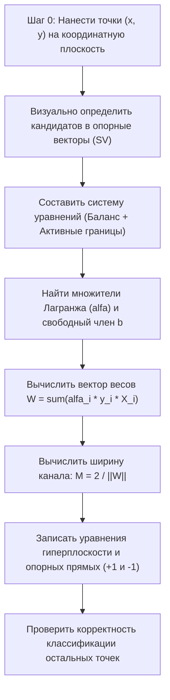

# Метод опорных векторов (SVM) — Типовая экзаменационная задача

Методическое руководство по решению типовых экзаменационных задач на линейный метод опорных векторов (SVM с жестким зазором — *hard margin* и линейным ядром — *linear kernel*).

---

## 1. Что делает алгоритм? (Коротко)

Это алгоритм **обучения с учителем** (*supervised learning*) для задач классификации и регрессии. Он строит оптимальную границу решения в виде **гиперплоскости**, разделяющей два класса ($+1$ и $-1$) таким образом, чтобы максимизировать безопасное расстояние (зазор / отступ) до ближайших точек каждого класса, обеспечивая наилучшую обобщающую способность на новых данных.

---

## 2. Принцип работы (Суть)

> [!important] Главная идея
> Вместо проведения любой произвольной линии, разделяющей классы, SVM ищет **оптимальную разделяющую гиперплоскость** — ту, которая проходит ровно посередине **максимально широкого коридора (канала / margin)** между классами.
> 
> Положение и ориентация этой гиперплоскости определяются **исключительно** небольшим критическим подмножеством точек, называемых **Опорными Векторами** (*Vectores de Soporte*), которые лежат ровно на границах этого коридора. Все остальные точки обучающей выборки вообще не влияют на итоговое решение.

```
       Класс +1          Коридор (Ширина = 2 / ||W||)        Класс -1
         (+)                     |             |               (-)
     (+)     (+)                 |             |          (-)      (-)
           (SV+) -------------> [•]            |
                                 |      |      |
                                 |      |      |
                                 |      |     [•] <------------- (SV-)
                                 |      |      |          (-)
                                 |      |      |
                         W^T X + b = +1 | W^T X + b = -1
                                        v
                                  W^T X + b = 0
                            (Разделяющая гиперплоскость)
```

---

## 3. Шаги и основные формулы

### 3.1. Уравнения гиперплоскостей
* **Разделяющая гиперплоскость (*Hiperplano separador*):**
  $$W^T X + b = 0 \quad \iff \quad w_1 x_1 + w_2 x_2 + \dots + w_n x_n + b = 0$$
* **Положительная опорная плоскость (для точек класса $y_i = +1$):**
  $$W^T X + b = +1$$
* **Отрицательная опорная плоскость (для точек класса $y_i = -1$):**
  $$W^T X + b = -1$$

### 3.2. Условие жесткого зазора (*Hard Margin*)
Чтобы все обучающие примеры были классифицированы верно и находились вне коридора либо строго на его границах:
$$y_i (W^T X_i + b) \ge 1, \quad \forall i = 1, \dots, N$$

### 3.3. Ширина канала / зазора (*Ancho del canal*)
Геометрическое расстояние между положительной и отрицательной опорными плоскостями равно:
$$M = \frac{2}{\|W\|} = \frac{2}{\sqrt{w_1^2 + w_2^2 + \dots + w_n^2}}$$
*Отсюда следует: **максимизация ширины канала** $M$ математически эквивалентна **минимизации** нормы весов $\frac{1}{2} \|W\|^2$.*

### 3.4. Связь с множителями Лагранжа ($\alpha_i$)
Вектор нормали $W$ выражается через линейную комбинацию обучающих векторов с помощью коэффициентов Лагранжа $\alpha_i$:
$$W = \sum_{i=1}^N \alpha_i y_i X_i$$
Где:
* Если точка $X_i$ — **опорный вектор** (*Vector de Soporte*): $\alpha_i > 0$ и выполняется строгое равенство на границе: $y_i (W^T X_i + b) = 1$.
* Если точка $X_i$ **не** является опорным вектором: $\alpha_i = 0$ и точка лежит глубже за пределами коридора: $y_i (W^T X_i + b) > 1$.

Условие баланса классов (равновесие множителей):
$$\sum_{i=1}^N \alpha_i y_i = 0$$

---

## 4. Общая методология: как решать каждый пункт Задачи 1

Ниже подробно разобран аналитический алгоритм ответа на каждый стандартный вопрос экзаменационного билета.



---

### I. Система уравнений для нахождения коэффициентов Лагранжа и $b$ (*Sistema de Ecuaciones*)

1. **Первоначальный выбор точек-кандидатов в опорные векторы:**
   * Постройте точки на плоскости $XY$.
   * Опорными векторами будут ближайшие друг к другу точки противоположных классов, задающие границу раздела.
   * Для всех остальных точек, находящихся в глубине своего класса, мы сразу полагаем $\alpha_k = 0$.
   * В 2D-пространстве для однозначного задания полосы обычно требуется 2 или 3 опорных вектора (например, 1 точка класса $+1$ и 1 или 2 точки класса $-1$, либо наоборот).

2. **Формирование уравнений системы:**
   * **Уравнение 1 (Условие баланса):**
     $$\sum_{i \in SV} \alpha_i y_i = 0$$
   * **Уравнения активных границ (по одному на каждый опорный вектор $X_k$):**
     Поскольку опорные векторы лежат ровно на опорных плоскостях, для них выполняется равенство:
     $$y_k (W^T X_k + b) = 1 \iff W^T X_k + b = y_k$$
     Подставляя выражение $W = \sum_{j \in SV} \alpha_j y_j X_j$, получаем:
     $$\sum_{j \in SV} \alpha_j y_j (X_j \cdot X_k) + b = y_k$$
     *(где $X_j \cdot X_k = x_{j1}x_{k1} + x_{j2}x_{k2}$ — скалярное произведение векторов признаков).*

В итоге получается линейная система уравнений, где число неизвестных ($\alpha_i$ для выбранных точек и $b$) совпадает с числом уравнений.

---

### II. Коэффициенты Лагранжа ($\alpha$) (*Coeficientes de Lagrange*)

* Решаем полученную линейную систему уравнений относительно неизвестных $\alpha_i$ и $b$.
* **Обязательная проверка корректности:** Все найденные $\alpha_i$ для опорных векторов обязаны быть **строго положительными**:
  $$\alpha_i > 0, \quad \forall i \in SV$$
  *(Если какой-то $\alpha_i \le 0$, значит, набор кандидатов в опорные векторы был выбран неверно и его необходимо пересмотреть).*
* Для всех остальных точек датасета:
  $$\alpha_j = 0$$

---

### III. Вектор весов, нормальный к гиперплоскости ($W$) (*Vector de Pesos*)

Вычисляется подстановкой найденных $\alpha_i$ в формулу для $W$:
$$W = \sum_{i \in SV} \alpha_i y_i X_i = \alpha_1 y_1 \begin{pmatrix} x_{11} \\ x_{12} \end{pmatrix} + \alpha_2 y_2 \begin{pmatrix} x_{21} \\ x_{22} \end{pmatrix} + \dots = \begin{pmatrix} w_1 \\ w_2 \end{pmatrix}$$

> [!note] Геометрический смысл
> Вектор $W = (w_1, w_2)^T$ перпендикулярен разделяющей прямой и указывает в сторону положительного класса ($+1$).

---

### IV. Свободный член $b$ / Вектор $B$ (*Vector B*)

* В билетах профессора скаляр $b$ часто называют *Vector B* (или смещение / *bias*).
* Значение $b$ получается непосредственно из решения системы уравнений пункта I.
* Также его можно выразить через любой известный опорный вектор $X_k$:
  $$b = y_k - W^T X_k = y_k - (w_1 x_{k1} + w_2 x_{k2})$$

---

### V. Опорные векторы (*Vectores Soporte*)

* Явно выписываются координаты и метки классов точек, для которых $\alpha_i > 0$.
* Это единственные точки, лежащие непосредственно на опорных прямых и удовлетворяющие равенству $y_i (W^T X_i + b) = 1$.

---

### VI. Ширина канала (*Ancho del canal*)

1. Вычисляется евклидова норма вектора весов $W$:
   $$\|W\| = \sqrt{w_1^2 + w_2^2}$$
2. Вычисляется итоговая ширина канала:
   $$\text{Ancho} = \frac{2}{\|W\|}$$

---

### VII. Уравнения гиперплоскости и опорных плоскостей (*Ecuaciones de los Hiperplanos*)

* **Разделяющая прямая (центральная гиперплоскость):**
  $$w_1 x + w_2 y + b = 0 \quad \implies \quad y = -\frac{w_1}{w_2} x - \frac{b}{w_2}$$
* **Положительная опорная прямая ($+1$):**
  $$w_1 x + w_2 y + b = +1 \quad \implies \quad y = -\frac{w_1}{w_2} x + \frac{1 - b}{w_2}$$
* **Отрицательная опорная прямая ($-1$):**
  $$w_1 x + w_2 y + b = -1 \quad \implies \quad y = -\frac{w_1}{w_2} x + \frac{-1 - b}{w_2}$$

*(Обратите внимание: все три прямые строго параллельны друг другу и имеют одинаковый угловой коэффициент $k = -\frac{w_1}{w_2}$).*

---

### VIII. Функция классификации (*Función de clasificación*)

Функция для предсказания класса любой новой точки $X = (x, y)^T$:
$$f(X) = \operatorname{sign}(W^T X + b) = \operatorname{sign}(w_1 x + w_2 y + b)$$
* Если $w_1 x + w_2 y + b > 0 \implies \text{Класс } +1$.
* Если $w_1 x + w_2 y + b < 0 \implies \text{Класс } -1$.

---

### IX. Классификация точек, не являющихся опорными векторами (*Clasificar los puntos restantes*)

Для каждой оставшейся точки $X_k$, не вошедшей в число опорных векторов:
1. Вычисляем алгебраическое значение: $v_k = W^T X_k + b = w_1 x_k + w_2 y_k + b$.
2. Проверяем, что знак совпадает с истинным классом: $\operatorname{sign}(v_k) = y_k$.
3. Убеждаемся, что точка лежит строго вне коридора:
   $$y_k \cdot v_k > 1$$
   *(Если получилось бы $< 1$, точка попала бы внутрь коридора, что нарушило бы условие жесткого зазора).*

---

## 5. Пункт b): Решение на языке R с пакетом `kernlab`

В практической части билета требуется воспроизвести те же расчеты с помощью библиотеки `kernlab`:

```r
library(kernlab)

# 1. Задаем координаты точек и метки классов
x <- c(1, 2, 3, 2, 3)
y <- c(2, -1, -1, 3, -3)
clase <- factor(c("+1", "-1", "-1", "+1", "-1"))
datos <- data.frame(x = x, y = y, clase = clase)

# 2. Обучаем модель линейного SVM с жестким зазором (большое C исключает ошибки)
modelo_svm <- ksvm(clase ~ x + y, data = datos, type = "C-svc", C = 100, kernel = "vanilladot")

# 3. Извлекаем индексы и координаты опорных векторов
indices_sv <- SVindex(modelo_svm)
vectores_soporte <- datos[indices_sv, ]

# 4. Вычисляем вектор весов W
# coef(modelo)[[1]] содержит величины (alfa_i * y_i)
w <- colSums(coef(modelo_svm)[[1]] * as.matrix(datos[indices_sv, c("x", "y")]))

# 5. Извлекаем свободный член b
# ВАЖНО: В kernlab функция b() возвращает отрицательное значение (-b) согласно формуле решения
termino_b <- -b(modelo_svm)

# 6. Вычисляем ширину канала
norma_w <- sqrt(sum(w^2))
ancho_canal <- 2 / norma_w

# 7. Графическое отображение точек и прямых
plot(modelo_svm, data = datos)

# Центральная разделяющая прямая: w1*x + w2*y + b = 0 => y = (-w1/w2)*x - b/w2
abline(a = -termino_b / w[2], b = -w[1] / w[2], col = "blue", lwd = 2)

# Положительная опорная прямая (+1): y = (-w1/w2)*x + (1 - b)/w2
abline(a = (1 - termino_b) / w[2], b = -w[1] / w[2], col = "green", lty = 2)

# Отрицательная опорная прямая (-1): y = (-w1/w2)*x + (-1 - b)/w2
abline(a = (-1 - termino_b) / w[2], b = -w[1] / w[2], col = "red", lty = 2)
```
