# Мультиклассификаторы и ансамбли — Полный конспект теории (Часть 2)

> [!info] Источники и охват материала
> Данный конспект представляет собой максимально полное и точное объединение всех теоретических материалов по **второй части курса «Aprendizaje Computacional» (UMA)** из каталога `FIcheros de CV sin sortear/Multiclasificadores (Ensemble)/Teoria/`:
> 1. **`Multiclasificadores.pdf`** — презентация *Introducción a los sistemas Multiclasificadores* (Carlos J. Alonso González, Universidad de Valladolid, 28 слайдов) — **включена полностью**.
> 2. **`Ensambles.pdf`** — технический отчёт *DPTOIA-IT-2006-001: Multiclasificadores: Métodos y Arquitecturas* (Saddys Segrera Francia, María N. Moreno García, Universidad de Salamanca, март 2006, разделы 1–8) — **включён полностью**.
> 3. **`boosting.pdf`** — презентация *Boosting* (Álvaro J. Riascos Villegas, Uniandes y Quantil, март 2018, 15 слайдов) — **включена полностью**.
> 4. **`RF_presentation.pdf`** — презентация *Random Forests: Teoría y ejemplos* (Romain Gouron, GLAM, 2016, 62 слайда) — **включена полностью**.
> 5. **`Rdatamining.pdf`** — книга *R and Data Mining: Examples and Case Studies* (Yanchang Zhao, 2011) — **включена глава 4** (*Decision Trees*: §4.1 `party::ctree`, §4.2 `rpart`, §4.3 `randomForest`, стр. 20–29).
>
> **Навигация:** краткая экзаменационная шпаргалка со ссылками на все разделы этого файла находится в [[02 Multiclasificadores y Ensembles — Краткая выжимка (RU)]].

---

## Содержание

- [[#1. Введение в мультиклассификаторы и ансамблевое обучение]]
  - [[#1.1. Мотивация, определение и области применения]]
  - [[#1.2. Преимущества и недостатки комбинирования моделей]]
  - [[#1.3. Три причины превосходства ансамблей по Диттериху]]
  - [[#1.4. Требования к базовым классификаторам и классификация методов]]
- [[#2. Декомпозиция смещения и дисперсии (Bias–Variance)]]
  - [[#2.1. Постановка задачи и природа компонентов ошибки]]
  - [[#2.2. Компромисс смещение–дисперсия и стабильность классификаторов]]
  - [[#2.3. Влияние ансамблей на смещение и дисперсию]]
- [[#3. Архитектуры мультиклассификаторов]]
  - [[#3.1. Вертикальная (последовательная) архитектура]]
  - [[#3.2. Горизонтальная (параллельная) архитектура]]
  - [[#3.3. Гибридная архитектура]]
- [[#4. Стратегии комбинирования выходов классификаторов]]
  - [[#4.1. Методы абстрактного уровня]]
  - [[#4.2. Методы уровня рангов]]
  - [[#4.3. Методы уровня измерений]]
  - [[#4.4. Сравнение стратегий слияния]]
- [[#5. Бэггинг (Bagging)]]
  - [[#5.1. Принцип бутстрэпа и алгоритм Bagging]]
  - [[#5.2. Анализ свойств, стабильность базовых моделей и ограничения]]
- [[#6. Деревья решений и случайные леса (Random Forests)]]
  - [[#6.1. Деревья решений — определение, свойства и построение]]
  - [[#6.2. Случайные леса — алгоритм и свойства]]
  - [[#6.3. Теоретический анализ Random Forests, ошибка OOB и важность признаков]]
  - [[#6.4. Эффективность на классических задачах и резюме плюсов и минусов]]
  - [[#6.5. Производные методы на основе деревьев]]
- [[#7. Бустинг (Boosting) и AdaBoost]]
  - [[#7.1. Общая идея бустинга и сравнение с бэггингом]]
  - [[#7.2. Алгоритм AdaBoost и многоклассовые расширения]]
  - [[#7.3. Подробный числовой пример работы AdaBoost]]
  - [[#7.4. Переобучение, непереобучение и теория маржи]]
  - [[#7.5. Градиентный бустинг (Gradient Boosting)]]
- [[#8. Другие ансамблевые методы и решения их проблем]]
  - [[#8.1. Метод случайных подпространств (Random Subspace Method)]]
  - [[#8.2. Кодирование выхода с исправлением ошибок (ECOC)]]
  - [[#8.3. Комитеты кросс-валидации (Cross-Validated Committees)]]
  - [[#8.4. Рандомизация (Randomization)]]
  - [[#8.5. Сравнительный анализ ансамблевых методов]]
  - [[#8.6. Решения практических проблем ансамблей]]
- [[#9. Гибридные методы — Стекинг и Каскадирование]]
  - [[#9.1. Метод стекинга (Stacking)]]
  - [[#9.2. Метод каскадирования (Cascading)]]
- [[#10. Неансамблевые мультиклассификаторы]]
  - [[#10.1. Нейронные сети радиально-базисных функций (RBF)]]
  - [[#10.2. Иерархическая смесь экспертов (Hierarchical Mixture of Experts)]]
- [[#11. Практическая реализация в R — Деревья решений и Random Forest]]
  - [[#11.1. Деревья решений в пакетах party и rpart]]
  - [[#11.2. Случайный лес в пакете randomForest]]
- [[#12. Практические кейсы и общие выводы]]
  - [[#12.1. Экспериментальное сравнение ансамблей в Weka]]
  - [[#12.2. Прогнозирование второгодничества школьников (данные MINEDUC)]]
  - [[#12.3. Итоговые выводы и ключевые источники]]

---

## 1. Введение в мультиклассификаторы и ансамблевое обучение

### 1.1. Мотивация, определение и области применения

В повседневной жизни и науке принятие решений в общем случае улучшается, когда сопоставляются различные мнения (*cuando se contrastan opiniones diversas*). Прямая аналогия в машинном обучении (*símil en aprendizaje*) состоит из двух шагов:
1. Сгенерировать различные модели (*generar diversos modelos*).
2. Объединить их выходы (*combinar su salida*).

В отличие от традиционных методов классификации, выбирающих единственную наилучшую гипотезу, **мультиклассификаторы** (*multiclasificadores / multiclassifiers*) учитывают **все гипотезы**, в большей или меньшей степени согласующиеся с данными: ни одна из согласованных гипотез не отбрасывается, а выполняется комбинирование (слияние) прогнозов всего набора моделей в единый итоговый результат.

В научной литературе эта концепция фигурирует под множеством синонимичных названий:
- методы ансамблирования (*métodos de ensamble*);
- множественные модели (*modelos múltiples / multiple models*);
- системы множественных классификаторов (*sistemas de múltiples clasificadores / multiple classifier systems*);
- комбинирование классификаторов (*combinación de clasificadores / combining classifiers*);
- интеграция классификаторов (*integración de clasificadores / integration of classifiers*);
- смесь экспертов (*mezcla de expertos / mixture of experts*);
- комитет принятия решений (*comité de decisión / decision committee*) и комитет экспертов (*comité de expertos*);
- слияние классификаторов (*fusión de clasificadores / classifier fusion*);
- мультимодельное обучение (*aprendizaje multimodelo / multimodel learning*).

**Основные области применения** мультиклассификаторов:
- биометрическая идентификация личности (распознавание лиц, речи, подписей и др.);
- биоинформатика и медицина (например, классификация опухолей по данным экспрессии генов, диагностика заболеваний сердца);
- геофизический анализ и дистанционное зондирование (*teledetección*, обновление карт земного покрова);
- оптическое распознавание символов (*OCR*), оценка пригодности земель, прогнозирование в образовании и др.

### 1.2. Преимущества и недостатки комбинирования моделей

**Преимущества (*ventajas*):**
- Как правило, достигается **значительное повышение точности предсказаний** (*aumento importante de precisión*) по сравнению с одиночным классификатором.
- Помогают смягчить проблему **переобучения** (*sobreaprendizaje / sobreadaptación / overfitting*) и, как правило, избавляют от необходимости выбирать чрезмерно сложную одиночную модель.
- Позволяют получать хорошие результаты даже при **малом объёме обучающих данных**.
- Сложную задачу классификации можно разбить на множество более простых подзадач.
- Некоррелированные ошибки индивидуальных классификаторов могут взаимно нейтрализоваться при объединении.

**Недостатки (*inconvenientes / problemas*):**
- **Потеря интерпретируемости** (*modelos difíciles de comprender / pérdida de comprensibilidad*): итоговую комбинированную модель трудно понять и объяснить человеку.
- **Высокие вычислительные затраты** при обучении большого числа моделей и повышенное время отклика при предсказании.
- **Необходимость хранить** в памяти все построенные модели ансамбля.

**Критерии оценки и сравнения мультиклассификаторов:**
- степень обобщения (*grado de generalización*);
- качество и характер обучения (*aprendizaje*);
- доля верной и ошибочной классификации;
- реальное время выполнения (*tiempo real de ejecución*).

### 1.3. Три причины превосходства ансамблей по Диттериху

Согласно Томасу Диттеричу (*Dietterich, 2002*), существуют **три фундаментальные причины**, по которым ансамбль классификаторов превосходит одиночный классификатор:

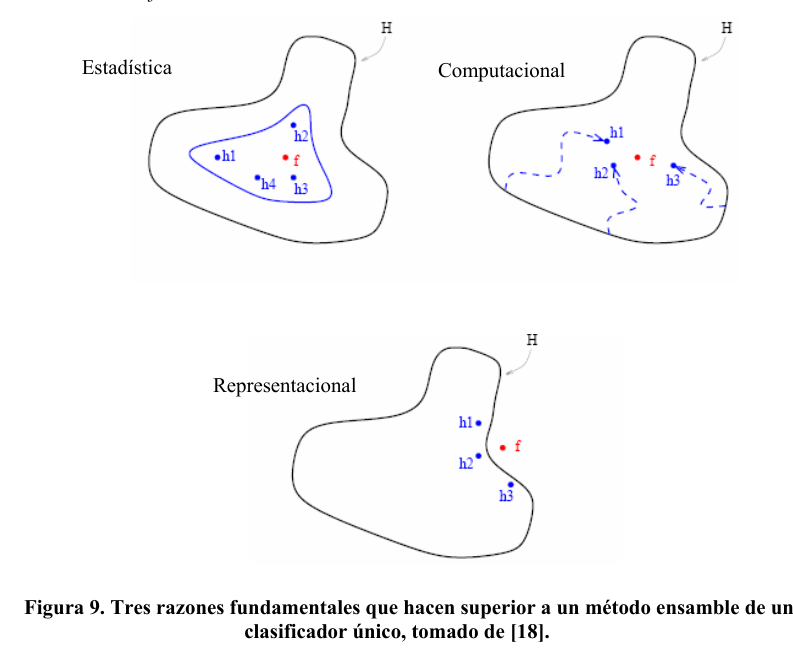

1. **Статистическая проблема (*Problema estadístico*):**
   Пространство гипотез $H$ слишком велико относительно доступного объёма обучающих данных. Внутри $H$ может существовать несколько различных гипотез ($h_1, h_2, h_3, h_4$), дающих одинаково хорошую точность на обучающей выборке. Выбор лишь одной из них несёт риск плохого обобщения на будущих тестовых данных. Голосование (усреднение) по таким гипотезам снижает этот риск и приближает итоговую гипотезу к истинной функции $f$.
2. **Вычислительная проблема (*Problema computacional*):**
   Даже если обучающих данных достаточно для статистического устранения неопределённости, многие алгоритмы обучения (например, нейронные сети или жадный локальный поиск в деревьях решений) выполняют локальный поиск и могут застревать в локальных оптимумах. Построение ансамбля путём запуска поиска из разных начальных точек ($h_1, h_2, h_3$) позволяет получить лучшую аппроксимацию истинной целевой функции $f$.
3. **Проблема представления / репрезентации (*Problema de representación*):**
   В ряде случаев пространство гипотез $H$, доступное отдельному алгоритму, **вообще не содержит** гипотезы, способной хорошо приблизить истинную функцию $f$ (например, при использовании линейных классификаторов или решающих пней на нелинейной задаче). Взвешенная комбинация гипотез из $H$ ($h_1, h_2, h_3$) **расширяет пространство представимых функций**, позволяя точнее аппроксимировать $f$.

### 1.4. Требования к базовым классификаторам и классификация методов

> [!important] Необходимое и достаточное условие успеха ансамбля
> Для того чтобы комбинирование классификаторов превосходило каждый индивидуальный классификатор, базовые модели должны быть одновременно:
> 1. **Точными (*precisos*):** ошибка каждого классификатора лучше случайного угадывания (для бинарной классификации — ошибка $< 0.5$).
> 2. **Разнообразными (*diversos*):** ошибки различных классификаторов на новых объектах должны быть по возможности некоррелированными (модели ошибаются на разных примерах).

Для количественной оценки разнообразия ансамбля в литературе (Kuncheva & Whitaker) исследованы **10 мер разнообразия**:
- $Q$-статистика;
- коэффициент корреляции;
- мера несогласия (*medida de discordancia*);
- мера двойного отказа (*doble fallo*, DF — чем меньше доля случаев, когда ошибаются оба классификатора одновременно, тем выше разнообразие и потенциальная точность);
- энтропийная мера;
- дисперсия Кохави–Волперта (*varianza de Kohavi–Wolpert*);
- мера согласия независимых экспертов (*interrater agreement*);
- мера «трудности» (*dificultad*);
- обобщённое разнообразие (*diversidad generalizada*);
- разнообразие совпадающих отказов (*diversidad de fracaso coincidente*).

Эти меры не заменяют прямую оценку точности ансамбля, но служат важным инструментом понимания его поведения.

**Основная классификация мультиклассификаторов:**
1. **Однородные ансамблевые методы (*Métodos de ensamble / homogéneos*):** объединяют модели, построенные с помощью **одного и того же** алгоритма обучения (например, *Bagging*, *Boosting*, *Random Subspace Method*, *ECOC*, *Cross-Validated Committees*, *Randomization*).
2. **Гибридные методы (*Métodos híbridos*):** комбинируют классификаторы, полученные **различными** алгоритмами обучения, заменяя простое голосование более сложными схемами взаимодействия (например, *Stacking*, *Cascading*).
3. **Неансамблевые методы (*Métodos de no ensamble*):** модели, структурно похожие на комбинирование гипотез (например, *RBF*-сети, *иерархическая смесь экспертов*).

**Ключевые оси различия мультиклассификаторных систем:**
- число объединяемых индивидуальных классификаторов;
- тип каждого классификатора (деревья решений, нейронные сети, метод ближайшего соседа, SVM и т.д.);
- характеристики подмножеств данных/признаков, используемых каждым классификатором;
- способ агрегации частных решений (мажоритарное голосование, взвешивание, *BKS*, среднее, максимум, минимум, произведение и др.);
- размер и природа обучающих выборок.

---

## 2. Декомпозиция смещения и дисперсии (Bias–Variance)

### 2.1. Постановка задачи и природа компонентов ошибки

Теоретический анализ происхождения ошибки гипотезы (*análisis teórico del origen del error de una hipótesis*) опирается на мысленный эксперимент со следующими допущениями:
- Имеется бесконечное число классификаторов, обученных на бесконечном числе **независимых обучающих выборок** (*conjuntos de entrenamiento independientes*) заданного размера.
- Оценка выполняется на бесконечном числе **независимых тестовых выборок** (*conjuntos de prueba independientes*) заданного размера.

При таком рассмотрении выделяются два фундаментальных источника ошибки классификатора:
1. **Смещение (*Bias*):** среднее значение ожидаемой ошибки по бесконечному числу тестовых выборок и возможных обучений. Эта компонента обусловлена **самим методом обучения** (ограниченностью или предположениями выбранного семейства моделей).
2. **Дисперсия (*Varianza*):** среднее значение ошибки, обусловленной **конкретной обучающей выборкой**, с которой приходится работать в реальном сценарии (чувствительность модели к флуктуациям данных при обучении).

> [!important] Разложение полной ожидаемой ошибки
> Полная ожидаемая ошибка классификатора представима в виде суммы смещения и дисперсии:
> $$\text{Error esperado total} = \text{Bias} + \text{Varianza}$$

### 2.2. Компромисс смещение–дисперсия и стабильность классификаторов

Разные семейства алгоритмов машинного обучения по-разному распределяют ошибку между смещением и дисперсией:
- **Нестабильные методы (*métodos inestables*):** даже небольшие изменения в составе обучающей выборки вызывают существенные изменения в построенной гипотезе. Классический пример — **деревья решений** (*árboles de decisión*, особенно без обрезки ветвей) и нейронные сети. У таких моделей обычно низкое смещение, но высокая дисперсия.
- **Стабильные методы (*métodos estables*):** слабо меняются при небольших возмущениях обучающей выборки (например, $k$-ближайших соседей при большом $k$, линейные классификаторы, *Naive Bayes*). Их дисперсия мала, но смещение может быть высоким.

**Практическая трудность:** в реальности в нашем распоряжении имеется лишь **одна обучающая выборка** (*un único conjunto de entrenamiento*), а не бесконечное множество независимых выборок.
**Альтернатива:** искусственно **манипулировать обучающей выборкой** (или входными признаками, или процессом обучения) для порождения множества различных гипотез.

### 2.3. Влияние ансамблей на смещение и дисперсию

Комбинирование нескольких классификаторов способно радикально снижать компоненту **дисперсии** (*componente varianza*):
- **Бэггинг (*Bagging*)** усредняет или проводит голосование по множеству моделей, обученных на бутстрэп-репликах одной выборки. Это целенаправленно **снижает дисперсию** и поэтому наиболее эффективно именно для **нестабильных** базовых классификаторов (чем выше нестабильность — например, при отключении прунинга дерева — тем заметнее выигрыш).
- Для **стабильных моделей** простое возмущение выборки (как в бэггинге) даёт почти одинаковые гипотезы и не приносит большого выигрыша. В этом случае необходим альтернативный подход: принудительно строить **взаимодополняющие модели** (*modelos que se complementen*), фокусирующиеся на ошибках предыдущих моделей — именно это делает **бустинг (*Boosting*)**, который способен уменьшать также и **смещение** за счёт повышения выразительности взвешенной суммы слабых классификаторов (см. [[#1.3. Три причины превосходства ансамблей по Диттериху|проблему представления]]).

---

## 3. Архитектуры мультиклассификаторов

При наличии набора из $L$ классификаторов выбор архитектуры (*arquitectura*) определяется тем, как их решения интегрируются: независимо друг от друга, путём последовательного отсечения гипотез или в рамках кооперативной схемы. Выделяют три базовые архитектуры: вертикальную (последовательную), горизонтальную (параллельную) и гибридную.

### 3.1. Вертикальная (последовательная) архитектура

В **вертикальной, или последовательной, архитектуре** (*arquitectura vertical o secuencial*) выходная информация одного классификатора становится входной для следующего. Система организована в виде последовательных уровней принятия решений, которые постепенно сужают неоднозначность и сокращают число возможных классов. На каждом шаге классификатор учитывает решение предыдущего, обрабатывая отказы либо подтверждая ответ.

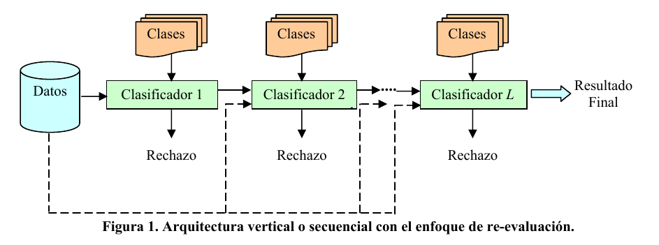

Существуют два основных подхода к реализации последовательной архитектуры:

1. **Повторная оценка (*Re-evaluación*):**
   Первый эксперт вместо жёсткой метки класса выдаёт оценку уверенности (*valor de confianza*), которая сравнивается с двумя порогами:
   - уверенность **выше верхнего порога** $\implies$ **принятие** (*aceptación*); объект классифицируется сразу, повторная оценка на следующем уровне не нужна;
   - уверенность **между первым и вторым порогами** $\implies$ промежуточная ситуация, решение принимается в зависимости от заданных ограничений;
   - уверенность **ниже второго порога** $\implies$ **отказ** (*rechazo*); объект передаётся на повторную оценку следующему классификатору.
   При отказе следующий классификатор ищет решение по всему пространству классов и вычисляет новую оценку уверенности; процесс продолжается до достижения достаточной уверенности или до последнего классификатора $L$.

2. **Сокращение множества классов (*Reducción del conjunto de clases*):**
   Первичный классификатор формирует укороченный список кандидатов (подмножество классов). Следующий классификатор ограничивает свой анализ только этим подмножеством и т.д.

**Особенности:** система чувствительна к порядку следования классификаторов (требуются априорные знания об их поведении), а из-за жёсткой зависимости между звеньями всю схему трудно оптимизировать целиком.

### 3.2. Горизонтальная (параллельная) архитектура

В **горизонтальной, или параллельной, архитектуре** (*arquitectura horizontal o paralela*) все $L$ классификаторов работают **независимо** друг от друга на одних и тех же входных данных, после чего их ответы поступают в общий **модуль комбинирования** (*Módulo de Combinación*), который ищет консенсус для вынесения итогового решения.

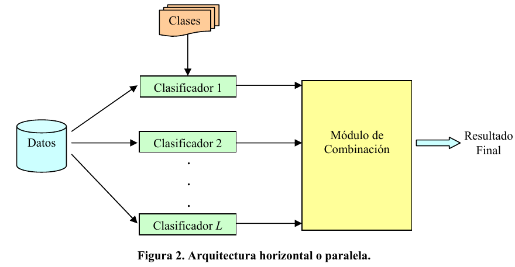

- **Преимущества:** простота реализации; при добавлении, удалении или изменении одного классификатора не требуется перенастройка (репараметризация) остальных.
- **Недостаток:** одновременная активация всех классификаторов влечёт высокие вычислительные затраты времени.

### 3.3. Гибридная архитектура

**Гибридная архитектура** (*arquitectura híbrida*) объединяет достоинства последовательной и параллельной схем: на первом этапе выполняется сужение множества возможных классов, а затем — параллельный поиск консенсуса между несколькими классификаторами (на схеме ниже данные обрабатывает Классификатор 1, а затем параллельно Классификаторы $2 \dots L$).

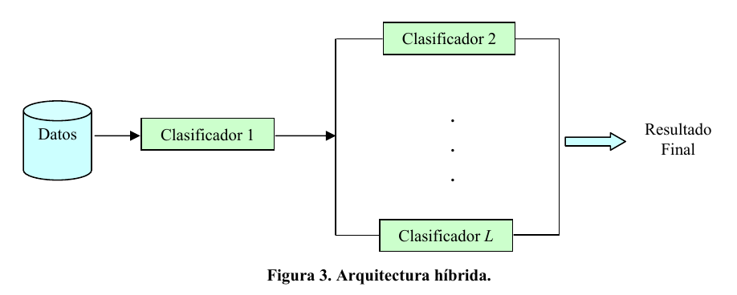

Такая схема позволяет полнее раскрыть сильные стороны каждого базового алгоритма, но данные обрабатываются зависимо, и оптимизация системы в целом становится ещё сложнее, чем в чисто последовательной архитектуре.

---

## 4. Стратегии комбинирования выходов классификаторов

Стратегии комбинирования (*estrategias de combinación*) определяют, каким образом выходы отдельных классификаторов сливаются в единый ответ. Они делятся на три группы по типу выходной информации базовых моделей: **абстрактный уровень**, **уровень рангов** и **уровень измерений**. Внутри каждой группы различают **фиксированные правила** (*reglas fijas*, не требующие обучения) и **обучаемые правила** (*reglas entrenadas*).

### 4.1. Методы абстрактного уровня

На **абстрактном уровне** (*nivel abstracto / abstract-level*) каждый классификатор выдаёт только жёсткую («чёткую», *salida crisp*) метку класса:
$$D: \mathbb{R}^n \to \Omega, \quad \Omega = \{c_1, \dots, c_k\},$$
где $D$ — решающая функция, отображающая вектор признаков $x \in \mathbb{R}^n$ в множество классов $\Omega$. Модуль комбинирования объединяет $N$ чётких выходов $S^{(1)}, \dots, S^{(N)} \in \Omega$.

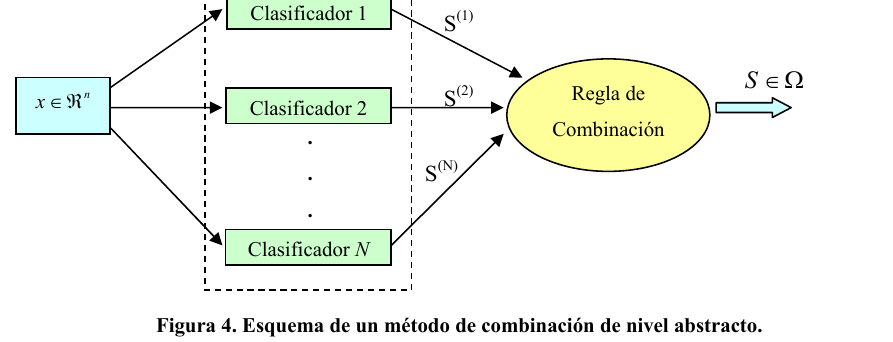

#### 4.1.1. Простое мажоритарное голосование (*Voto mayoritario simple*)
- Фиксированное правило: каждый из $N$ классификаторов имеет один голос равного веса.
- Выбирается наиболее часто предсказанный класс; базовый вариант — голосование по относительному большинству (*voto de la pluralidad*).
- Для предотвращения ничьей обычно выбирают нечётное число классификаторов $N$, а при абсолютном большинстве класс-победитель должен набрать не менее $50\%$ голосов ($N/2$).
- **Пример:** при $\Omega = \{a, b\}$ и $N = 3$, если $S^{(1)} = a$, $S^{(2)} = b$, $S^{(3)} = a$, итоговый выход — **$a$** (2 голоса против 1).

#### 4.1.2. Взвешенное мажоритарное голосование (*Voto mayoritario por peso*)
- Обучаемое правило: каждому $j$-му классификатору назначается вес $w^{(j)}$ пропорционально его точности на фиксированной тестовой/валидационной выборке.
- Если классификаторы независимы и оценки их точности надёжны, метод обычно превосходит простое голосование.
- Вес каждого класса вычисляется как сумма весов предсказавших его классификаторов; побеждает класс с максимальным суммарным весом.
- **Пример:** $\Omega = \{a, b\}$, $N = 3$:
  - $S^{(1)} = a, \ w^{(1)} = 2$;
  - $S^{(2)} = b, \ w^{(2)} = 5$;
  - $S^{(3)} = a, \ w^{(3)} = 1$.
  Тогда $w_a = 2 + 1 = 3$, а $w_b = 5$, следовательно, **побеждает класс $b$** (несмотря на то, что класс $a$ выбрали два классификатора из трёх).

#### 4.1.3. Правила на основе подхода Байеса (*Reglas basadas en el enfoque de Bayes*)
Теоретически оптимальное решение относит вход $x$ к классу $c_i$, если его апостериорная вероятность при данном векторе ответов максимальна:
$$P(c_i \mid S^{(1)}, S^{(2)}, \dots, S^{(N)}) > P(c_j \mid S^{(1)}, S^{(2)}, \dots, S^{(N)}), \quad \forall j \neq i.$$

Апостериорные вероятности оцениваются по обучающей/валидационной выборке двумя основными методами:

1. **Пространство поведения и знаний — BKS (*Behavior-Knowledge Space*):**
   Подсчитывает эмпирические частоты появления каждого класса $c_i$ для каждой конкретной комбинации ответов $(S^{(1)}, \dots, S^{(N)})$:
   $$\hat{P}(c_i \mid S^{(1)}, \dots, S^{(N)}) = \frac{N(c_i \mid S^{(1)}, \dots, S^{(N)})}{\sum_{l=1}^k N(c_l \mid S^{(1)}, \dots, S^{(N)})}.$$

   **Числовой пример BKS** для $N = 3$ бинарных классификаторов и классов $\{0, 1\}$:

   | Класс | $0,0,0$ | $0,0,1$ | **$0,1,0$** | $0,1,1$ | $1,0,0$ | $1,0,1$ | $1,1,0$ | $1,1,1$ |
   | :---: | :---: | :---: | :---: | :---: | :---: | :---: | :---: | :---: |
   | **0** | 100 | 50 | **76** | 89 | 54 | 78 | 87 | 5 |
   | **1** | 8 | 88 | **17** | 95 | 20 | 90 | 95 | 100 |

   Для комбинации $(0, 1, 0)$:
   $$P(c = 0 \mid 0,1,0) = \frac{76}{76 + 17} = 0.82, \qquad P(c = 1 \mid 0,1,0) = \frac{17}{76 + 17} = 0.18.$$
   Выбирается класс `0`.
   - **Недостаток BKS:** общее число оцениваемых вероятностей равно $k^{N+1}$ (в примере $2^{3+1} = 16$), что при росте числа классов $k$ и классификаторов $N$ вызывает комбинаторный взрыв и требует огромной выборки для заполнения таблицы.

2. **Байесовское правило / Функции доверия — BFR (*Belief Functions Rule*):**
   В отличие от BKS, предполагает **условную независимость** классификаторов при фиксированном истинном классе:
   $$P(c_i \mid S^{(1)}, \dots, S^{(N)}) \propto P(S^{(1)}, \dots, S^{(N)} \mid c_i) \cdot P(c_i),$$
   $$P(S^{(1)}, \dots, S^{(N)} \mid c_i) = \prod_{j=1}^N P(S^{(j)} \mid c_i) \propto \prod_{j=1}^N P(c_i \mid S^{(j)}) \cdot P(S^{(j)}).$$
   Вероятность $P(c_i \mid S^{(j)})$ оценивается по матрице ошибок (*matriz de confusión*) каждого $j$-го классификатора, где $m_{ih}^{(j)}$ — количество объектов истинного класса $c_i$, отнесённых $j$-м классификатором к классу $c_h$:
   $$P(\text{clase} = c_i \mid S^{(j)} = c_h) = \frac{m_{ih}^{(j)}}{\sum_h m_{ih}^{(j)}}.$$
   - **Сравнение с BKS:** BFR снижает число параметров до $N \cdot k^2$ и хорошо работает даже на малых выборках, но критически опирается на допущение условной независимости классификаторов.

### 4.2. Методы уровня рангов

На **уровне рангов** (*nivel de rango / rank-level*) каждый классификатор упорядочивает все $k$ классов $\Omega = \{c_1, \dots, c_k\}$ по убыванию степени уверенности (наивысший ранг присваивается наиболее вероятному классу).

#### 4.2.1. Метод подсчёта Борда (*Método de la cuenta de Borda*)
Фиксированное правило. Пусть $N$ — число классификаторов, $k$ — число классов, а $r_i^{(j)}$ — ранг класса $i$, назначенный $j$-м классификатором. Итоговый суммарный ранг класса $i$:
$$r_i = \sum_{j=1}^N r_i^{(j)}.$$
Выбирается класс с максимальным $r_i$.

**Числовой пример** для $N = 3$ классификаторов и 4 классов $\{a, b, c, d\}$:

| Значение ранга | Классификатор 1 | Классификатор 2 | Классификатор 3 |
| :---: | :---: | :---: | :---: |
| **4** | $c$ | $a$ | $b$ |
| **3** | $b$ | $b$ | $a$ |
| **2** | $d$ | $d$ | $c$ |
| **1** | $a$ | $c$ | $d$ |

Вычисление суммарных рангов:
- $r_a = 1 + 4 + 3 = 8$;
- $r_b = 3 + 3 + 4 = \mathbf{10}$ (победитель);
- $r_c = 4 + 1 + 2 = 7$;
- $r_d = 2 + 2 + 1 = 5$.

Метод прост и не требует обучения, но не учитывает разную точность классификаторов, не имеет строгого теоретического обоснования и зависит от способа присвоения рангов.

#### 4.2.2. Взвешенный метод подсчёта Борда (*Método de la cuenta de Borda por peso*)
Обучаемое правило, вводящее вес $w_j$ для каждого классификатора (например, по его точности на обучающей/валидационной выборке):
$$r_i = \sum_{j=1}^N w_j r_i^{(j)}.$$
Распределение рангов отражает «сложность» конкретного объекта и может использоваться в последовательных архитектурах для отсечения маловероятных классов. Однако, если классификаторы выдают непрерывные оценки уверенности, предпочтительнее использовать именно их.

### 4.3. Методы уровня измерений

На **уровне измерений** (*nivel de medidas*) классификаторы возвращают непрерывные оценки уверенности или меры расстояния для каждого класса $\omega_1, \dots, \omega_k$. Перед слиянием выходы разнородных моделей обычно необходимо **нормировать** к интервалу $[0, 1]$ (что нетривиально при несовпадающих шкалах).

#### 4.3.1. Правила простого среднего, произведения и другие статистические операторы
Для $k$ классов и $m$ классификаторов, где $v_j$ ($j = 1, \dots, m$) — вектор вероятностей $j$-го классификатора (сумма компонент равна 1), вычисляется результирующий вектор $\alpha$ и выбирается класс с максимальной компонентой:
- **Простое среднее (*promedio simple*):** $\alpha = \frac{1}{m}\sum_{j=1}^m v_j$ (уменьшает дисперсию ошибок оценивания).
- **Правило произведения (*regla del producto*):** $\alpha = \prod_{j=1}^m v_j$ (обосновано для статистически независимых классификаторов, например при разных наборах признаков).
- **Сумма (*suma*):** $\alpha = \sum_{j=1}^m v_j$.
- **Медиана (*mediana*):** $\alpha = \operatorname{mediana}_{1 \le j \le m}(v_j)$.
- **Максимум (*máximo*):** $\alpha = \max_{1 \le j \le m}(v_j)$.
- **Минимум (*mínimo*):** $\alpha = \min_{1 \le j \le m}(v_j)$.

В двухклассовых задачах лучшими стратегиями часто оказываются **максимум** и **минимум**, за которыми следует **среднее**. Произведение и минимум выводятся из гипотезы **статистической независимости**; сумма, максимум и медиана — из допущения, что апостериорные оценки мало отклоняются от априорных вероятностей классов.

**Числовой пример** ($m = 3$, $k = 4$, классы $\{a, b, c, d\}$):
- $v_1 = \{0.25,\ 0.55,\ 0.10,\ 0.10\}$
- $v_2 = \{0.50,\ 0.00,\ 0.05,\ 0.45\}$
- $v_3 = \{0.15,\ 0.20,\ 0.30,\ 0.45\}$

Итоги по разным операторам:
- **Сумма:** $\{0.90,\ 0.75,\ 0.45,\ 1.00\} \implies d$
- **Среднее:** $\{0.30,\ 0.25,\ 0.15,\ 0.33\} \implies d$
- **Произведение:** $\{0.018,\ 0.00,\ 0.0015,\ 0.020\} \implies d$
- **Медиана:** $\{0.25,\ 0.20,\ 0.10,\ 0.45\} \implies d$
- **Максимум:** $\{0.50,\ 0.55,\ 0.30,\ 0.45\} \implies b$
- **Минимум:** $\{0.15,\ 0.00,\ 0.05,\ 0.10\} \implies a$

#### 4.3.2. Взвешенные операторы (*Operadores pesados*)
Вес $w_j$ классификатора $j$ задаётся пропорционально его точности или вычисляется по матрице ошибок:
- **Взвешенное среднее (*promedio ponderado*):**
  $$p_i = \sum_{j=1}^N w_j p_i^j.$$
- **Взвешенное произведение (*producto pesado*):**
  $$p_i = \prod_{j=1}^N \left(p_i^j\right)^{w_j}.$$

### 4.4. Сравнение стратегий слияния

| Характеристика | Абстрактный уровень (*Nivel abstracto*) | Уровень рангов (*Nivel de rango*) | Уровень измерений (*Nivel de medidas*) |
| :--- | :--- | :--- | :--- |
| **Преимущества** | • Применим к **любому** набору классификаторов (достаточно только меток классов). | • Удобен в задачах с большим числом классов, где верный класс часто в топе списка.<br>• Устраняет несогласованность шкал разнородных классификаторов.<br>• Упрощает проектирование схемы слияния. | • Извлекает **максимум информации** по сравнению с другими уровнями.<br>• Позволяет строить сложные комбинаторы для моделей с разной точностью и сложными корреляциями. |
| **Недостатки** | • Обучаемые правила (BKS и др.) предъявляют высокие требования к качеству и объёму выборки. | • Нет строгого теоретического обоснования.<br>• Результат зависит от шкалы присвоенных рангов. | • Требует **нормализации** выходов при разных типах моделей.<br>• Часто нуждается в больших и качественных выборках. |

**Общее правило выбора между фиксированными и обучаемыми комбинаторами:**
- **Фиксированные правила** вычислительно дёшевы, просты и лучше подходят для **независимых** классификаторов со схожим уровнем качества.
- **Обучаемые правила** вычислительно дороже, гибче и лучше работают при **коррелированных** классификаторах или моделях разного качества.

---

## 5. Бэггинг (Bagging)

### 5.1. Принцип бутстрэпа и алгоритм Bagging

Метод **Bagging** (сокращение от *Bootstrap AGGregatING*) предложен Лео Брейманом (*Leo Breiman, 1996*). Он относится к самым простым, но мощным однородным ансамблевым методам.

**Идеальный метод vs практическая реальность:**
- *Идеально:* случайно получить несколько независимых обучающих наборов данных размера $N$, обучить на каждом свой классификатор и объединить их прогнозы.
- *Трудность:* обычно в распоряжении имеется **только одна** обучающая выборка $E = (e_1, \dots, e_N)$.
- *Решение (бутстрэппинг, bootstrapping):* сгенерировать $K$ вспомогательных выборок (**бутстрэп-реплик** $\acute{E}_1, \dots, \acute{E}_K$) того же размера $N$, извлекая объекты из исходной выборки **случайно, равномерно и с возвращением** (*muestreo aleatorio uniforme con reemplazo*). В силу отбора с возвращением одни примеры в реплике могут повторяться несколько раз, а другие — отсутствовать вовсе (в среднем около $36.8\%$ объектов не попадают в конкретную реплику и образуют так называемую выборку *out-of-bag*).

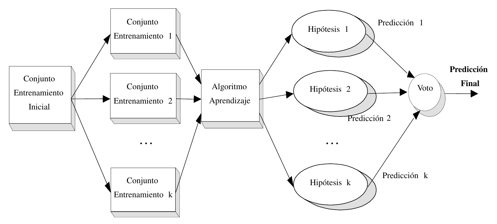

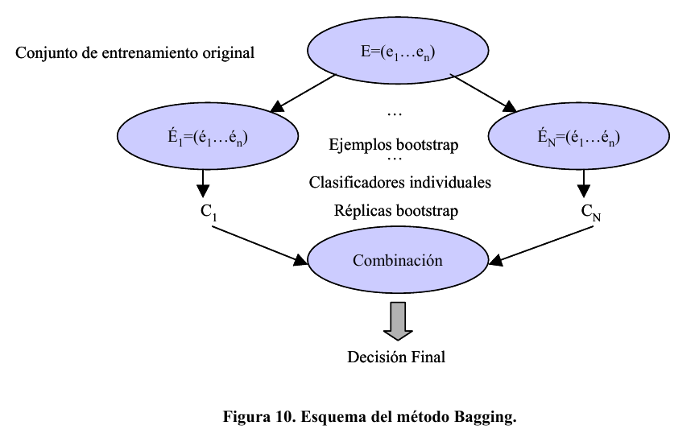

> [!important] Алгоритм Bagging
> **Фаза генерации моделей (обучение):**
> 1. Пусть $N$ — число объектов (*instancias*) в исходной обучающей выборке $E$.
> 2. Для каждого $k = 1, \dots, K$ создаваемого классификатора:
>    - Случайным образом выбрать $N$ объектов **с возвращением** из $E$, получив бутстрэп-реплику $\acute{E}_k$.
>    - Применить выбранный алгоритм обучения к $\acute{E}_k$ и сохранить полученную модель $C_k$ (гипотезу $h_k$).
>
> **Фаза классификации (предсказание для нового объекта $x$):**
> - В задачах **классификации:** получить предсказание $h_k(x)$ от каждой модели и вернуть класс, набравший наибольшее число голосов (**простое мажоритарное голосование**, *voto por mayoría*, все гипотезы имеют равный вес).
> - В задачах **регрессии:** вернуть **среднее арифметическое** (*media*) предсказаний всех моделей.

### 5.2. Анализ свойств, стабильность базовых моделей и ограничения

- **Механизм работы:** бэггинг снижает **дисперсию** (*componente varianza*) итогового классификатора за счёт усреднения (голосования).
- **Эффективность на нестабильных моделях:** бэггинг даёт наибольший прирост точности при использовании **нестабильных методов** (*métodos inestables*), таких как деревья решений или нейронные сети, где малые изменения выборки заметно меняют границу решений. Более того, качество бэггинга может даже **улучшаться при намеренном повышении нестабильности** базового метода (например, при отказе от обрезки ветвей деревьев — *eliminando la poda*).
- **Взвешенное голосование:** если базовые гипотезы сопровождаются мерой уверенности (*medida de certeza*), можно получить небольшое дополнительное улучшение, заменив простое голосование взвешенным.
- **Поведение с ростом числа моделей $K$:** как правило, частота ошибок (*tasa de error*) монотонно снижается по мере увеличения $K$, причём $K$ может быть очень большим (сотни и тысячи моделей). Однако в редких патологических случаях ошибка может возрастать.
- **Переобучение и шум:**
  - В отличие от бустинга, бэггинг **обычно не усиливает переобучение** (*no suele aumentar el sobreajuste*).
  - Обладает высокой устойчивостью и **помогает при наличии шума** (*ruido*) и выбросов в данных (поскольку шумные примеры реже доминируют сразу во многих бутстрэп-выборках).
- **Ограничение на стабильных моделях:** на стабильных алгоритмах (например, $k$-NN или линейный дискриминант) бэггинг почти не даёт выигрыша, так как модели на бутстрэп-репликах получаются слишком похожими.

---

## 6. Деревья решений и случайные леса (Random Forests)

### 6.1. Деревья решений — определение, свойства и построение

> [!note] Определение дерева решений
> **Дерево решений (*árbol de decisión*)** — это классификатор древовидной формы (обучение с учителем, *aprendizaje supervisado*), в котором:
> - в каждом внутреннем **узле (*nodo*)** проверяется значение некоторого признака (*feature*);
> - для каждого значения (или интервала значений) проверяемого признака существует **ветвь (*rama*)**;
> - терминальные **листья (*hojas*)** символизируют целевые категории / классы (*output*).

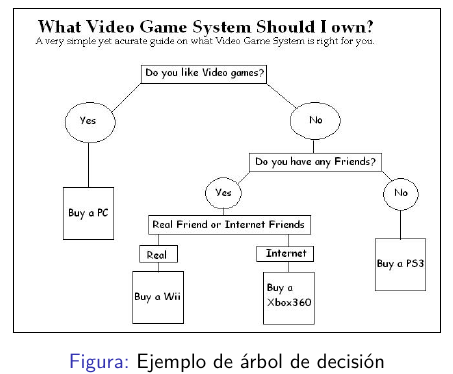

**Преимущества деревьев решений:**
- Хорошо работают с **качественными (категориальными) данными** (*datos cualitativos*), если число признаков разумно.
- Обладают высокой **интерпретируемостью** (*son interpretables*): из структуры дерева легко извлечь понятные человеку логические правила «ЕСЛИ — ТО» (например, скоринг покупателей `Buyer` / `non Buyer`).

**Что делает дерево «хорошим» vs «плохим»:**
- **Хорошее дерево** задаёт вопросы в наиболее экономном порядке, то есть имеет **максимально короткие ветви** (*ramas tan cortas como posible*).
- **Плохое дерево** (*árbol malo: podría ser más separador*) ставит в корень малоинформативный признак, из-за чего ветви становятся длиннее, а одни и те же проверки приходится дублировать в разных поддеревьях.

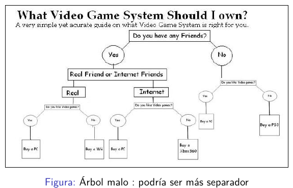

**Главный недостаток (минус) одиночного дерева решений:** высокая нестабильность и **сильная склонность к переобучению (*overfitting*)** — слишком глубокое дерево идеально подгоняется под обучающую выборку, но плохо обобщает на новых данных.

**Основные вопросы при построении дерева:**
1. Как выбрать признак для разбиения (*feature de división / split*)?
2. Как обрабатывать непрерывные признаки (*features continuos*)?
3. Как определить оптимальный размер дерева (*tamaño del árbol*)?

Ответы определяются конкретным алгоритмом построения, среди которых основными являются **CART** (*Classification and Regression Trees*) и **CHAID** (*Chi-square Automatic Interaction Detection*). Для выбора наилучшего разбиения в узле обычно используют два критерия:

1. **Критерий Джини (*Criterio de Gini*):**
   Принцип — выбрать признак и порог, которые наилучшим образом отделяют наиболее представленный (или доминирующие) классы от остальных, минимизируя неоднородность (*impureza*) дочерних узлов.

   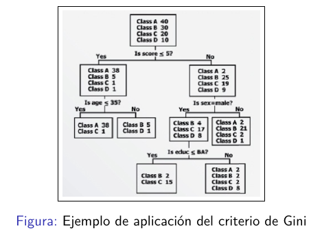

2. **Критерий энтропии и прироста информации (*Criterio de entropía / Ganancia de información*):**
   Для набора данных $S$ с двумя классами $\{+, -\}$, где $p_+$ — доля положительных объектов, а $p_-$ — доля отрицательных объектов, **энтропия** определяется как:
   $$\text{Entropía}(S) = -p_+ \log p_+ - p_- \log p_-.$$
   Если проверка признака $R$ разбивает узел $S$ на множество дочерних узлов $H$, то **прирост информации (*Ganancia de información*)** равен:
   $$\text{Ganancia}(S, R) = \text{Entropía}(S) - \sum_{h \in H} \frac{|S_h|}{|S|} \text{Entropía}(S_h).$$
   Выбирается признак, обеспечивающий максимальный прирост информации (максимальное снижение энтропии), как в классическом примере *PlayTennis* (`Humidity` против `Wind` при корне $S: [9+, 5-]$, $E = 0.940$).

   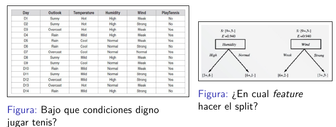

### 6.2. Случайные леса — алгоритм и свойства

Алгоритм **Random Forests** (случайные леса) был предложен Лео Брейманом в **2001 году** (*L. Breiman, 2001*). Основная идея: вместо одного склонного к переобучению дерева сгенерировать большое число ($B$ или $N$) разнообразных деревьев, обучить их и объединить их выходы с помощью голосования (классификация) или усреднения (регрессия).

> [!important] Главная формула Random Forests
> Случайный лес добавляет к бэггингу второй источник случайности — случайный отбор признаков в узлах:
> $$\text{RF} = \text{Tree Bagging} + \text{Feature Sampling}$$

Два уровня случайности при построении каждого дерева $b \in \{1, \dots, B\}$:
1. **Бэггинг деревьев (*Tree Bagging*):**
   Из исходной обучающей выборки $(X, Y)$ случайным образом **с возвращением** (*al azar y con reposición*) извлекается бутстрэп-выборка $(X_b, Y_b)$, на которой обучается $b$-е дерево. Это снижает переобучение.

   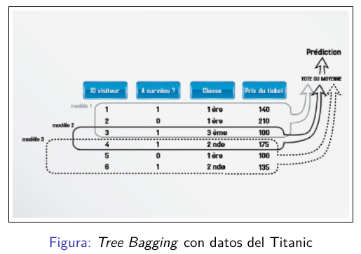

2. **Случайный отбор признаков (*Feature Sampling*):**
   Из общего числа $n$ признаков (*features*) каждое дерево или каждый узел при поиске разбиения имеет доступ лишь к случайному подмножеству из $m$ признаков — типично:
   $$m \approx \sqrt{n}$$
   (в реализации `scikit-learn` параметр `max_features='auto'` / `'sqrt'`, в R `randomForest` параметр `mtry = floor(sqrt(p))` для классификации).
   Это **декоррелирует деревья** между собой, уменьшая коэффициент парной корреляции $\rho$ (если бы в данных был один очень сильный признак, без *feature sampling* почти все деревья ставили бы его в корень и были бы сильно скоррелированы).

**Ключевые гиперпараметры** (на примере сигнатуры `sklearn.ensemble.RandomForestClassifier`):
- `n_estimators` ($B$) — число деревьев в лесу;
- `criterion` — критерий качества разбиения (`'gini'` или `'entropy'`);
- `max_depth`, `min_samples_split`, `min_samples_leaf`, `max_leaf_nodes` — ограничения глубины и размеров узлов/листьев (критически важны при дисбалансе классов);
- `max_features` ($m$) — число признаков, рассматриваемых при каждом разбиении;
- `bootstrap=True`, `oob_score=False` — использование бутстрэпа и подсчёт ошибки *Out-Of-Bag*;
- `n_jobs` — число потоков для параллельного построения деревьев.

### 6.3. Теоретический анализ Random Forests, ошибка OOB и важность признаков

#### 1. Что минимизируется при разбиении и как уменьшается дисперсия леса?
- На уровне **отдельного дерева** в каждом узле минимизируется неоднородность (критерий **Джини** или **энтропия** / максимизируется прирост информации).
- На уровне **всего ансамбля**: если дисперсия одного дерева равна $\sigma^2$, то среднее $N$ (или $B$) **независимых** одинаково распределённых (i.i.d.) деревьев имело бы дисперсию $\frac{\sigma^2}{N}$. Однако деревья в лесу обучаются на пересекающихся выборках и не являются строго независимыми. Если средняя парная корреляция между деревьями равна $\rho$, то дисперсия случайного леса равна:
  $$V_{\text{forest}} = \rho \sigma^2 + (1 - \rho) \frac{\sigma^2}{B}.$$

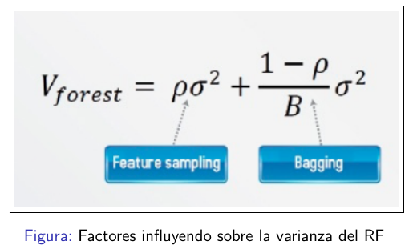

Эта формула объясняет роль обоих механизмов Random Forest:
- **Bagging** (увеличение числа деревьев $B$) уменьшает второе слагаемое $\frac{1 - \rho}{B} \sigma^2 \to 0$, но не может уменьшить первое слагаемое $\rho \sigma^2$.
- **Feature sampling** уменьшает **корреляцию $\rho$ между деревьями**, тем самым напрямую снижая предел дисперсии $\rho \sigma^2$!

#### 2. Ошибка вне мешка (OOB — *Out-Of-Bag Error*)
Поскольку каждое дерево обучается на бутстрэп-выборке с возвращением, примерно треть исходных наблюдений не попадает в выборку для данного дерева (является для него *out-of-bag*, OOB).
- Для каждого обучающего объекта $x_i$ можно получить предсказание, используя только те деревья леса, в обучении которых $x_i$ **не участвовал**.
- Сравнение этих OOB-предсказаний с истинными метками даёт несмещённую внутреннюю оценку ошибки обобщения — **OOB estimate of error rate** (например, в `randomForest` на языке R выводится автоматически вместе с матрицей ошибок по классам и общим вектором `err.rate` по мере роста числа деревьев).

#### 3. Важность признаков (*Variable Importance*)
Random Forest позволяет количественно оценить вклад каждого признака в качество классификации (см. [[#11.2. Случайный лес в пакете randomForest|практику в R]]):
- **MeanDecreaseGini** (среднее снижение индекса Джини): суммарное уменьшение неоднородности Джини, полученное благодаря разбиениям по данному признаку, усреднённое по всем деревьям леса. Чем больше значение (например, в задаче `iris`: `Petal.Width = 30.43` и `Petal.Length = 29.24` против `Sepal.Width = 1.32`), тем важнее признак для разделения классов.

#### 4. Запас (маржа) предсказаний (*Margin*) в Random Forest
В терминологии пакета `randomForest` (R):
> **Запас (*margin*)** для точки данных определяется как доля голосов, отданных за правильный класс, минус максимальная доля голосов, отданных за любой из остальных классов. Положительный запас означает верную классификацию, отрицательный — ошибку, а величина запаса отражает уверенность ансамбля.

### 6.4. Эффективность на классических задачах и резюме плюсов и минусов

На классических табличных задачах классификации (например, в `scikit-learn` или `randomForest` в R) Random Forest показывает исключительно высокую точность практически «из коробки» (*«Spoiler: muy exitoso»*).

**Резюме по Random Forests:**

| Плюсы (*Pros*) | Минусы (*Contra*) |
| :--- | :--- |
| • **Легко реализовать** (*Fácil de implementar*).<br>• **Отлично распараллеливается** (*Paralelizable*): деревья строятся независимо друг от друга.<br>• Устойчив к переобучению и шуму, даёт встроенную оценку OOB и важности признаков. | • **Неинтерпретируем** (*No interpretable*): «чёрный ящик» из сотен/тысяч деревьев.<br>• **Много гиперпараметров** для тонкой настройки (*Muchos parámetros para un reglaje fino*: `ntree`, `mtry`, `min_samples_split`, `min_samples_leaf`, `max_depth` и др.). |

### 6.5. Производные методы на основе деревьев

#### 1. Предельно случайные деревья (*Extremely Randomized Trees / Extra-Trees*)
Предложены Гертсом, Эрнстом и Вехенкелем (*Geurts P., Ernst D., Wehenkel L., 2005*).
- В обычных **Random Forests** для каждого дерева:
  - подвыборка данных (или набор признаков) — **случайна**;
  - выбор порога разбиения (*split*) внутри узла — **детерминирован** (ищется оптимальный порог по Джини/энтропии).
- В **Extra-Trees** сам выбор разбиения (*split*) **также становится случайным**: для каждого из случайно отобранных признаков генерируется несколько случайных порогов разбиения, и из них выбирается наилучшее разбиение. Это ещё сильнее снижает дисперсию (уменьшает $\rho$) и ускоряет обучение.

#### 2. Лес вращений (*Rotation Forest*)
Предложен Родригесом, Кунчевой и Алонсо (*Rodriguez J.J., Kuncheva L.I., Alonso C.J., 2006*).
Вместо простого отбора подмножества исходных признаков строит новые ортогональные проекции пространства признаков для каждого дерева, чтобы одновременно повысить и разнообразие, и точность индивидуальных деревьев:
1. Разбить пространство признаков на $K$ случайных подмножеств по $N_k$ переменных ($k \in \{1, \dots, K\}$).
2. На каждом подмножестве (обычно после отбора бутстрэп-подвыборки) выполнить **анализ главных компонент (PCA — *Análisis en Componentes Principales*)**.
3. Собрать полученные матрицы главных компонент всех $K$ блоков в единую разреженную **матрицу поворота** (*matriz de rotación*).
4. Обучить дерево решений на исходных данных, преобразованных (повёрнутых) с помощью этой новой матрицы.

---

## 7. Бустинг (Boosting) и AdaBoost

### 7.1. Общая идея бустинга и сравнение с бэггингом

**Бустинг (*Boosting*)** — это итеративный ансамблевый метод, объединяющий множество гипотез, сгенерированных **одним и тем же** алгоритмом обучения (*mismo algoritmo de aprendizaje*), но строящихся **последовательно (серийно)**, а не параллельно.

Если **Bagging** полагается на **нестабильные** базовые модели и обучает их независимо на бутстрэп-репликах с равным весом при голосовании, то **Boosting** (особенно полезный для **стабильных** или **слабых** моделей) принудительно формирует **взаимодополняющие модели** (*modelos complementarios*):
- каждому обучающему примеру назначается вес;
- на каждой новой итерации обучающий алгоритм концентрируется на тех примерах, которые были **неверно классифицированы предыдущими моделями** (*instancias mal clasificadas por los anteriores*);
- каждой построенной гипотезе назначается индивидуальный вес согласно её качеству (*según su calidad*);
- итоговое решение принимается **взвешенным голосованием** (*voto ponderado*).

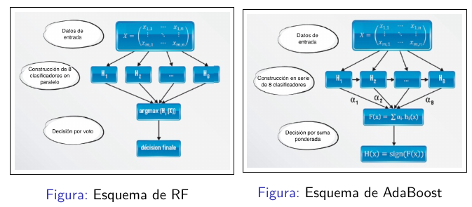

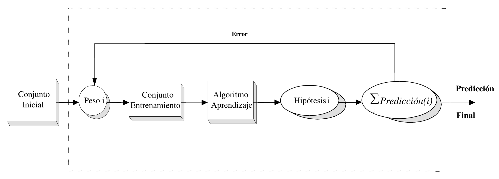

**Свойства и требования к базовым классификаторам:**
- **Базовый классификатор (*Clasificador base*):** модель, строящаяся на каждой итерации. Бустинг работает особенно хорошо, когда базовые классификаторы **простые (*simples*)**.
- **Гипотеза слабых классификаторов (*clasificadores débiles / weak learners*):** от базового классификатора $h_t$ **не требуется** строго минимизировать ошибку; достаточно, чтобы его ошибка $e_t$ была хотя бы немного лучше случайного угадывания:
  $$e_t < \frac{1}{2} - \gamma \quad (\text{для некоторого } \gamma > 0).$$
- **Парадигматический пример:** **бустинг решающих пней (*Boosting de stumps*)** — деревьев решений глубины 1 (одно условие разбиения). Даже из таких примитивных классификаторов бустинг строит мощнейший ансамбль.

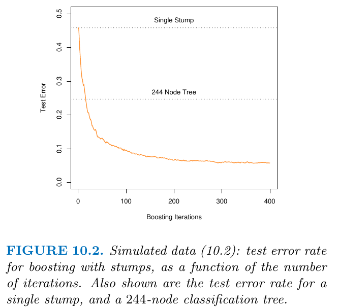

На графике (ESL Figure 10.2) видно, что один решающий пень (*Single Stump*) даёт ошибку на тесте $\approx 0.46$, одно сложное дерево из 244 узлов (*244 Node Tree*) — $\approx 0.25$, а бустинг решающих пней опускается ниже $0.25$ уже примерно к 20-й итерации и достигает $\approx 0.06$ к 300–400-й итерации.

### 7.2. Алгоритм AdaBoost и многоклассовые расширения

Наиболее известная и широко применяемая версия бустинга — **AdaBoost** (*Adaptive Boosting*, Freund & Schapire, 1996). В материалах курса представлены две эквивалентные по сути записи алгоритма: **бинарная экспоненциальная форма** (`boosting.pdf`) и **мультиклассовая форма AdaBoost.M1** (`Multiclasificadores.pdf`, `Ensambles.pdf`).

#### Вариант 1. Классический бинарный AdaBoost ($y_i \in \{-1, 1\}$)

Пусть дана обучающая выборка:
$$\tau_n = \{(x_1, y_1), \dots, (x_m, y_m)\}, \quad y_i \in \{-1, 1\}.$$
Задаются начальные веса для каждого наблюдения $i = 1, \dots, m$:
$$D_1(i) = \frac{1}{m}.$$
Величина $D_t$ на каждом шаге $t$ остаётся распределением вероятностей на $m$ наблюдениях ($\sum_{i=1}^m D_t(i) = 1$).

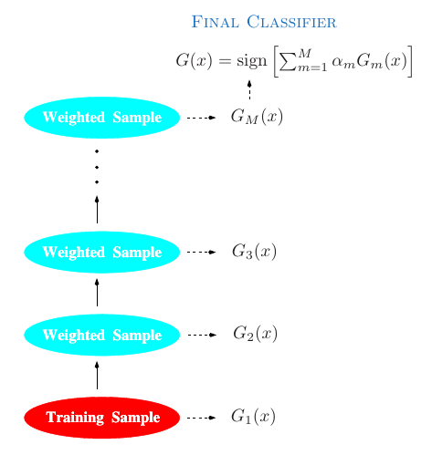

> [!important] Алгоритм AdaBoost (бинарная форма)
> Для каждого раунда $t = 1, \dots, T$:
> 1. Построить базовый классификатор $h_t(x) \in \{-1, 1\}$ на выборке с распределением весов $D_t$, минимизирующий взвешенную ошибку:
>    $$e_t = \sum_{i=1}^{m} D_t(i)\, I(y_i \neq h_t(x_i)).$$
> 2. Вычислить вес гипотезы $\alpha_t$ (где $\log$ — натуральный логарифм $\ln$):
>    $$\alpha_t = \frac{1}{2} \ln\left(\frac{1 - e_t}{e_t}\right).$$
> 3. Обновить веса объектов:
>    $$D_{t+1}(i) = \frac{D_t(i) \exp\big(-\alpha_t\, y_i\, h_t(x_i)\big)}{Z_t},$$
>    где нормировочный множитель равен:
>    $$Z_t = \sum_{i=1}^{m} D_t(i) \exp\big(-\alpha_t\, y_i\, h_t(x_i)\big).$$
>    *(Примечание: на слайде 4 презентации `boosting.pdf` в знаменателе ошибочно пропущен множитель $\exp(-\alpha_t y_i h_t(x_i))$ в определении $Z_t$; корректная нормировка именно такая, что подтверждается и таблицей расчётов в слайде 10.)*
>
> **Итоговый классификатор:**
> $$H(x) = \operatorname{sign}\left(\sum_{t=1}^{T} \alpha_t h_t(x)\right).$$

**Теоретические замечания по бинарному AdaBoost:**
- Если случайно выбрать пример согласно распределению $D_t$, вероятность ошибки $h_t$ равна $e_t$ (ошибка измеряется относительно того же распределения $D_t$, на котором обучалась $h_t$).
- При $e_t < \frac{1}{2}$ имеем $\alpha_t > 0$, и вес $\alpha_t$ тем больше, чем меньше ошибка $e_t$.
- Если вычислить взвешенную ошибку гипотезы $h_t$ относительно **нового** распределения $D_{t+1}$, она в точности равна $\frac{1}{2}$ (следующий классификатор вынужден искать новую закономерность).
- **Ошибка обучения** $\widehat{\mathrm{err}}(H)$ (доля неверно классифицированных объектов без взвешивания) убывает **экспоненциально** с ростом числа комбинируемых слабых классификаторов $T$.
- При этом сама по себе малая ошибка обучения ещё не гарантирует малую ошибку обобщения (*error de generalización*): истинная ошибка снижается, если базовые классификаторы не слишком сложны и их ошибки не растут слишком быстро.

#### Вариант 2. Алгоритм AdaBoost.M1 (многоклассовое расширение)

Алгоритм **AdaBoost.M1** работает при **любом числе классов** и требует, чтобы базовый алгоритм либо сам умел принимать веса примеров (*ejemplos ponderados*), либо использовал отбор с возвращением пропорционально весам (*muestreo con reemplazo según pesos*).

> [!important] Алгоритм AdaBoost.M1 (обучение и классификация)
> **Генерация моделей:**
> 1. Всем $m$ объектам обучающей выборки назначается одинаковый начальный вес $P_i \leftarrow \frac{1}{m}$ (или равный вес $p$).
> 2. Для каждой итерации $t = 1, \dots, T$:
>    - Обучить модель $m_t$ на взвешенной обучающей выборке.
>    - Вычислить взвешенную ошибку ресубституции (*error de resubstitución*) $e$: сумму весов ошибочно классифицированных объектов, нормированную на сумму весов всех объектов ($0 \le e \le 1$).
>    - **Критерий останова:** если $e = 0$ или $e \ge 0.5$ — **прекратить генерацию моделей**! *(В отличие от Bagging с фиксированным числом шагов, AdaBoost останавливается при достижении идеальной точности или вырождении модели в случайную).*
>    - Обновить веса **верно** классифицированных объектов:
>      $$P_i \leftarrow P_i \cdot \frac{e}{1 - e}$$
>      *(в результате доля веса ошибочных примеров относительно верных возрастает)*.
>    - Нормировать веса всех объектов так, чтобы их сумма равнялась 1.
>
> **Классификация нового объекта $x$:**
> 1. Для каждого класса $c$ инициализировать суммарный вес $W_c = 0$.
> 2. Для каждой сохранённой модели $t$ (с ошибкой $e_t$): прибавить к весу предсказанного ей класса $c = m_t(x)$ величину:
>    $$-\ln\left[\frac{e_t}{1 - e_t}\right] = \ln\left(\frac{1 - e_t}{e_t}\right).$$
> 3. Вернуть класс с наибольшим суммарным весом $W_c$.

**Связь двух записей:** при $\beta_t = \frac{e_t}{1 - e_t}$ умножение весов верных примеров на $\beta_t$ после нормировки математически эквивалентно умножению на $e^{-\alpha_t}$ (и увеличению весов неверных в $e^{+\alpha_t}$ раз), поскольку $\alpha_t = \frac{1}{2}\ln\frac{1 - e_t}{e_t} = \frac{1}{2}\ln\frac{1}{\beta_t}$, а вес голоса в `AdaBoost.M1` равен $2\alpha_t = \ln\frac{1 - e_t}{e_t}$ (умножение всех весов гипотез на константу $2$ не меняет знак суммы и победителя голосования).

### 7.3. Подробный числовой пример работы AdaBoost

Рассмотрим классический игрушечный пример (*tiny toy problem*, Schapire & Freund, гл. 1, рис. 1.1–1.2, табл. 1.1) для $m = 10$ примеров на двумерной плоскости и $T = 3$ раундов бустинга. В качестве слабых классификаторов выступают **решающие пни** (вертикальные и горизонтальные разделяющие прямые).

**Состав 10 примеров:**
- **5 положительных (`+`, $y_i = +1$):** `#1`, `#2`, `#3` (верхняя часть), `#5` (середина слева), `#8` (низ слева).
- **5 отрицательных (`-`, $y_i = -1$):** `#4` (правый верхний угол), `#6`, `#7` (центр), `#9` (низ левее центра), `#10` (низ справа).

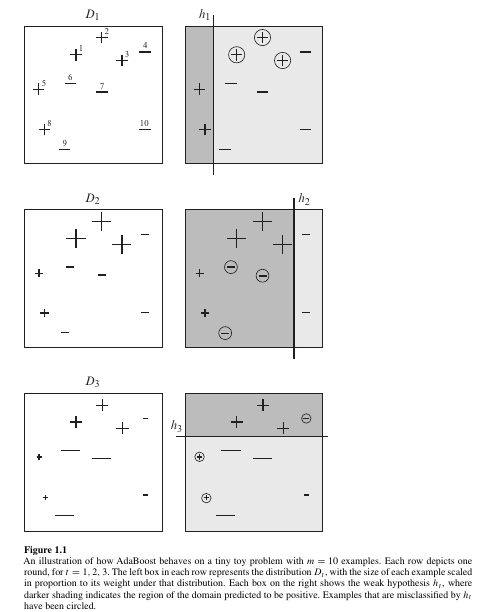

#### Ход вычислений по раундам (Table 1.1)

| Величина | #1 (`+`) | #2 (`+`) | #3 (`+`) | #4 (`-`) | #5 (`+`) | #6 (`-`) | #7 (`-`) | #8 (`+`) | #9 (`-`) | #10 (`-`) | Итоги раунда |
| :--- | :---: | :---: | :---: | :---: | :---: | :---: | :---: | :---: | :---: | :---: | :--- |
| **Раунд 1** | | | | | | | | | | | |
| $D_1(i)$ | **<u>0.10</u>** | **<u>0.10</u>** | **<u>0.10</u>** | 0.10 | 0.10 | 0.10 | 0.10 | 0.10 | 0.10 | 0.10 | $\epsilon_1 = 0.30,\ \alpha_1 \approx 0.42$ |
| $e^{-\alpha_1 y_i h_1(x_i)}$ | 1.53 | 1.53 | 1.53 | 0.65 | 0.65 | 0.65 | 0.65 | 0.65 | 0.65 | 0.65 | |
| $D_1(i) e^{-\alpha_1 y_i h_1(x_i)}$ | 0.15 | 0.15 | 0.15 | 0.07 | 0.07 | 0.07 | 0.07 | 0.07 | 0.07 | 0.07 | $Z_1 \approx 0.92$ |
| **Раунд 2** | | | | | | | | | | | |
| $D_2(i)$ | 0.17 | 0.17 | 0.17 | 0.07 | 0.07 | **<u>0.07</u>** | **<u>0.07</u>** | 0.07 | **<u>0.07</u>** | 0.07 | $\epsilon_2 \approx 0.21,\ \alpha_2 \approx 0.65$ |
| $e^{-\alpha_2 y_i h_2(x_i)}$ | 0.52 | 0.52 | 0.52 | 0.52 | 0.52 | 1.91 | 1.91 | 0.52 | 1.91 | 0.52 | |
| $D_2(i) e^{-\alpha_2 y_i h_2(x_i)}$ | 0.09 | 0.09 | 0.09 | 0.04 | 0.04 | 0.14 | 0.14 | 0.04 | 0.14 | 0.04 | $Z_2 \approx 0.82$ |
| **Раунд 3** | | | | | | | | | | | |
| $D_3(i)$ | 0.11 | 0.11 | 0.11 | **<u>0.05</u>** | **<u>0.05</u>** | 0.17 | 0.17 | **<u>0.05</u>** | 0.17 | 0.05 | $\epsilon_3 \approx 0.14,\ \alpha_3 \approx 0.92$ |
| $e^{-\alpha_3 y_i h_3(x_i)}$ | 0.40 | 0.40 | 0.40 | 2.52 | 2.52 | 0.40 | 0.40 | 2.52 | 0.40 | 0.40 | |
| $D_3(i) e^{-\alpha_3 y_i h_3(x_i)}$ | 0.04 | 0.04 | 0.04 | 0.11 | 0.11 | 0.07 | 0.07 | 0.11 | 0.07 | 0.02 | $Z_3 \approx 0.69$ |

*(Подчёркнутые значения в строках $D_t(i)$ отмечают примеры, на которых $h_t$ ошиблась.)*

**Пояснение по раундам:**
1. **Раунд $t = 1$:** все веса равны $D_1(i) = 0.10$. Гипотеза $h_1$ — левая вертикальная прямая (`+` слева, `-` справа). Ошибки на 3 точках: **`#1, #2, #3`**.
   - $\epsilon_1 = 0.10 + 0.10 + 0.10 = 0.30$;
   - $\alpha_1 = \frac{1}{2} \ln\left(\frac{1 - 0.30}{0.30}\right) = \frac{1}{2}\ln\left(\frac{7}{3}\right) \approx 0.42$;
   - $e^{\alpha_1} \approx 1.53$, $e^{-\alpha_1} \approx 0.65$; сумма ненормированных весов $Z_1 \approx 0.92$. После деления на $Z_1$ веса `#1, #2, #3` выросли до $0.17$, а веса остальных снизились до $0.07$.
2. **Раунд $t = 2$:** чтобы не ошибиться на «тяжёлых» примерах `#1, #2, #3`, гипотеза $h_2$ проводит правую вертикальную прямую (`+` слева, `-` справа). Ошибки на 3 точках: **`#6, #7, #9`**.
   - $\epsilon_2 = 0.07 + 0.07 + 0.07 \approx 0.21$;
   - $\alpha_2 = \frac{1}{2}\ln\left(\frac{1 - 0.21}{0.21}\right) \approx 0.65$;
   - $Z_2 \approx 0.82$. Теперь веса `#6, #7, #9` вырастают до $0.17$.
3. **Раунд $t = 3$:** гипотеза $h_3$ проводит горизонтальную прямую сверху (`+` выше, `-` ниже). Ошибки на 3 точках: **`#4, #5, #8`**.
   - $\epsilon_3 = 0.05 + 0.05 + 0.05 \approx 0.14$;
   - $\alpha_3 = \frac{1}{2}\ln\left(\frac{1 - 0.14}{0.14}\right) \approx 0.92$;
   - $Z_3 \approx 0.69$.

#### Итоговый комбинированный классификатор

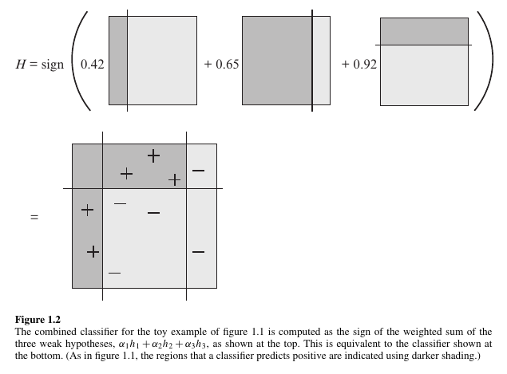

Итоговое правило имеет вид:
$$H(x) = \operatorname{sign}\big(0.42\, h_1(x) + 0.65\, h_2(x) + 0.92\, h_3(x)\big).$$
Оно разбивает плоскость на прямоугольные ячейки и **безошибочно классифицирует все 10 обучающих примеров**. Например, для отрицательного примера **`#4`** в правом верхнем углу ($h_1(x_4) = -1$, $h_2(x_4) = -1$, $h_3(x_4) = +1$):
$$H(x_4) = \operatorname{sign}(-\alpha_1 - \alpha_2 + \alpha_3) = \operatorname{sign}(-0.42 - 0.65 + 0.92) = \operatorname{sign}(-0.15) = -1.$$

Аналогичная интуитивная геометрическая иллюстрация 2D-бустинга приведена и в `RF_presentation.pdf`: последовательность трёх осе-параллельных линейных классификаторов $H_1, H_2, H_3$ переносит внимание на ошибочные области и формирует ступенчатую разделяющую границу $H = \sum \alpha_i h_i$:

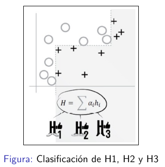

### 7.4. Переобучение, непереобучение и теория маржи

Несмотря на теоретическую привлекательность, поведение AdaBoost на тестовой выборке зависит от данных и сложности базовых моделей.

#### 1. Случай переобучения (*Overfitting*) — данные сердечных заболеваний
На датасете о заболеваниях сердца (*heart-disease dataset*, Schapire & Freund, табл. 1.2 и рис. 1.5) бустинг строился на решающих пнях. Первые 6 базовых классификаторов:

| Раунд | Условие (`If`) | При истинности (`Then`) | Иначе (`Else`) |
| :---: | :--- | :--- | :--- |
| **1** | `thalamus normal` | `healthy` | `sick` |
| **2** | `number of major vessels colored by fluoroscopy > 0` | `sick` | `healthy` |
| **3** | `chest pain type is asymptomatic` | `sick` | `healthy` |
| **4** | `ST depression induced by exercise relative to rest >= 0.75` | `sick` | `healthy` |
| **5** | `cholesterol >= 228.5` | `sick` | `healthy` |
| **6** | `resting electrocardiographic results are normal` | `healthy` | `sick` |

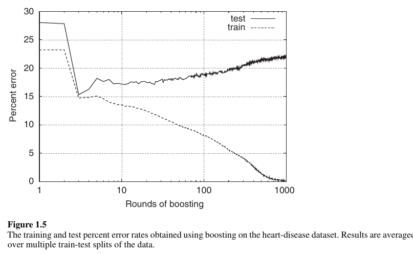

На Figure 1.5 видно, что ошибка обучения (`train`) монотонно падает почти до $0\%$, тогда как ошибка на тесте (`test`) снижается примерно до $\sim 15\%$ к 3-му раунду, а затем начинает **расти** (доходя до $\sim 18.8\%$ к сотне раундов и $\sim 22.0\%$ к 1000 раундов). Это классический пример **переобучения** (*overfitting*), согласующийся с «бритвой Оккама» (*Occam's razor*): избыточный рост сложности ансамбля приводит к подгонке под шум.

#### 2. Случай отсутствия переобучения (*Non Overfitting*) — задача OCR с C4.5
На задаче оптического распознавания символов (*OCR*) с деревьями решений **C4.5** в качестве базовых классификаторов (рис. 1.7) наблюдается противоположный эффект:

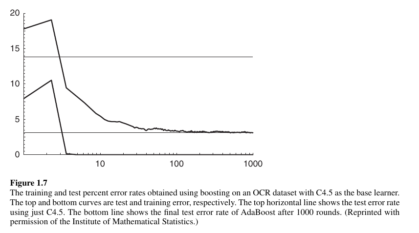

- Ошибка одного дерева C4.5 на тесте составляет $\approx 13.8\%$.
- Ошибка обучения (`training error`) падает до $0\%$ уже к 4–5-му раунду.
- Однако **ошибка на тесте (`test error`) продолжает падать и после обнуления ошибки на обучении**, стабилизируясь около $\approx 3.1\%$ даже после **1000 раундов** без малейшего ухудшения!

#### 3. Маржинальная теория бустинга (*Teoría marginal del boosting*)
> [!important] Объяснение через отступ (маржу / уверенность)
> Парадокс устойчивости к переобучению при росте числа деревьев с 5 до 1000 объясняется **маржинальной теорией бустинга**: для качества обобщения важен не только сам факт безошибочной классификации на обучении, но и **уверенность (*confianza* / отступ, *margin*)** в классификации.
>
> Уверенность (маржа) для обучающего примера $(x_t, y_t)$ измеряется величиной:
> $$y_t\, f(x_t) \in (-1, 1),$$
> где
> $$f(x) = \sum_{t=1}^{T} \alpha_t h_t(x),$$
> а веса $\alpha_t$ нормированы так, чтобы $\sum_{t=1}^{T} \alpha_t = 1$.
>
> Даже когда ошибка обучения уже равна нулю (знаки верны для всех примеров), добавление новых раундов бустинга продолжает **увеличивать уверенность (маржу) $y_t f(x_t)$**, отодвигая разделяющую границу от обучающих точек и тем самым снижая ошибку на тесте.

### 7.5. Градиентный бустинг (Gradient Boosting)

Идея **градиентного бустинга** (*Gradient Boosting*) формулируется как обобщение идеи AdaBoost на оптимизацию произвольной дифференцируемой функции потерь методом градиентного спуска в пространстве функций:
$$\text{Gradient Boosting} = \text{AdaBoost} + \text{Gradient Descent}.$$

**Математическая постановка:**
Минимизируется суммарная функция потерь (*función de costo*):
$$J(h) = \sum_{i=1}^{n} j\big(y_i, H(x_i)\big),$$
где итоговый ансамбль является аддитивной суммой $K$ базовых функций (обычно деревьев):
$$H = H_K = \sum_{k=1}^{K} h_k.$$

**Принцип последовательной подгонки:**
На каждом шаге новая базовая модель $h_k$ обучается приближать то, что «осталось» (ошибку / остаток / антиградиент потерь) после предыдущего приближения.
- Начав с $H = h_1$, для второго шага требуется:
  $$\forall i \in \{1, \dots, m\}: \quad h_2(x_i) \approx H(x_i) - y_i \quad (\text{в нотации кода: } \texttt{h2.fit(X, y - H)}).$$
- В общем виде выполняется шаг градиентного спуска по предсказаниям модели:
  $$H(x_i) := H(x_i) - \frac{\partial J}{\partial H(x_i)}, \quad \forall i \in \{1, \dots, m\}.$$

---

## 8. Другие ансамблевые методы и решения их проблем

### 8.1. Метод случайных подпространств (Random Subspace Method)

**Метод случайных подпространств (*Método de Subespacios Aleatorios / Random Subspace Method, RSM*)** предложен Тин Кам Хо (*Tin Kam Ho, 1998*). Если бэггинг варьирует **строки** (примеры), то RSM варьирует **столбцы** (признаки).

Пусть дана выборка $X$ из $n$ примеров в $p$-мерном пространстве признаков: $X_i = (x_{i1}, x_{i2}, \dots, x_{ip})$.
1. Для каждого $b = 1, 2, \dots, B$:
   - случайным образом выбирается $r$-мерное подпространство признаков $\widetilde{X}_b$ ($r < p$) из исходного пространства $X$;
   - на $\widetilde{X}_b$ обучается классификатор $C_b$.
2. Решения всех $B$ классификаторов объединяются **мажоритарным голосованием**.

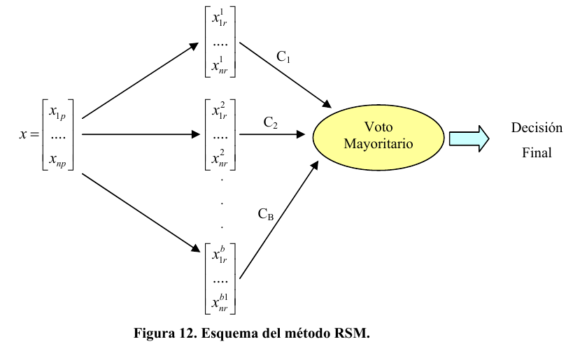

В классическом RSM базовыми классификаторами выступают **деревья решений**, а итоговый ансамбль образует лес (*Forest*). Решения $n_t$ деревьев комбинируются путём усреднения оценок апостериорных вероятностей классов в терминальных узлах. Если $v_j(x)$ — лист дерева $T_j$ ($j = 1, \dots, n_t$), в который попал объект $x$, то условная вероятность класса $c \in \{1, \dots, n_c\}$ равна доле примеров класса $c$ в этом узле:
$$\hat{P}(c \mid v_j(x)) = \frac{P(c, v_j(x))}{\sum_{k=1}^{n_c} P(c_k, v_j(x))}.$$
*(Примечание: при чистых листьях $\hat{P}(c \mid v_j(x))$ равна $1$ для класса листа и $0$ для остальных.)*
Дискриминантная функция для класса $c$:
$$g_c(x) = \frac{1}{n_t} \sum_{j=1}^{n_t} \hat{P}(c \mid v_j(x)).$$
Объект $x$ относится к классу $c$, максимизирующему $g_c(x)$ (для чистых листьев это совпадает с голосованием по относительному большинству).

**Преимущества и параметры:**
- RSM особенно эффективен в **многомерных пространствах с избыточными признаками**, поскольку не страдает от проклятия размерности.
- **Критические параметры:** число случайных подпространств $B$ (число классификаторов) и размерность подпространств $r$.

### 8.2. Кодирование выхода с исправлением ошибок (ECOC)

**ECOC (*Error-Correcting Output Coding / Codificación de la Salida de Corrección del Error*)** описан Диттеричем и Бакири (*Dietterich & Bakiri, 1995*). В отличие от Bagging/Boosting (манипулирующих обучающими примерами) и RSM (манипулирующего входными признаками), ECOC **манипулирует выходными метками классов**, сводя многоклассовую задачу с $K$ классами к набору из $m$ бинарных задач классификации.

**Принцип работы:**
- Строится бинарная кодовая матрица из $K$ строк (по одной на класс) и $m$ столбцов (каждый столбец $f_j$ задаёт разбиение всех $K$ классов на два мета-класса `0` и `1`, для которого обучается бинарный классификатор). Каждому классу соответствует $m$-битовое **кодовое слово (*codeword*)**.
- При предсказании нового объекта $x$ все $m$ бинарных классификаторов выдают вектор из $m$ битов. Итоговый класс выбирается по **минимальному расстоянию Хэмминга (*distancia de Hamming*)** до кодовых слов матрицы (что позволяет исправлять ошибки отдельных бинарных классификаторов) либо по мажоритарному голосованию совпавших битов.

**Четыре способа построения хороших кодов ECOC:**
1. Исчерпывающий перебор (*técnica exhaustiva*).
2. Отбор столбцов из исчерпывающего кода.
3. Рандомизированный алгоритм восхождения на холм (*hill-climbing*).
4. Коды БЧХ (*códigos BCH — Bose–Chaudhuri–Hocquenghem*).

**Пример (распознавание 10 цифр $\{0, \dots, 9\}$ по 6 бинарным признакам, Fig. 13):**
Бинарные классификаторы проверяют наличие вертикальной линии (`lv`), горизонтальной (`lh`), диагональной (`ld`), замкнутой кривой (`cc`), открытой левой кривой (`ci`) и открытой правой кривой (`cd`):

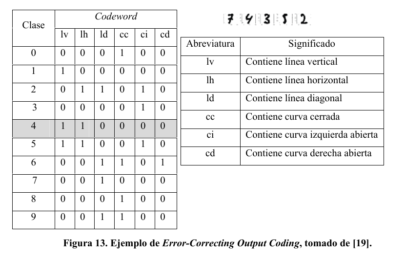

Если для новой цифры получено кодовое слово `110001`, то ближайшее к нему по расстоянию Хэмминга слово в таблице — `110000` (отличие в 1 бите, соответствует классу **`4`**), поэтому ансамбль возвращает класс `4`.

**Два обязательных свойства хорошего ECOC:**
1. **Разделение строк (*separación de las filas*):** достаточно большое расстояние Хэмминга между кодовыми словами любых двух классов (чтобы исправлять больше битовых ошибок).
2. **Разделение столбцов (*separación de las columnas*):** некоррелированность бинарных функций $f_i$ и $f_j$ (необходимо избегать как положительной, так и сильной отрицательной корреляции столбцов, т.е. их инверсий).

ECOC обеспечивает оценку уверенности классификации и слабо зависит от конкретного размера обучающей выборки и способа присвоения кодовых слов классам.

### 8.3. Комитеты кросс-валидации (Cross-Validated Committees)

**Комитеты перекрёстной проверки (*Comités de validación cruzada / Cross-Validated Committees, CVC*)** адаптируют схему $K$-блочной перекрёстной проверки (*cross-validation*) для формирования обучающих выборок ансамбля (Parmanto et al., 1996).

- Исходный набор данных $D$ разбивается на $K$ блоков $D_1, \dots, D_K$ (блоки не обязаны быть строго непересекающимися).
- Путём поочерёдного исключения блока $v_k$ формируются $K$ реплик $D_1^{-v_1}, \dots, D_K^{-v_k}$, на каждой из которых обучается свой классификатор (например, нейронная сеть).
- Оценка ошибки строится через индикатор $\Delta(X_i, c_i) = 1$, если $d(X_i) \neq c_i$, и $0$ иначе:
  $$R(d_k) = \frac{1}{|D_k|} \sum_{(X_i, c_i) \in D_k} \Delta(X_i, c_i), \qquad R^{cv}(d) = \frac{1}{K} \sum_{k=1}^K R(d_k).$$
- При большом $K$ размер обучающей реплики $|D - D_k| = N(1 - \frac{1}{K})$ близок к полному размеру выборки, что делает процедуру стабильной; предельный случай $K = N$ соответствует схеме *leave-one-out*.

**Алгоритм CVC:**
1. Разбить данные на $v$ фрагментов $d_1, \dots, d_v$.
2. Исключить фрагмент $d_k$ и обучить модель (сеть) $h_k$ на оставшихся данных $(D - d_k)$.
3. При необходимости использовать $d_k$ как валидационный набор для критерия останова обучения.
4. Объединить выходы всех $v$ моделей в комитет методом **простого среднего**.

Метод вычислительно трудоёмок, но **хорошо подходит для выборок малого размера**, где важно сохранить почти все объекты для обучения каждой модели.

### 8.4. Рандомизация (Randomization)

**Рандомизация (*Aleatorización / Randomization*)** вносит случайность непосредственно **внутрь стандартного алгоритма обучения** (при фиксированной выборке):
- **Случайная инициализация весов** в нейронных сетях при обучении методом обратного распространения ошибки (*back propagation*).
- **Инъекция шума в данные:** добавление искусственного шума снижает качество отдельного классификатора, но повышает разнообразие ансамбля; существует оптимальный уровень шума, повышающий итоговую точность ансамбля.
- **Случайный выбор признака при построении/обрезке деревьев решений:** в каждом узле дерева разбиение выбирается случайно среди $N$ лучших кандидатов (вместо строго лучшего).

### 8.5. Сравнительный анализ ансамблевых методов

По данным эмпирических сравнений из научной литературы (Bauer & Kohavi [4], Dietterich [17], Quinlan [54], Pal [58], Giacinto et al. [30]):
- На **чистых данных (без шума)** **Boosting** в большинстве экспериментов показывает наилучшую точность, превосходя Bagging и Randomization.
- На **зашумлённых данных** (ошибки в метках, пропуски) ситуация меняется на противоположную: **Bagging** становится лучшим (наиболее робастным), а **Boosting** — худшим (поскольку слишком агрессивно наращивает веса шумных выбросов).
- На задачах с деревьями решений в ряде исследований **RSM (Forest)** демонстрировал наивысшую точность и обучался значительно быстрее, чем Bagging и Boosting.

**Сводная таблица различий методов ансамблирования (Cuadro 2 из отчёта `Ensambles.pdf`):**

| Метод | Способ манипуляции | Данные без шума | Данные с шумом |
| :--- | :--- | :---: | :---: |
| **Boosting** | Веса / распределение обучающих примеров | **1-е место** (лучший) | **3-е место** (худший) |
| **Bagging** | Бутстрэп-подвыборки обучающих примеров | **2-е место** | **1-е место** (лучший) |
| **Randomization** | Внесение случайности в алгоритм обучения | **3-е место** | **2-е место** |
| **Forest (RSM)** | Случайные подпространства входных атрибутов | — | — |
| **Cross-Validated Committees** | Исключение блоков обучающих примеров | — | — |
| **ECOC** | Кодирование выходных меток классов | — | — |

### 8.6. Решения практических проблем ансамблей

Главные практические проблемы ансамблей — высокие затраты ресурсов при обучении, необходимость хранить сотни моделей, медленный отклик при инференсе и потеря интерпретируемости. В отчёте `Ensambles.pdf` описаны три решения этих проблем:

#### 1. Обрезка (прунинг) деревьев решений в AdaBoost (*Poda de árboles de decisión con AdaBoost*)
Предложена Margineantu & Dietterich [56] с учётом ограничений на память. Показывает, что ансамбль AdaBoost можно радикально сократить на **60–80%** без потери точности предсказания. Наиболее успешные стратегии:
- **обрезка по Каппе (*Poda de Kappa*)** — отбор подмножества деревьев, максимизирующего точность и разнообразие по статистике Каппа;
- **обрезка со снижением ошибки (*Poda por Reducción del Error*)** — жадный отбор деревьев, последовательно уменьшающих ошибку ансамбля на валидации.

#### 2. Минибустинг (*Miniboosting*)
Предложен Quinlan [61] для построения сверхкомпактных ансамблей всего из **3 деревьев решений** ($C_1, C_2, C_3$; ансамбль $C_B$). Вместо взвешенного голосования AdaBoost используются равные веса (как в Bagging); в многоклассовых задачах, если все три дерева выдают разные ответы, приоритет отдаётся первому дереву $C_1$.
Ансамбль $C_B$ ошибается тогда, когда ошибаются как минимум 2 из 3 деревьев:
$$P(e_B) \le P(e_1 e_2 \bar{e}_3) + P(e_1 \bar{e}_2 e_3) + P(\bar{e}_1 e_2 e_3) + P(e_1 e_2 e_3),$$
где при предположении независимости, например, $P(e_1 e_2 \bar{e}_3) = P(e_1) \times P(e_2) \times (1 - P(e_3))$.
Чтобы минимизировать пересечение ошибок при обучении третьего дерева $C_3$:
- **обнуляются веса** тех примеров, на которых ошиблись **одновременно** $C_1$ и $C_2$ (поведение $C_3$ всё равно не изменит итог голосования двух уже ошибшихся моделей);
- **увеличиваются веса** тех примеров, на которых ошиблось **либо** $C_1$, **либо** $C_2$ (но не оба сразу).

#### 3. Делегирование классификаторов (*Delegación de clasificadores*)
Предложено Ferri, Flach & Hernández-Orallo [24] под девизом *«заставь других делать то, что сам не можешь сделать хорошо»*. Использует понятие **«осторожного классификатора» (*clasificador prudente*)**: первый классификатор $f^{(1)}$ самостоятельно размечает только те примеры, в которых высоко уверен, а остальные **делегирует** второму классификатору $f^{(2)}$ при пороге уверенности $\tau$:
$$\text{IF } f_{\text{CONF}}^{(1)}(e) > \tau \text{ THEN PREDICC } f_{\text{CLASS}}^{(1)}(e) \text{ ELSE PREDICC } f_{\text{CLASS}}^{(2)}(e).$$

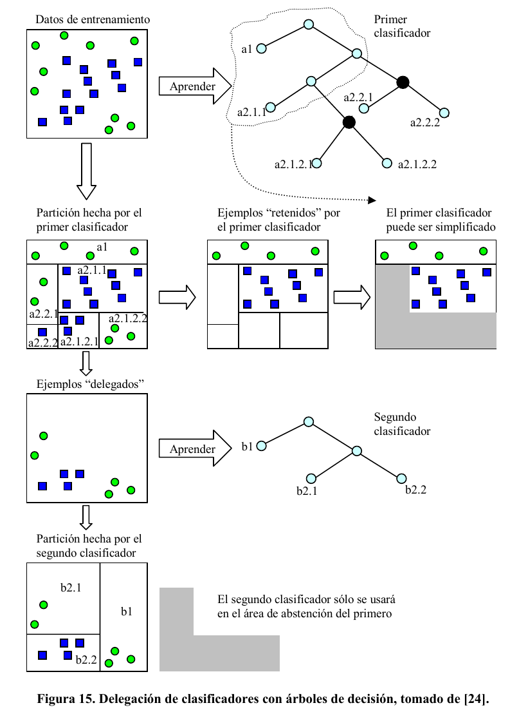

Обучающая выборка $Tr$ делится на множество «удержанных» примеров высокой уверенности $Tr_f^> = \{e \in Tr : f_{\text{CONF}}(e) > \tau\}$ и множество «делегированных» примеров $Tr_f^\le = Tr - Tr_f^>$. Следующий классификатор $f^{(2)}$ обучается **только на $Tr_f^\le$** и применяется только в области воздержания первого классификатора (порог $\tau$ подбирается по заданной доле $\rho$ методом *Глобального абсолютного процента*).
- **Преимущества:** каждый объект классифицируется **только одним** классификатором (не теряется интерпретируемость!) и каждый последующий классификатор обучается на всё меньшем наборе данных (высокая скорость).

---

## 9. Гибридные методы — Стекинг и Каскадирование

В отличие от однородных ансамблей (Bagging, Boosting), **гибридные методы (*métodos híbridos*)** комбинируют классификаторы **разного типа** (*distinto tipo*, разные алгоритмы обучения) и заменяют простое или взвешенное голосование обучаемым комбинированием.

### 9.1. Метод стекинга (Stacking)

**Стекинг**, или метод накопления (*Stacking / Stacked Generalization / Método de Acumulación*), предложен Дэвидом Волпертом (*David Wolpert, 1992*). Он вводит концепцию **мета-обучения (*meta-aprendizaje*)** вместо механизма голосования:
- **Уровень 0 (*Nivel 0*, базовый уровень):** несколько разнородных алгоритмов обучения $L_1, \dots, L_N$ (например, дерево решений, нейронная сеть, SVM) обучаются на исходной выборке $S = \{(x_i, y_i)\}$, формируя базовые модели $C_1, \dots, C_N$, работающие параллельно.
- **Уровень 1 (*Nivel 1*, мета-уровень):** **мета-алгоритм обучения (*meta-aprendiz*)** обучается выдавать итоговое предсказание, принимая в качестве входных признаков предсказания моделей уровня 0.

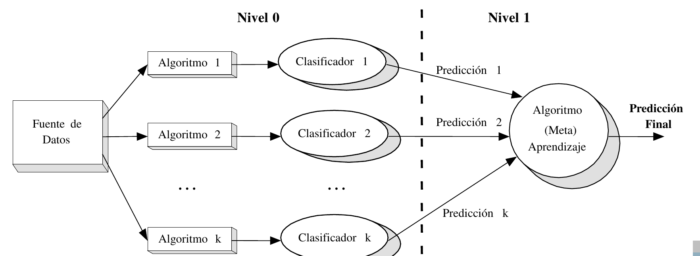

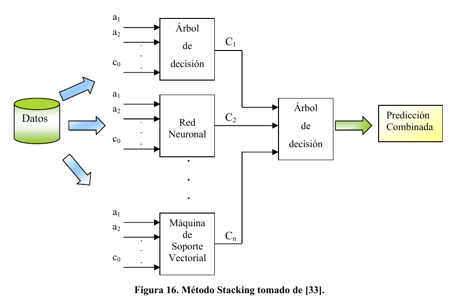

#### Как правильно обучать Stacking (проблема утечки данных)?
> [!warning] Критическое правило обучения Stacking
> **Нельзя** напрямую обучать мета-модель уровня 1 на предсказаниях базовых моделей уровня 0, полученных на той же обучающей выборке, на которой они обучались! Переобученные базовые модели (например, деревья) дадут на своих обучающих данных почти идеальные ответы, и мета-модель не научится адекватно их комбинировать на новых данных.

Два корректных способа формирования обучающего набора для уровня 1:
1. **Разбиение выборки (Hold-out):** выделить отдельные непересекающиеся части данных для обучения моделей уровня 0, для обучения мета-модели уровня 1 и для итогового тестирования. *Минус:* уменьшается объём данных для обучения каждого уровня.
2. **Стандартный метод — внутренняя перекрёстная проверка (*validación cruzada interna*) или *leave-one-out*:**
   - Данные разбиваются на $k$ фолдов (например, 5-блочная кросс-валидация: $F_1, F_2, F_3, F_4, F_5$).
   - На каждом шаге модели уровня 0 обучаются на $k - 1$ фолдах и делают предсказания для оставшегося тестового фолда $F_j$.
   - Полученные предсказания $D_{1,j}, D_{2,j}, \dots$ вместе с истинным классом $C_j$ дописываются в таблицу мета-данных уровня 1.
   - После прохода по всем фолдам **все** обучающие примеры используются для обучения мета-модели уровня 1, а сами базовые модели уровня 0 затем дообучаются на полном наборе данных.

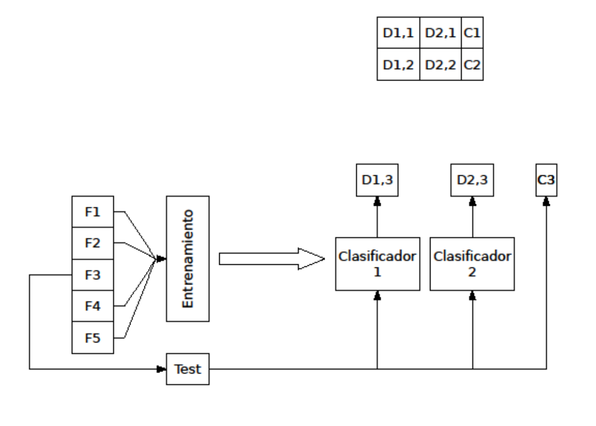

#### Практические рекомендации и особенности Stacking
- **Какие алгоритмы выбирать для Уровня 0 и Уровня 1?**
  - **Уровень 0:** любые достаточно разнообразные классификаторы (*cualquiera*).
  - **Уровень 1:** по рекомендации Д. Волперта — **«глобальные, гладкие» модели (*modelos «globales, suaves»*)**. Базовые модели уровня 0 выполняют основную сложную работу, а уровень 1 выступает в роли простого **арбитра (*árbitro*)**, что снижает риск переобучения. Подходящие модели уровня 1: линейные модели, перцептрон, деревья с линейными моделями в листьях, *Naive Bayes*, линейный SVM, а также **многооткликовая линейная регрессия (RLM — *regresión lineal multi-respuesta*)** (для $m$ классов строится $m$ линейных регрессий на бинарные индикаторы классов, и выбирается класс с наибольшим значением).
- **Использование распределений вероятностей (DP):** вместо одних только жёстких меток классов базовые модели обычно передают на мета-уровень **вектор распределения вероятностей** по всем $m$ классам (Ting & Witten [77]):
  $$p^C(x) = \big(p^C(c_1 \mid x),\ p^C(c_2 \mid x),\ \dots,\ p^C(c_m \mid x)\big).$$
  Это передаёт мета-классификатору информацию о **мере уверенности** (*medidas de certeza*) каждой базовой модели и заметно повышает точность.
- **Вариант с арбитром (*árbitro*):** для разрешения разногласий базовых моделей может обучаться отдельный классификатор-арбитр с правилом отбора спорных обучающих примеров и правилом арбитража (применять ответ арбитра, если среди базовых классификаторов нет большинства).
- **Ограничения:** Stacking менее популярен на практике, чем Boosting и Bagging, из-за сложности теоретического анализа («чёрный ящик», *caja negra*) и огромного числа возможных вариантов реализации.

### 9.2. Метод каскадирования (Cascading)

**Каскадное обобщение (*Cascade Generalization / Método en Cascada*)** предложено Гамой и Браздилом (*Gama & Brazdil, 2000*). В отличие от параллельного Stacking, **Cascading** применяет разнородные классификаторы **последовательно**, на каждом шаге **расширяя исходный набор признаков новыми атрибутами**, равными распределению вероятностей классов от предыдущего классификатора.

**Формальное описание:**
Пусть конструктивный оператор $\Phi(E, \mathrm{M})$ конкатенирует каждый исходный вектор $\vec{x}$ из набора $E$ с вектором распределения вероятностей классов, выданным моделью $\mathrm{M}$, добавляя $c$ новых числовых атрибутов ($c$ — число классов). Для обучающей выборки $E$, тестовой выборки $T$ и двух последовательных алгоритмов $L_1, L_2$:
$$\text{Entrenam.Nivel}_1 = \Phi\big(E,\ \mathrm{A}(L_1(E), E)\big),$$
$$\text{TestNivel}_1 = \Phi\big(T,\ \mathrm{A}(L_1(E), T)\big),$$
$$L_2 \nabla L_1 = \mathrm{A}\big(L_2(\text{Entrenam.Nivel}_1),\ \text{TestNivel}_1\big),$$
где символ $\nabla$ обозначает последовательную каскадную композицию ($L_2$ поверх $L_1$).

**Пример на наборе данных UCI Monks-2 (рис. 17):**
Задача классификации роботов (6 признаков, классы `OK` и `not_OK`; целевое правило: *«робот в порядке, если ровно 2 признака принимают свои первые значения»* — сложная нелинейная/симметричная зависимость):
- По отдельности (кросс-валидация): дерево решений `C4.5` даёт ошибку **32.9%**, `Naive Bayes` — **34.2%**.
- При каскаде $\text{C4.5} \nabla \text{NaiveBayes}$: `Naive Bayes` добавляет к исходным 6 признакам два новых непрерывных признака $P(\text{OK})$ и $P(\text{not\_OK})$ (`Nivel1`). Дерево `C4.5`, обученное на расширенных данных, снижает ошибку до **8.9%**!

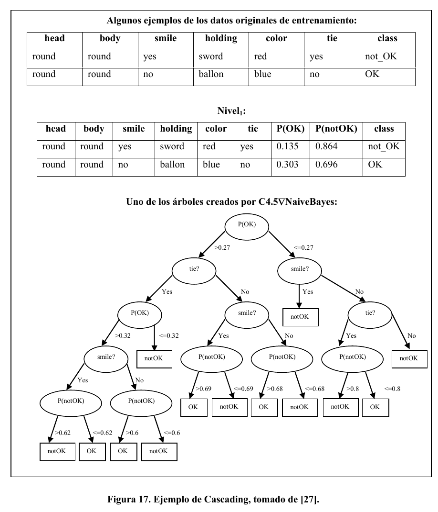

**Ключевые отличия Cascading от Stacking:**
1. Новые атрибуты всегда непрерывны (вероятности классов), сохраняя уверенность классификатора.
2. Каждый последующий классификатор сохраняет доступ ко **всем исходным признакам** наряду с добавленными (в Stacking мета-ученик обычно видит только выходы уровня 0).
3. Cascading не использует внутреннюю кросс-валидацию, что снижает вычислительные затраты.
4. Stacking является **параллельным** на базовом уровне, а Cascading — **последовательным**.

---

## 10. Неансамблевые мультиклассификаторы

### 10.1. Нейронные сети радиально-базисных функций (RBF)

**Нейронные сети с радиальными базисными функциями (*RNFBR / Radial Basis Function Networks, RBF*)** можно рассматривать как аддитивный метод, где каждая скрытая базисная функция формирует одну из локальных гипотез. Сеть имеет три слоя прямого распространения:

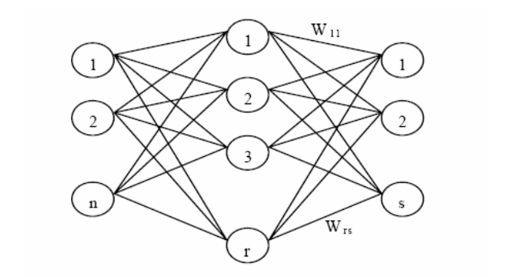

1. **Входной слой** ($n$ нейронов): просто передаёт $n$-мерный вектор признаков $x$.
2. **Скрытый слой** ($m$ радиальных базисных единиц): выполняет кластеризацию, снижение размерности и нелинейное преобразование по расстоянию от входа $x$ до центра прототипа $c_i$:
   $$R_i(x) = R_i\left(\frac{\|x - c_i\|}{\sigma_i}\right), \quad i = 1, 2, \dots, m,$$
   где $c_i$ — центр, $\sigma_i$ — ширина радиальной функции. Чаще всего используется **гауссова функция** (хотя применяются также мультиквадратичные, обратные мультиквадратичные и кубические функции):
   $$R_i(x) = \exp\left(-\frac{\|x - c_i\|^2}{\sigma_i^2}\right),$$
   где $\sigma_i^2$ соответствует диагональным элементам ковариационной матрицы.
3. **Выходной слой** ($r$ линейных нейронов): формирует линейную комбинацию выходов скрытого слоя:
   $$y_j(x) = \sum_{i=1}^m R_i(x) \cdot w_{ij}, \quad j = 1, \dots, r,$$
   где $w_{ij}$ — вес связи между $i$-м скрытым нейроном и $j$-м выходным узлом.

### 10.2. Иерархическая смесь экспертов (Hierarchical Mixture of Experts)

Метод **иерархической смеси экспертов (*Mezcla jerárquica de expertos / Hierarchical Mixture of Experts, HME*)** предложен Джорданом и Джейкобсом (*Jordan & Jacobs, 1994*) для задач обучения с учителем, когда данные естественно порождаются несколькими специализированными подмоделями (экспертами).

**Идея и пример:** например, задача распознавания слов делится на две подзадачи: различение пары *«bee» / «tree»* и пары *«gate» / «mate»*. В вероятностной трактовке (рис. 19) сначала задаётся вход $x_i$, затем стохастически (в зависимости от $x_i$) выбирается эксперт $e_i$, после чего (в зависимости от $x_i$ и $e_i$) генерируется класс $y_i$ (причинность обращена по сравнению с *Naive Bayes*).

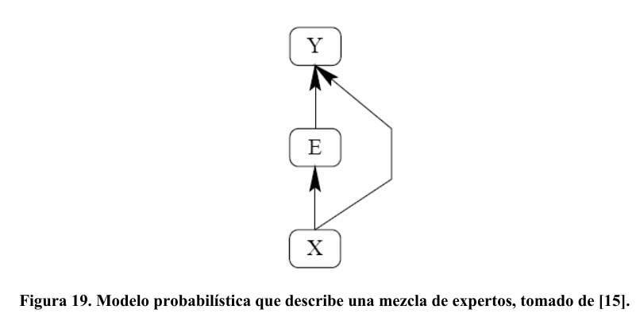

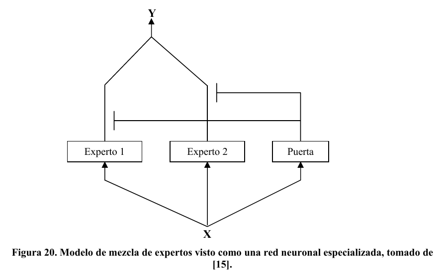

В нейросетевой реализации (рис. 20) вход $x$ подаётся одновременно на всех экспертов и на **сеть-шлюз (*puerta de la red / gating network*)**, которая динамически вычисляет веса $g_e(x)$ каждого эксперта в зависимости от самого входного объекта $x$:
$$P(y \mid x) = \sum_{e} g_e(x)\, p_e(y \mid x),$$
где $g_e(x)$ — вес (выход сети-шлюза) для эксперта $e$, а $p_e(y \mid x)$ — распределение вероятностей классов, предсказанное экспертом $e$.

---

## 11. Практическая реализация в R — Деревья решений и Random Forest

> [!note] Охват материала из `Rdatamining.pdf`
> Из книги Yanchang Zhao *«R and Data Mining: Examples and Case Studies»* (2011) в данный конспект включена **Глава 4 (*Decision Trees*, стр. 20–29)**, непосредственно относящаяся ко второй части курса (деревья решений и случайные леса в R). Главы 1–3 (установка R, импорт/экспорт и разведка данных) и главы 5–12 (регрессия, кластеризация, выбросы, временные ряды, ассоциативные правила, текстовый майнинг) выходят за рамки темы *Multiclasificadores (Ensemble)* и намеренно исключены.

### 11.1. Деревья решений в пакетах party и rpart

#### Пакет `party` (`ctree` — Conditional Inference Trees)
В примере на классическом наборе данных `iris` (150 наблюдений, 4 числовых признака `Sepal.Length`, `Sepal.Width`, `Petal.Length`, `Petal.Width` и 3 класса `Species`) выборка разбивается на обучающую ($70\%$) и тестовую ($30\%$):

```r
set.seed(1234)
ind <- sample(2, nrow(iris), replace=TRUE, prob=c(0.7, 0.3))
trainData <- iris[ind==1,]
testData <- iris[ind==2,]

library(party)
myFormula <- Species ~ Sepal.Length + Sepal.Width + Petal.Length + Petal.Width
iris_ctree <- ctree(myFormula, data=trainData)

# Проверка на обучающей и тестовой выборках
table(predict(iris_ctree), trainData$Species)
print(iris_ctree)
plot(iris_ctree)
plot(iris_ctree, type="simple")

testPred <- predict(iris_ctree, newdata = testData)
table(testPred, testData$Species)
```

**Практические замечания по `ctree`:**
- `plot(iris_ctree)` строит дерево со столбчатыми диаграммами классов в листьях, а `type="simple"` — компактный текстовый вид с числом наблюдений `n` и долями классов.
- Если в обучающую формулу передан признак, который не попал в дерево, он всё равно должен присутствовать в `testData` при вызове `predict()`. Уровни факторов в `testData` должны точно совпадать с уровнями в `trainData`.

#### Пакет `rpart` (Recursive Partitioning & Pruning)
На примере регрессионной задачи `bodyfat` (71 наблюдение из пакета `mboost`, предсказание `DEXfat`):

```r
data("bodyfat", package = "mboost")
library(rpart)
myFormula <- DEXfat ~ age + waistcirc + hipcirc + elbowbreadth + kneebreadth
bodyfat_rpart <- rpart(myFormula, data = bodyfat,
                       control = rpart.control(minsplit = 10))

print(bodyfat_rpart$cptable)
plot(bodyfat_rpart); text(bodyfat_rpart, use.n=TRUE)

# Обрезка дерева (pruning) по минимальной ошибке кросс-валидации xerror
opt <- which.min(bodyfat_rpart$cptable[,"xerror"])
cp <- bodyfat_rpart$cptable[opt, "CP"]
bodyfat_prune <- prune(bodyfat_rpart, cp = cp)

DEXfat_pred <- predict(bodyfat_prune, newdata = bodyfat)
```

### 11.2. Случайный лес в пакете randomForest

Для построения случайного леса на данных `iris` используется пакет `randomForest` *(в тексте книги как альтернатива упоминается функция `cforest`, однако в R она принадлежит пакету `party`, а не `randomForest`)*.

#### 1. Обучение модели и проверка OOB-матрицы ошибок

```r
ind <- sample(2, nrow(iris), replace=TRUE, prob=c(0.7, 0.3))
trainData <- iris[ind==1,]
testData <- iris[ind==2,]

library(randomForest)
rf <- randomForest(Species ~ ., data=trainData, ntree=100, proximity=TRUE)
table(predict(rf), trainData$Species)
```

Вывод матрицы сопряжённости (`predict(rf)` без `newdata` возвращает OOB-предсказания):
```text
            setosa versicolor virginica
  setosa        38          0         0
  versicolor     0         33         2
  virginica      0          2        28
```

#### 2. Просмотр сводки модели `print(rf)` и атрибутов `attributes(rf)`

```r
> print(rf)
Call:
 randomForest(formula = Species ~ ., data = trainData, ntree = 100, proximity = TRUE)
               Type of random forest: classification
                     Number of trees: 100
No. of variables tried at each split: 2

        OOB estimate of error rate: 3.88%
Confusion matrix:
           setosa versicolor virginica class.error
setosa         38          0         0  0.00000000
versicolor      0         33         2  0.05714286
virginica       0          2        28  0.06666667
```
Важные поля вывода:
- `Number of trees`: 100 (`ntree`).
- `No. of variables tried at each split`: 2 (`mtry`, для 4 признаков $\sqrt{4} = 2$).
- `OOB estimate of error rate`: **3.88%** — встроенная оценка ошибки вне мешка.
- `Confusion matrix`: матрица ошибок с долей ошибок по каждому классу (`class.error`).

Список всех компонентов объекта `rf` (`attributes(rf)`):
`call`, `type`, `predicted`, `err.rate`, `confusion`, `votes`, `oob.times`, `classes`, `importance`, `importanceSD`, `localImportance`, `proximity`, `ntree`, `mtry`, `forest`, `y`, `test`, `inbag`, `terms`.

#### 3. График динамики ошибки `plot(rf)`

```r
> plot(rf)
```

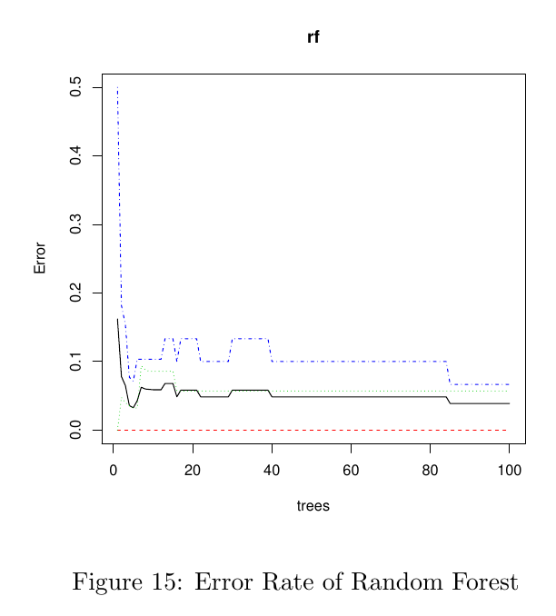

Сплошная чёрная кривая показывает общую OOB-ошибку, а цветные пунктирные линии — ошибки по отдельным классам по мере добавления деревьев от 1 до 100.

#### 4. Важность переменных `importance(rf)` и `varImpPlot(rf)`

```r
> importance(rf)
               MeanDecreaseGini
Sepal.Length           6.653214
Sepal.Width            1.319307
Petal.Length          29.236710
Petal.Width           30.427564

> varImpPlot(rf)
```

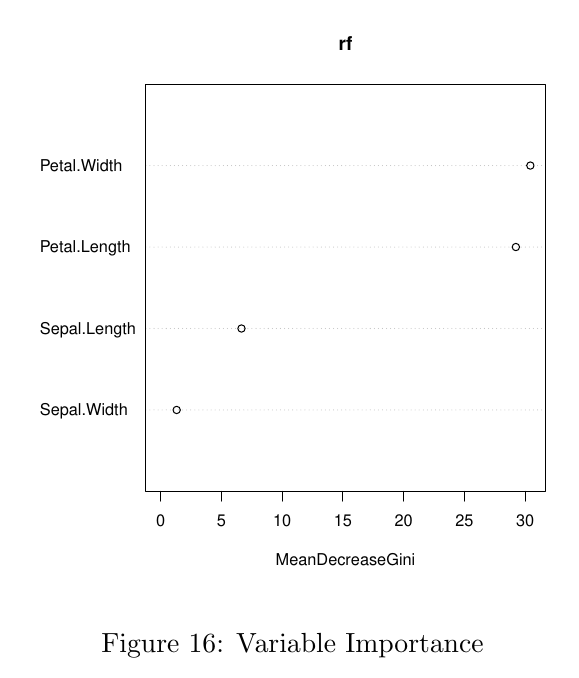

Значения `MeanDecreaseGini` показывают, насколько в среднем каждый признак снижает индекс Джини при разбиениях во всех деревьях леса: чем выше значение, тем информативнее признак (`Petal.Width` и `Petal.Length` — ключевые признаки для классификации ирисов).

#### 5. Предсказание на тестовой выборке и график запаса `margin`

```r
> irisPred <- predict(rf, newdata=testData)
> table(irisPred, testData$Species)
irisPred     setosa versicolor virginica
  setosa         12          0         0
  versicolor      0         15         3
  virginica       0          0        17

> plot(margin(rf, testData$Species))
```

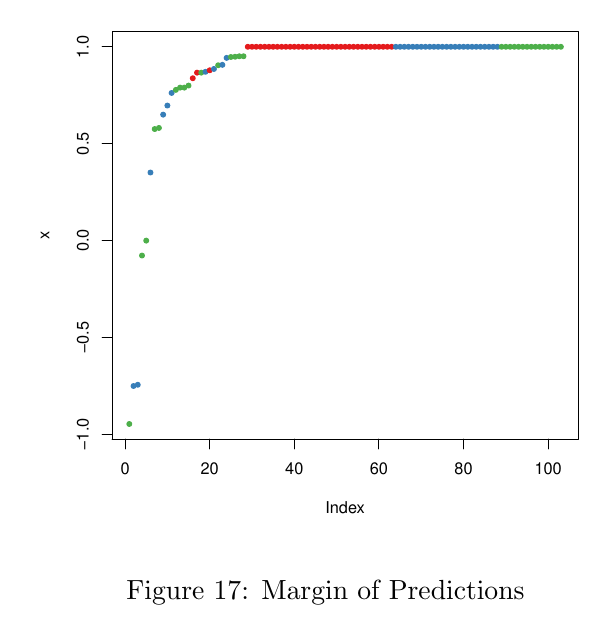

**Определение запаса (`margin`):**
$$\text{margin}(x) = (\text{доля голосов за правильный класс}) - \max_{c \neq y}(\text{доля голосов за другой класс } c).$$
Положительное значение `margin > 0` соответствует **правильной классификации**, отрицательное `margin < 0` — ошибке.

---

## 12. Практические кейсы и общие выводы

### 12.1. Экспериментальное сравнение ансамблей в Weka

В отчёте `Ensambles.pdf` (раздел 7) рассмотрен реальный кейс оценки физической пригодности земель для выращивания сахарного тростника на Кубе (данные института *INICA*):
- **Выборка:** 1000 записей, 12 атрибутов (10 номинальных и 2 числовых: `prec`, `prfu`), **без пропусков и без шума**.
- **Целевой класс (`eval`):** 4 категории — `A1` (403), `A2` (194), `A3` (287), `N` (116).
- **Инструменты:** *MineSet* (статистический и визуальный аудит данных) и *WEKA 3.4* (10 запусков 10-кратной кросс-валидации).

**Результаты экспериментов:**

1. **Одиночные алгоритмы (Cuadro 3):**
   - Деревья решений: **90,6%**
   - Ближайший сосед ($k$-NN): **83,2%**
   - Байесовское обучение: **69,80%**

2. **Однородные ансамбли на деревьях решений (Cuadro 4):**
   - Одиночное дерево: **90,6%**
   - **Bagging:** **92,2%**
   - **Boosting (AdaBoost):** **93,90%**

   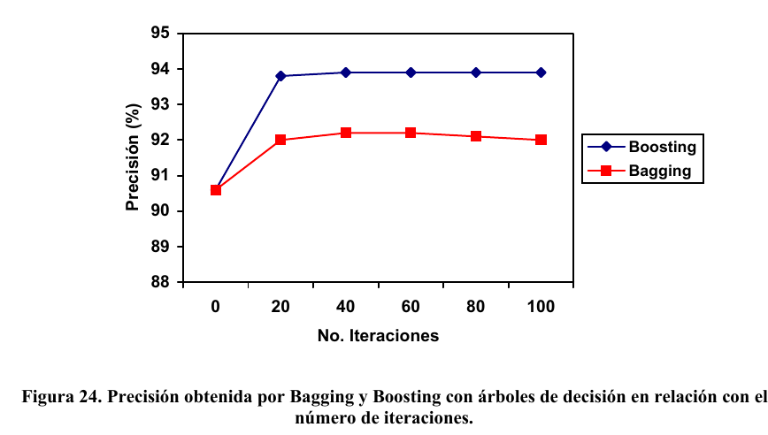

   Наибольший рост точности происходит на первых 20 итерациях, пик достигается к 40 итерациям. Поскольку датасет **не содержит шума**, **Boosting превзошёл Bagging** (аналогично и на базе байесовского классификатора: 71.3% против 71%), что подтверждает выводы теории [17].

3. **Гибридный метод Stacking в WEKA (Cuadro 5):**
   При объединении всех трёх базовых алгоритмов (деревья решений, ближайший сосед, байесовское обучение) с мета-классификатором *Naive Bayes*:
   - **Stacking:** **91,2%** — выше, чем у лучшего одиночного классификатора (90,6%).

### 12.2. Прогнозирование второгодничества школьников (данные MINEDUC)

В презентации `RF_presentation.pdf` (раздел 4) описано применение **Random Forest** (`sklearn.ensemble.RandomForestClassifier`) на реальных данных Министерства образования Чили (**MINEDUC**) для предсказания риска оставления ученика на второй год (*predicción de repitencia escolar*).

- **Признаки:** идентификаторы школы и региона (`RBD`, `COD_REG_RBD`, `COD_DEPE` — тип подчинения школы, `RURAL_RBD` — город/село), характеристики ученика (`GEN_ALU`, `INT_ALU`, `COD_GRADO`), академические показатели (`PROM_GRAL` — средний балл, `ASISTENCIA` — посещаемость), расстояние (`DIST`) и целевой статус `SIT_FIN` (`P` — переведён, `R` — оставлен на второй год, `Y` — выбыл).
- **Проблема без настройки гиперпараметров:** при варьировании только числа деревьев (`100, 300, 1000, 3000`) без ограничения `min_samples_split` и `min_samples_leaf` (особенно в старшем классе `3er medio`) модель предсказывает мажоритарный класс почти со 100% точностью (синяя кривая), но практически полностью игнорирует редкий класс второгодников (красная кривая $\approx 0\text{–}0.2$).

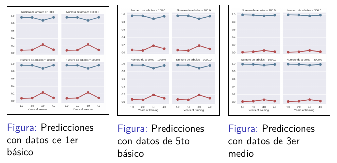

- **Влияние тонкой настройки `min_samples_split` и `min_samples_leaf`:** перебор сетки $4 \times 4$ для значений $\{8, 16, 32, 64\}$ в `3er medio` показал, что увеличение `min_samples_leaf` с 8 до 64 резко поднимает долю распознавания редкого класса (красная кривая растёт с $\sim 0.3$ до $\sim 0.8$), снижая синюю кривую. Оптимальный баланс пересечения кривых достигается при `min_samples_leaf = 16–32` на уровне **$\sim 70\%$** верных предсказаний (*«Predicciones ciertas a 70%»*).

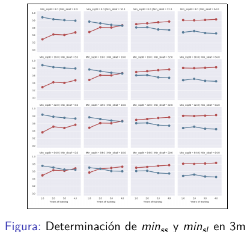

### 12.3. Итоговые выводы и ключевые источники

**Общие выводы по второй части курса:**
1. Комбинирование двух и более классификаторов даёт более робастный, надёжный и точный прогноз по сравнению с одиночной моделью, снижает переобучение и устраняет необходимость выбора слишком сложного одиночного классификатора (ценой снижения интерпретируемости).
2. Выбор стратегии зависит от задачи и данных:
   - Для **нестабильных моделей** (деревья) и **зашумлённых данных** лучше подходит **Bagging** и особенно **Random Forest** (который декоррелирует деревья за счёт случайного выбора $\sqrt{n}$ признаков).
   - Для **чистых данных без шума** и простых слабых моделей (например, решающих пней) максимальную точность обычно даёт **Boosting (AdaBoost / Gradient Boosting)**.
   - При объединении **разнородных** моделей применяются **Stacking** (параллельно через внутреннюю кросс-валидацию и гладкую мета-модель) или **Cascading** (последовательное расширение признаков вероятностями классов).
   - Проблемы размера и скорости ансамблей решаются через обрезку (*Kappa pruning*, *Error-reduction pruning*), *Miniboosting* и *делегирование классификаторов*.

**Ключевые первоисточники, цитируемые в материалах курса:**
- **L. Breiman (1996):** *Bagging predictors* — основа метода Bagging.
- **L. Breiman (2001):** *Random Forests* — классическая формализация случайных лесов.
- **Y. Freund & R. E. Schapire (1996, 1999); R. E. Schapire & Y. Singer (1998):** алгоритм AdaBoost, многоклассовые модификации и теория маржи.
- **T. G. Dietterich (2000, 2002) & G. Bakiri (1995):** три причины превосходства ансамблей, сравнение Bagging/Boosting/Randomization, ECOC.
- **T. K. Ho (1998):** *Random Subspace Method (RSM)*.
- **P. Geurts, D. Ernst & L. Wehenkel (2005):** *Extremely Randomized Trees (Extra-Trees)*.
- **J. J. Rodriguez, L. I. Kuncheva & C. J. Alonso (2006):** *Rotation Forest*.
- **D. Wolpert (1992); K. M. Ting & I. H. Witten (1999):** *Stacked Generalization (Stacking)* и стекинг с распределениями вероятностей.
- **J. Gama & P. Brazdil (2000):** *Cascade Generalization (Cascading)*.
- **M. I. Jordan & R. A. Jacobs (1994):** *Hierarchical Mixture of Experts*.
- **L. I. Kuncheva & C. J. Whitaker (2003):** анализ 10 мер разнообразия ансамблей.
- **C. Ferri, P. Flach & J. Hernández-Orallo (2004):** *Delegating classifiers*.
